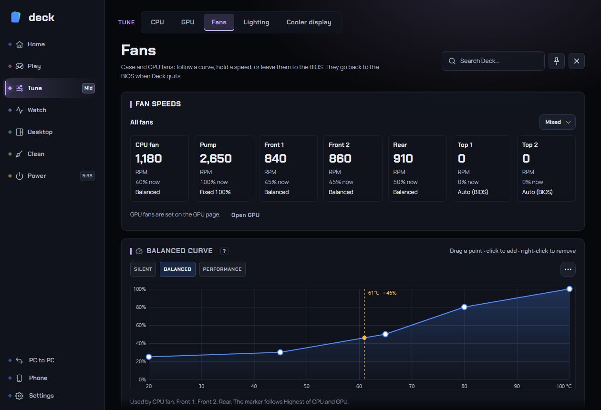

# Fans

The Fans page controls the case, CPU and pump fans connected to your motherboard. Each fan can follow the BIOS, hold a fixed speed, follow a temperature curve you can drag, combine two curves, or copy another fan. Deck also gives you quiet hours, a rehearsal that shows what a curve would do without touching a fan, and a calibration that measures each fan's real range.

**Where to find it:** sidebar > **Tune** > **Fans**. The page has three tabs: **Speeds**, **Curves** and **Calibrate & extras**. Deck remembers the tab you used last.

*(The screenshot may differ a little from the current layout, which has the tabs described below.)*

**The most important thing to know:** fans always go back to the BIOS (your motherboard's own control) when Deck quits, crashes, is ended from Task Manager, or Windows signs out. See [What happens if Deck crashes](#what-happens-if-deck-crashes-or-quits).

Related pages: [GPU](gpu.md) (the graphics card's own fans are set there), [Lighting](lighting.md), [Sensors](sensors.md) (fan speed graphs), [Gaming](gaming.md) (a fan preset per game), [Game bar](game-bar.md) (a Fan preset widget), [Home](home.md).

## Contents

- [What you need](#what-you-need)
- [How fan control works](#how-fan-control-works)
- [The Speeds tab](#the-speeds-tab)
- [The Curves tab](#the-curves-tab)
- [Calibrate & extras tab](#calibrate--extras-tab)
- [Safety rules Deck always applies](#safety-rules-deck-always-applies)
- [What happens if Deck crashes or quits](#what-happens-if-deck-crashes-or-quits)
- [What happens with anti-cheat](#what-happens-with-anti-cheat)
- [The tray and other ways to change fans](#the-tray-and-other-ways-to-change-fans)
- [Recommended setups](#recommended-setups)
- [Troubleshooting](#troubleshooting)
- [FAQ](#faq)

## What you need

- **Administrator rights.** Fan control talks to your motherboard's monitoring chip through a small signed hardware driver (PawnIO) that Deck installs when you set up admin access. Until then the page shows **One-time set up: Hardware control needs admin rights** with a **Set up** button. One admin prompt, then Deck starts with the right access and never asks again.
- **A supported fan chip.** Deck controls these motherboard chips:
  - Nuvoton NCT668x and NCT679x
  - ITE Super I/O chips (many Gigabyte boards and others)
  - HP laptop fans, through the BIOS (HP OMEN and Victus laptops)

  Those chips are in most MSI, ASUS, Gigabyte and ASRock boards. Other laptops usually control their fans themselves; the page says "No supported fan chip on this PC".
- Chips that haven't been verified are **monitor-only** until you allow control (see below).
- **One Deck controls the hardware per PC.** If a second Windows user also runs Deck, only the first controls fans and lights. The other only reads sensors, says so on the hardware pages, and takes over a few seconds after the first quits.

The Fans page only appears when the PC has fans Deck can see. Fan speeds on **GPU fans** are set on the [GPU page](gpu.md), not here.

### Three states a board can be in

| State | What you see | What it means |
|---|---|---|
| **Verified** | Normal controls. | Deck has tested fan writes on this chip. |
| **Not verified on this board** | A banner: "Deck reads the fans but only controls them if you allow it below." | Deck reads the chip, but fan writes have not been checked on this exact board. Turn on **Allow control on this unverified board** (**?**). Most boards with that chip work the same. If fans act oddly, turn it off or quit Deck: the fans go straight back to the BIOS. |
| **Read-only** | A banner: "Read-only: ..." with the reason, and live monitoring instead of controls. | The chip can be read but not controlled safely. An example is MSI 800-series boards with the NCT6687DR chip, which use a different fan-control protocol that Deck does not drive yet. Another is when another user's Deck owns the hardware, or an anti-cheat client has the fans handed back. |

## How fan control works

Each fan has a **mode**:

| Mode | What the fan does |
|---|---|
| **BIOS** (Auto) | Your motherboard controls it. This is the default for every fan, and what the fan returns to whenever Deck lets go. |
| **Fixed 30 %, 50 %, 75 %, 100 %** | A constant speed. Suits pumps and testing. |
| **Curve: <name>** | Speed follows a temperature curve. The curves **Silent**, **Balanced** and **Performance** exist from the start, and you can make your own. |
| **Highest / Lowest / Average of two curves** (a mix) | Combines two curves. See [Combine curves and follow fans](#combine-curves-and-follow-fans). |
| **Follows another fan** (a sync) | Copies another fan's speed plus an offset. |

For curve and mix modes each fan also has a **temperature source** (what its curve reads):

- **CPU**
- **GPU**
- **CPU/GPU hotter**
- **CPU/GPU average**
- one of the **Board: <sensor>** temperatures from the motherboard (their names are the chip's own)

Edits are a **draft**: **nothing reaches your fans until you press Apply** in the bar that appears at the bottom ("Changes aren't on the hardware yet."). **Undo changes** drops the draft.

### The default curves

Temperature in degrees C against fan speed in %:

| Curve | Points |
|---|---|
| **Silent** | 30 C: 25 %, 50 C: 30 %, 70 C: 45 %, 85 C: 70 %, 95 C: 100 % |
| **Balanced** | 30 C: 30 %, 50 C: 40 %, 65 C: 60 %, 80 C: 85 %, 90 C: 100 % |
| **Performance** | 30 C: 40 %, 45 C: 55 %, 60 C: 75 %, 75 C: 100 %, 100 C: 100 % |

Curve points are always entered in degrees C, even if the rest of Deck shows Fahrenheit (Settings > Appearance > Performance and units; see [Settings](settings.md)).

## The Speeds tab

**Fan speeds** (or **Live monitoring** when Deck can't control the fans):

- **All fans**: a drop-down that sets every fan to one mode at once (BIOS, a fixed speed, or a curve). It shows **Mixed** when fans differ.
- One tile per fan: its name (the chip's own, such as CPU fan, Pump, System fan 1), its live **RPM**, the percentage it is running at now, and its mode. A fan with no reading shows "Unavailable". A header with no fan plugged in reads 0.
- A link to the [GPU page](gpu.md), where graphics card fans are set.

**Fan settings** (**?**): one row per fan with two drop-downs.

| Control | What it does |
|---|---|
| **Mode** | The fan's mode. Click the fan's name to jump to its curve on the Curves tab. |
| **Follows** (**?**) | The temperature source for a curve or mix (greyed out in other modes). Case fans that follow the **hotter** of CPU and GPU help in games. The curve's marker moves to the new temperature. |

Press **Apply** to send changes to the fans.

## The Curves tab

A curve is temperature (across) against fan speed (up), smoothed between points. The orange marker shows the temperature the curve reads now and the speed it gives.

**Editing:** drag a point; click empty space to add one; right-click a point to remove one. Temperatures run from 20 to 100 C. Changes apply after **Apply**.

The chips above the graph pick which curve you are editing. Under the curve a line says which fans use it ("Used by CPU fan, Front 1. The marker follows CPU/GPU hotter.") or "No fan uses this curve yet. Assign it under Speeds."

The **...** button next to the chips:

| Item | What it does |
|---|---|
| **Save as a new curve...** | Copies the current curve under a new name. |
| **Rename...** | Renames it; fans and mixes that use it follow the new name. |
| **Put Silent, Balanced and Performance back** | Restores the three default curves (and re-adds any you deleted). Your own curves are kept. |
| **Delete this curve...** | Only shown when you have more than one. Fans using it go back to the BIOS, and mixes using it go back to the BIOS too. |

### Slow-down behaviour

Shared by all curve fans. A fan always speeds up at once when it warms up; these settings only control how it slows down, so it doesn't surge and fall.

| Setting | What it does | Default | Range |
|---|---|---|---|
| **Slow down only after the temperature drops** (**?**) | Fans slow down only after the temperature has fallen this many degrees. Higher is steadier but louder for longer; 0 follows every degree. | 2 C | 0 to 10 C |
| **Wait between slow-downs** (**?**) | After slowing down, fans wait this long before slowing again. Short loads, like opening an app, then don't make the fans pulse. | 3 s | 0 to 30 s |
| **Ignore short spikes** (**?**) | A preset that sets 4 C and 15 s. **Back to the usual 2 C and 3 s** restores the defaults. | | |
| **Stop system fans below (0 = never)** (**?**) | Case fans on a curve stop below this temperature. A stopped fan restarts 3 C above the limit, or at once if the CPU reaches 85 C. | 0 (never) | 0 to 70 C |

Only fans named as **case fans** (a name containing "system", "chassis" or "case") can stop. CPU, pump and AIO headers, and unnamed headers like "Fan 3", never stop. Some fans struggle to restart: test that yours do before relying on it. Fans on a fixed speed or the BIOS never stop; a fan on a curve or mix can. A fan stopped by a curve restarts if all temperature readings disappear.

## Calibrate & extras tab

### Combine curves and follow fans

(**?**) Two ways to make fans react together.

**Mix two curves** (needs at least two curves): choose a fan, then **Highest of**, **Lowest of** or **Average of**, then the two curves, and press **Use mix on this fan**. The fan then uses, at every temperature, the higher, lower or average speed of the two. Use it to combine two cooling needs, for example a quiet curve with a performance curve, and take the highest.

**Follow another fan**: choose the fan that follows, the fan it follows, and an **Offset** (from -30 % to +30 %), then press **Use follow on this fan**. The fan copies the other fan's speed plus the offset, with a minimum of 20 %. Two fans can't follow each other: that pair reverts to the BIOS when you apply. If the fan it follows has no reading, the fan runs fast (100 %) rather than guess.

Both buttons set the fan's mode in the draft; press **Apply** afterwards. Switching a fan back to a plain curve or the BIOS in **Speeds** undoes them.

### Quiet hours

(**?**) **Cap fans on a curve at night.** Off by default.

| Setting | Default | Range |
|---|---|---|
| **From** / **to** (hours) | 23:00 to 07:00 (a window across midnight is fine) | any hour |
| **Cap** | 45 % | 25 to 90 % |
| **Lift the cap at** | 70 C | 50 to 85 C |

In those hours, fans on a **curve or mix** never go above the cap, unless the temperature reaches the lift point. **Fixed speeds, followers (Follows another fan) and BIOS fans aren't capped.** An unknown temperature never caps. Normal safety limits still apply.

### Rehearse a curve

(**?**) Runs made-up temperatures through your **draft** curve, its slow-down settings, the safety rules and quiet hours, and plots the result. **Nothing is sent to the hardware.**

Pick a fan (it must be on a curve or a mix) and a temperature story, then **Rehearse**:

| Story | What it plays |
|---|---|
| **Steady climb from idle to hot** | 35 C rising to 88 C over a minute and a half |
| **Short spike while idle** | 40 C with a 4-second jump to 75 C |
| **Sensor lost for 20 seconds** | The temperature disappears (fans must go to full speed) |
| **Hot, then cooling down** | 80 C falling to 40 C |

The graph shows the **Temperature (C)**, the temperature **After slow-down rules**, and the **Fan speed (%)**, plus how far the speed ranged. Use it to see how fast a curve reacts before you apply it.

### Calibrate fans

(**?**) Measures a fan's real range so Deck knows what each speed gives. One fan at a time: press **Calibrate** (or **Calibrate again**) next to a fan.

What it does:

- Steps the fan from 100 % down to 20 % and reads the RPM at each step.
- For **case fans** only, it also goes down to 15, 10, 5 and 0 %, then climbs from 5 to 30 %, to find the speed where the fan **stops** and where it **starts again**. CPU, pump and unnamed headers never go below 20 %.
- It takes under two minutes. A line shows "Testing Front 1 at 40 % (step 6 of 19)" and **Cancel** stops it at once.
- The result for each fan: "Stops at 15 %, starts at 25 %. Top 1,500 RPM, measured <date>."

Safety:

- It **will not start** while a game is in front, if the CPU is already at 70 C or warmer, if a temperature reading is missing, or if fan control isn't allowed.
- It **stops at once** if the CPU reaches 80 C or the GPU 85 C, on **Cancel**, or when Deck quits.
- The fan returns to its own setting afterwards (it never changes the fan's mode; it only overrides one fan for a few seconds at a time and lets go by itself if Deck stops).
- **Calibration changes real fan speeds** while it runs.

Afterwards, if a calibrated fan turns **much slower than it did at the same speed** (below about 70 % of what was measured, for two minutes in a row), Deck shows a Windows notification, "<fan> looks slower than before". Dust or a worn fan are the usual causes: clean it, then calibrate again.

## Safety rules Deck always applies

These rules are in the fan engine itself, not on the page, and apply to every fan Deck drives (curve, mix, follow and **fixed**):

- **Heat guard:** the fan goes to **100 %** when the CPU reaches **85 C**, when its own temperature source reaches **90 C**, or when that source has **no reading**.
- **Floor:** a fan Deck drives never runs below **20 %** (a case fan on a curve may stop completely only if you set **Stop system fans below**, and a stopped fan restarts at once when the CPU reaches 85 C).
- **Gentle slow-down:** the speed falls by at most 4 percentage points a second, so fans don't hunt.
- **Startup:** for the first 20 seconds after Deck starts, a fan with no temperature yet is left with the BIOS.
- **Refresh:** Deck re-sends each fan's speed at least every 10 seconds.
- **No reading, no risk:** if a curve fan loses its temperature, it runs at 100 % and Deck logs it.
- **Chip stops answering:** old board readings stop counting after 3 seconds.
- **Per-chip recovery:** before the first manual fan command, Deck saves the fan chip's registers. If power is cut while Deck holds a speed, the next start puts the original values back first.

## What happens if Deck crashes or quits

| Situation | What happens to the fans |
|---|---|
| You quit Deck normally, or Windows shuts down, restarts or signs you out | Deck gives all fans back to the BIOS (and the GPU fan back to the driver) before it ends. |
| Deck crashes or hits an internal error | The crash handler hands the fans back to the BIOS before anything else. |
| Deck is ended from outside (Task Manager's **End task**, `taskkill /f`) | A small second copy of Deck, the **watchdog**, waits for it to end. It hands the fans to the BIOS and the GPU fan to the driver within seconds, then starts Deck again, hidden. You may see a second `deck.exe` in Task Manager while hardware control is on: that is the watchdog. |
| Deck ends unexpectedly three times in ten minutes | The watchdog stops restarting it. Deck then starts with the fans on the BIOS and no overclock until you turn hardware control on again (a toast says why). |
| The setup, update or uninstaller closes Deck | The fans go back to the BIOS first. |
| The power was cut or the PC hard-reset while Deck held a speed | On the next start Deck restores the fan chip's saved original values first. |
| A driver installer is running | The watchdog waits for it to finish before restarting Deck. |

Run `deck.exe --release-fans` from a command prompt as administrator to hand every fan back to the BIOS by hand.

## What happens with anti-cheat

Deck never injects into games or reads their memory, and the Fans page does nothing to a game. The only thing that matters here is the **hardware driver** (PawnIO) Deck uses to reach the fan chip.

- Deck only looks at program **names** to decide this: while a known anti-cheat client that refuses to run next to the driver is open, Deck **hands the fans back to the BIOS and stops using the driver**, shows a toast and a banner that says why, and resumes when the client closes. Today that list has one entry: **FACEIT**.
- The driver itself cannot be unloaded while Windows runs, so Deck can only stop using it. If an anti-cheat still refuses to start, **uninstalling Deck takes the driver out**.
- Deck's CPU, fans and sensors need that driver. GPU tuning does not (it uses NVIDIA's driver interfaces).

## The tray and other ways to change fans

- **Tray menu > All fans:** sets every fan to one mode (BIOS, a fixed speed or a curve). Only shown when fan control is available.
- **Gaming** (per game): a **fan preset** is switched on while the game runs and everything goes back after. See [Gaming](gaming.md).
- **Game bar:** a **Fan preset** widget. See [Game bar](game-bar.md).
- Changes from the tray and Gaming take effect right away; they don't need Apply.

## Recommended setups

**Most people:** put the CPU fan and case fans on **Balanced**, with **CPU/GPU hotter** as the source for case fans. Leave anything you're unsure about on the **BIOS**.

**Quiet PC:** use **Silent**, turn on **Ignore short spikes**, and consider **Quiet hours** at night. Keep the top of the curve at 100 % so the PC is safe under load. Optionally enable **Stop system fans below** around 40 to 45 C if your case fans restart reliably.

**Gamers / cooling first:** use **Performance** for case fans with source **CPU/GPU hotter**. Add a **mix** of Silent and Performance if you want quiet at the desktop and quick reaction in games.

**Water cooling:** give the **pump** a **Fixed 100 %** or leave it on the BIOS. Don't put a pump on a curve unless you are sure it should slow down. The pump header never stops.

**HP laptops:** Deck drives the two fans (CPU and GPU) through the BIOS interface and never asks for less than about 1,800 RPM while a manual speed is set. Leave them on the BIOS if you don't need manual control.

Always **Apply**, then watch the temperatures on [Sensors](sensors.md) for a while under load.

## Troubleshooting

**The Fans page says "Fan control isn't supported on this PC yet".** Deck found no fan controller it knows: on a laptop the fans are run by the maker's embedded controller, which Deck can't talk to yet; on a desktop the board's fan chip isn't one Deck knows. The fans keep working as the maker or BIOS set them. **Copy report** on that card copies the support report: send it to us so support can be added. (Without administrator rights the page only shows **Set up**.)

**The page says "No motherboard fan readings were found."** The chip answered but reported no fan headers. Check [This PC](this-pc.md) for what Deck found.

**The page is read-only.** See the table under [Three states a board can be in](#three-states-a-board-can-be-in). If it says another user's Deck owns the hardware, quit Deck in the other session, or wait; if it names an anti-cheat, close that client.

**A fan shows "Unavailable" or 0 RPM.** Nothing is plugged into that header, or the fan has no tachometer wire, or it is stopped on purpose.

**I changed a mode and nothing happened.** Edits are a draft: press **Apply** in the bar. Changes from the tray and Gaming apply immediately.

**The fan is faster than my curve.** A safety rule is on (CPU at 85 C, the source at 90 C or no reading) or a calibration is holding that fan. Check the curve's source and sensor readings. A fan always speeds up at once when the temperature rises; the slow-down settings only delay slowing down.

**Fans are surging up and down.** Press **Ignore short spikes** (4 C and 15 s), or raise **Slow down only after the temperature drops**.

**Fans make a rattle at low speed.** Raise the low end of the curve, or give the fan a minimum speed above where it rattles. Use **Calibrate** to see where it stops and starts.

**Calibration won't start.** "A game is running", "the CPU isn't cool enough" (needs under 70 C), a missing temperature reading, or fan control isn't allowed. Close the game and let the PC cool.

**Fans behave oddly on an unverified board.** Turn off **Allow control on this unverified board**, or quit Deck: the fans return to the BIOS.

**My other fan software disagrees.** Two programs writing to the same fan chip will fight. Close the other tool, or let Deck own the fans.

## FAQ

**Will Deck leave my fans stuck at a low speed if it crashes?** No. See [What happens if Deck crashes or quits](#what-happens-if-deck-crashes-or-quits): crashes hand the fans back, a watchdog covers Task Manager kills, and the chip's original values are restored after a power cut.

**Can fans damage my PC if I set a curve too low?** A CPU or pump fan set too low can overheat the CPU. That is why the heat guard gives fans 100 % at 85 C (CPU) or 90 C (source) or with no reading, and why a driven fan never goes under 20 %. Keep the top of your curve at 100 %.

**Do fans keep their setting after I restart the PC?** Deck stores your modes and curves and applies them when it starts. Until it starts, the BIOS controls the fans.

**Does Deck control GPU fans here?** No. Graphics card fans are in the GPU profile (see [GPU](gpu.md)). The page links to it.

**Is it safe with anti-cheat?** Deck never touches a game. The only interaction is the hardware driver; see [What happens with anti-cheat](#what-happens-with-anti-cheat).

**Does Deck change anything permanent in my BIOS?** No. It writes the fan chip's live registers (and saves the originals first), never the BIOS settings.

**What does Deck change on my PC for fans, and how do I undo it?** Deck changes fan speeds in the motherboard chip while it runs, and keeps your modes and curves in its own settings. To undo: set fans to **BIOS** and **Apply**, or quit Deck.

**What if I set the same curve on a fan that follows another?** A fan in **follow** mode copies a leader; two fans that follow each other revert to the BIOS.

**Can I use my motherboard's fan software at the same time?** Not recommended: both write to the same chip and the fans hunt.

**Where are fan settings stored?** In Deck's settings folder under `hardware` (`settings.ini` and `curves.ini`). If another program edits them, Deck keeps fans on the BIOS and waits for you to press **Apply them** in a toast.
