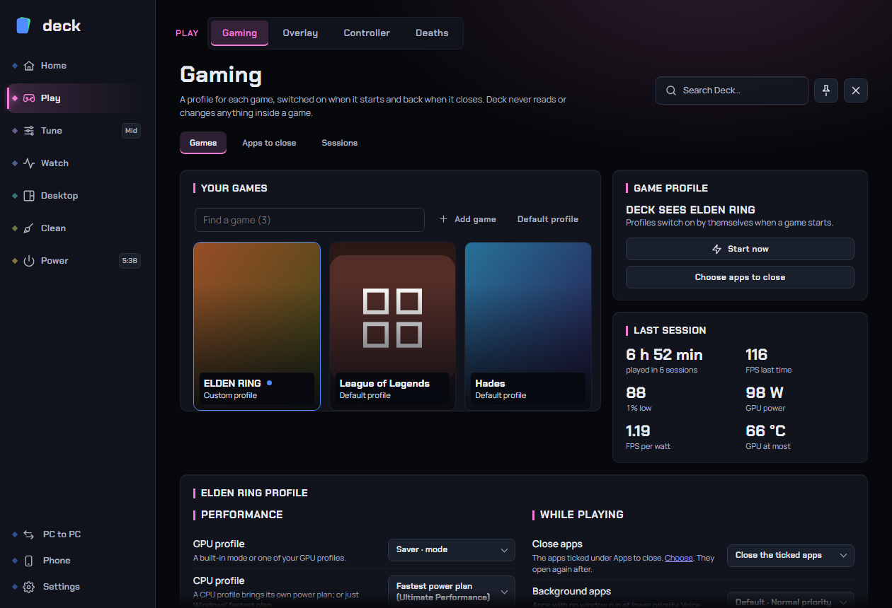

Where to find it: Gaming › Game profiles

# Game profiles

Tell Deck what to change for each game (profiles, frame rate limit, apps to close, fans, lights, sound, display), and get a report of every session.

Deck applies a game's choices when it starts and puts everything back when it closes. Game profiles has two tabs, **Games** and **Apps to close**; the reports are on **Diagnostics › Session reports**, linked below the title.

Related pages: [Performance overlay](overlay.md), [Deck bar](game-bar.md), [CPU](cpu.md) and [GPU](gpu.md) (where profiles are made), [Death counter](death-counter.md).

## How it works

1. The **Default profile** applies to every game. Any game can have its own **Custom profile**; what you leave alone follows the default.
2. When a game has been in front for a few seconds, Deck turns on Deck game mode (with **Automatic game profiles** on, the default) and applies the game's profile.
3. While you play, Deck records the session: time, FPS, 1% low, power, temperatures and stutters.
4. About 45 seconds after the game closes, Deck puts everything back and reopens the apps it closed. The wait means a launcher handing over to the game doesn't end the session.

If Deck or the PC crashes mid-session, Deck puts back the power plan, profiles and settings at the next start.

## What Deck changes

Only what you set up:

| Change | Afterwards |
|---|---|
| GPU or CPU profile, or Windows' fastest power plan | The previous profile or plan |
| More processor time for the game | Priority back to normal |
| Close the selected apps | Started again |
| Let background apps wait (lower priority) | Back to normal |
| Make room in memory | Nothing to restore |
| Pause Deck's own downloads | Resumed |
| Fan preset, lighting effect, audio output, voice effect, notifications, display mode, HDR, digital vibrance | The previous values |
| Target FPS: lower power limits | The original limits |

Deck never touches games, launchers, anti-cheat, voice chat, music players, mouse and headset software, recorders, security software or Windows itself. The only thing it does to a game is raise its priority when you ask, and it skips that for games with a known anti-cheat. Deck never injects into a game or reads its memory; see the [FAQ](faq.md).

## The Games tab

Your games on the left, the selected game on the right. While Deck game mode is on, a bar across the top shows the session.

### Your games

**Default profile** sits at the top, then every game Deck knows, each with its banner and whether it uses the **Custom profile** or the default. A green dot marks the game running now.

Deck finds games in two ways:

- Installed games from Steam, Epic Games, Riot, EA app, Battle.net, Ubisoft, GOG, Rockstar and the Xbox app, with their artwork. A game whose folder is gone leaves the list. Steam software and tools (Wallpaper Engine, Proton) are left out.
- Games you play with Deck running: a program Windows lists as a game, or that runs from a game folder, ships game files (an engine, DLSS, anti-cheat), or takes the whole screen and isn't a browser or video player.

| Control | What it does |
|---|---|
| **Find a game** | Filters the list by name. |
| **Add a game** (+) | Pick a game's program yourself, for a game Deck hasn't seen. |
| **Default profile** | The profile for every game without its own. |

**Other game folders** (at the bottom) lists games from other stores or portable games: press **Add a folder**, give a name pattern (default `*.exe`), **Try** to see how many games it finds, then **Apply**. **Remove** drops the folder.

### Organize your games

- The star adds a game to favorites; favorites stay first.
- The chips under **Find a game** filter the list: **Favorites**, **Custom profile**, **Playing**, **Backlog**, **Finished**, **Dropped** and your tags. They combine. **Show all** clears them.
- **Save this filter** keeps a combination as a chip (up to 12).
- The list has sections: **Playing now**, **Custom profile** and **All other**.
- On a game's banner, set its **Status** (**Playing**, **Backlog**, **Finished**, **Dropped**, or **No status**) and press **+ Tag** to add tags (up to 8, 1 to 24 characters).
- **Pick a game** suggests what to play: **Playing** games first, then **Backlog**. **Short** keeps games whose sessions averaged 45 minutes or less. **Another** shows the next one, **Open** selects it.

Library choices don't change how a game runs. **Playing** is a status you set; **Playing now** means the game is running.

### Programs that aren't games

Deck's **Built-in list** keeps known programs out of the game list and away from Deck game mode: benchmarks and stress tests (Unigine, 3DMark, PCMark, Cinebench, FurMark, OCCT), the Roblox launcher and Studio, store launchers, crash reporters and engine editors.

- Something else listed as a game? On Home, while it runs, use **Not a game**. It moves to **Not games** at the end of the Games tab.
- To count a program as a game again, click it under **Not games** or **Built-in list**. A program with its own profile always counts.

## Deck game mode

While Deck game mode is on, the bar at the top of the Games tab shows **Playing** and the game, how long, and live **FPS**, **1% low**, **GPU power**, **FPS per watt** and GPU temperature when RivaTuner measures the game.

- **Stop Deck game mode** ends it and puts everything back. If the game is still running, Deck leaves it alone until it has been closed for about two minutes.
- **Changes this session** lists what Deck did. If nothing was set up, only the figures are recorded.
- **On start** shows the profile's changes as chips (for example **Game first**, **CPU fastest plan**).
- A session started by hand ends with its game, or after 3 hours if no game was found.

You can also start it from the **Deck game mode** switch on the [Deck bar](game-bar.md).

## A game's settings

Select a game (or **Default profile**). The head shows the game and its figures: this week, **In all**, **FPS last time**, **1% low**, **GPU power**, **FPS per watt** and **GPU at most**. **Last session** opens its last report.

- Change any setting and the game gets a **Custom profile**; only what you change differs. Each choice offers **Default** (with what the default is) to follow it again, and the undo button beside a row does the same.
- A change to a running game applies at once, otherwise at the next start. Every change saves at once.
- **Use default settings** removes the game's own choices. **Copy from…** copies another game's settings.

The settings are in five sections: **Performance**, **Power**, **While playing**, **PC settings** and **Saves**.

### Performance

| Setting | What it does | Default |
|---|---|---|
| **GPU profile** | A built-in mode (under **Power modes**) or a saved GPU profile while the game runs. Needs a GPU Deck can control. | Don't change |
| **CPU profile** | A built-in mode, a saved CPU profile, or Windows' fastest power plan. A CPU profile brings its own power plan. | Don't change |
| **Frame rate limit** | Caps this game's FPS. On the Default profile it is RivaTuner's global limit, with an on/off switch. | No per-game limit |
| **Game priority** | **Game first** gives the game more processor time. Hidden for games with a known anti-cheat. Deck never uses real-time priority. | Don't change |

Frame rate limit:

- On NVIDIA cards the NVIDIA driver keeps the limit (like the Control Panel's Max Frame Rate), so it works even without Deck. On other cards it is kept in the game's RivaTuner profile and needs RivaTuner ([Performance overlay](overlay.md)). Without either, the row says **Needs NVIDIA or RivaTuner**.
- The choices include 30 to 144, each monitor's refresh rate and "just under" it (141 for 144 Hz), which keeps G-Sync or FreeSync on without tearing. **Other…** takes any number.
- A new installed game shows **After the first play** until Deck has learned its program.

Recommended: leave the profiles on **Don't change** until you have ones you trust, and cap demanding games just under the refresh rate for less heat and noise.

### Power

Holds [Target FPS](#target-fps-power-saver) for this game, and an **Energy and cost** line whose **Power use** button opens [Power use](power-use.md). On the Default profile it says "Pick a game to set its target FPS".

### While playing

| Setting | What it does | Default |
|---|---|---|
| **Close apps** | **Close the selected apps** closes the apps chosen on [Apps to close](#the-apps-to-close-tab) and reopens them afterwards. **Edit list** opens that tab. Save your work first. | Leave them open |
| **Pause Deck's downloads** | Pauses only Deck's own app downloads; they resume afterwards. | Keep going |
| **Let background work wait** | **Background waits** gives background apps without a window lower priority. Voice chat and music are untouched. | Don't change |
| **Make room in memory** | **When nearly full** frees idle memory when 85 % or more is in use; **Always clear** also clears the standby cache, so other apps may load slower afterwards. Nothing closes. | Don't change |

Recommended: leave memory alone unless the PC runs out of RAM in games.

### PC settings

Switches devices for this game and puts them back afterwards. Needs **Automatic game profiles** on.

- **Use the default PC settings** (games only): turn it off to set them for this game.
- **Apply PC settings** turns the list on.
- **Fan preset** ([Fans](fans.md)), **Lighting effect** ([Lighting](lighting.md)) and **Audio output**.
- **Voice effect** ([Mic](voice.md)): back to the earlier effect after playing, also after a crash.
- **Turn off notifications**: Windows notifications off while you play, back on afterwards.
- **Monitor**, then its **Display mode**, **HDR** and **Digital vibrance** (NVIDIA).

Each row starts with **Don't change**, and you only see devices this PC has.

### Saves

See [Save backups](#save-backups).

## Target FPS power saver

Saves power and heat in games that run faster than you need. Pick a frame rate; while the game stays comfortably above it, Deck lowers the GPU power limit and the processor's long-term power limit step by step, and raises them again when the frame rate nears the target.

It is off by default and set per game in the game's **Power** section.

### Requirements

- An NVIDIA card Deck can control, and RivaTuner measuring the game (the overlay can be off).
- Deck running as administrator ([why](getting-started.md#why-deck-needs-administrator)).
- The processor part works only where Deck can set its power limit ([CPU](cpu.md)).
- No other tuning tool (such as MSI Afterburner) in control. Otherwise it waits and says why.

### The settings

| Setting | What it does | Default |
|---|---|---|
| **Target FPS** | **Off**, 60, 90, 120, 144 or **Other number** (10 to 1000, then **Apply target**). | Off |
| **Go below the lowest power limit** | When the card is at its minimum power and still far above target, also holds the core clock lower. | Off |

The status line shows the live state, for example "87 FPS now, target 60: GPU 140 W", or "Waiting for this game in front with fresh FPS. Limits return when you leave." It also shows the estimated power cut this session and last session.

### How it behaves

- It starts from your active profile's limits, or the lower ones that held the target last time.
- It lowers limits after about 2 seconds more than 8 % above the target, and raises them after about 1 second more than 3 % below.
- It never goes below the card's minimum power limit, or for the processor 35 % of its maximum or 25 W.
- If the 1% low falls under 75 % of the target or frames get uneven, it steps back up.
- Limits return to the profile's values on loading screens and idle menus, when FPS data stops for 3 seconds, and when the game isn't in front.
- At 92 °C on the CPU or 87 °C on the GPU it pauses for that game until you turn Target FPS off and on.
- If you pick another profile while it runs, it stays off for that game until the game restarts.

Your original limits are saved before the first change and restored when you leave the game, change a profile or the setting, quit Deck, or after a crash at the next start.

### Simulate power saving

Try it on made-up FPS data; no game or hardware is touched. Pick a target and a trace (such as **Steady headroom**, **Brief FPS spikes**, **Idle menus** or **Loading screen**) and press **Simulate**.

Recommended: try **Simulate** first, then set a target a little above what you want to feel. Skip it for competitive games.

## Gaming settings

At the end of the Games tab, in **Automatic profiles** and **Save backups**:

| Setting | What it does | Default |
|---|---|---|
| **Automatic game profiles** | Deck notices a game, applies its settings and restores them afterwards. Off: nothing switches automatically. | On |
| **Never suggest closing** | Apps you told Apps to close never to suggest. Click one to allow it again. | Empty |
| **Back up game saves**, **Size limit**, **Backups kept** | See [Save backups](#save-backups). | Off, 500 MB, 10 |
| **Not games**, **Built-in list** | See [Programs that aren't games](#programs-that-arent-games). | |

Two report options sit in the gear menu of **Diagnostics › Session reports**: **Detailed after-game summary** (off; the after-game notice also lists peak temperatures, average FPS and hitches) and **Add connection quality to reports** (on; see [Network](#session-reports)). **Record Windows crash reports** is on [Crashes](crashes.md#profiles).

## The Apps to close tab

Pick which apps Deck game mode closes, or close them now.

At the top, a ring shows memory **In use** and the part **Held by selected apps**. Tiles show what the default profile does **When a game starts** and how many games are **Set per game**. Beside them:

- **Close N apps now** closes the selected apps once, after you confirm. They stay closed, and unsaved work may be lost.
- **Free memory now** frees every program's idle memory and the standby cache. Apps stay open but may slow down briefly.

**Running apps** lists **Open windows** and **Running in the background**, with each app's memory. Press **Refresh** after starting or closing a program. Select an app's name to see its memory, why it is or isn't suggested, and **Close it** or **Leave it open**.

- **Suggested** apps are selected for you the first time: cloud sync, torrent clients, updaters and helpers. Browsers only while they have no window.
- **Only suggested** selects just the suggestions; **Select none** clears all.
- **Voice, calls or music** apps (Discord, Spotify) are shown but never selected for you.
- **Never suggest** keeps an app off the suggestions for good; **Allow again** undoes it.

Games, launchers, anti-cheat, voice chat and mouse or headset software are never offered. Apps are asked to close like clicking X, so they can save; an app that keeps a window open is left alone.

## Starting point

On a fresh install, **Games** offers a **Starting point**: **Balanced** (game first, background waits, memory cleared when nearly full), **Performance** (also always clears memory and pauses Deck's downloads) or **Leave my PC alone**. Nothing changes until you pick one; it fills in the Default profile, where you can change it.

## Save backups

A mod, a game rule or a crash can damage saves. With **Back up game saves** on, Deck copies the game's save folder at game start, before changing anything, and again when the game closes, but only when the saves changed.

1. Open **Game profiles › Games**, pick a game and open **Saves**.
2. Choose the **Save folder** once (Deck suggests it only where it is sure).
3. **Back up now** copies it by hand. Each dated copy has **Restore** and delete.

- A restore first saves today's files as **Before restore**, never deletes a file, and is refused while the game runs.
- Deck waits for saves to settle before copying and retries a copy that changed midway. An automatic copy is skipped (**Skipped**, with the reason) when the saves are over the size limit or the drive would have under 1 GB free.
- Only files are copied; the game itself isn't touched.

## Session reports in Diagnostics

Open **Diagnostics › Session reports**, or use the link on Game profiles. The list starts with the live [Why did it stutter?](#why-did-it-stutter) panel, then the reports. Crashes have their own page, [Diagnostics › Crashes](crashes.md); a session with one shows **Crash recorded**.

### Session reports

Deck records a session every time you play with Deck running, with or without Deck game mode. When the game closes, a "Session report" notification offers **Open**.

The list groups sessions by day, with **Show more**, **Find a game** and a game filter. Its gear menu has **Show latest only**, **Include sessions under 1 minute**, **Detailed after-game summary** and **Add connection quality to reports**. Select a session to open its report:

- **Summary**: when and how long, the grade and the main cause of stutters, **Average** FPS, **1% low** and **Hitches**. A note says when frames were read for only part of the session.
- **Frame rate (FPS)**: the [timeline](#the-timeline).
- **What caused stutters**: [causes and patterns](#what-caused-stutters).
- **Moments**: [the saved moments](#moments).
- **Frame times (ms)**: how frame times were spread, with **Show table** / **Show chart**.
- **This game over time**: [the trend and comparison](#this-game-over-time).
- **Details**: profiles, highest temperatures, deaths, **Energy estimate**, FPS per watt, the 0.1% low and slowest frame. **Network** appears when connection quality was recorded ([Network](network.md)): pings answered and the typical and slowest delay. It describes pings only, not proof of packet loss.
- **Tools**: **Rename**, **Pin as baseline**, **Export** (CSV or JSON), **Compare with** (the baseline or another session), **Mark as benchmark** and **Before / after** (compares play before and after a change; **End step** finishes it).

FPS needs RivaTuner measuring the game; without it FPS says **Not recorded**, but time, temperatures and energy are kept. **Deck game mode runs** in the game filter lists older Deck game mode runs. Everything stays on your PC.

### Timed runs

While a game plays, the live panel has **Timed runs**:

1. Name the run, pick 30 s, 1 min, 2 min or 5 min, and add the scene or route.
2. Press **Start run**. Deck measures that stretch (average, 1% and 0.1% lows, hitches, worst frame) and stops automatically. **Stop run** ends it early (**Cut short**).
3. On the game's saved reports, pick two finished runs and **Compare runs**. A warning shows when the games, lengths or scenes differ.

## Why did it stutter?

Deck grades how smoothly each session ran and explains each stutter with what the PC was doing at that moment. It is at the top of Session reports (the current session, or the last one), inside each report, and in the [Deck bar](game-bar.md)'s **FPS drops** widget.

It needs RivaTuner reading the game's FPS (the overlay can be off). It pauses while another window is in front or the game seems to be loading. It never touches the game; the extra data comes from Windows.

### The verdict

A grade, **Smooth**, **Mostly smooth**, **Some stutter** or **Rough**, with one line and three figures:

- **Average** and **1% low** (the speed of the slowest 1 % of the time). A low far under the average means uneven frames.
- **Hitches**: half-seconds with a frame at least 2.5 times longer than those around it, per hour.

The grade needs a minute of frames, read across at least 60 % of the session; otherwise it shows **No verdict** and a note such as "Frames read for 17 of 70 min". Smooth means under 0.3 % of time lost to hitches, fewer than 30 hitches an hour and no drop; Mostly smooth is under 1 % and 120 an hour; Some stutter is under 3 %.

### The timeline

The whole session in one chart: average FPS as a line, the 1% low dotted, a tick for hitches, a diamond for each thing Windows logged and a numbered pin for each saved moment. Gaps mean no frame data, never zero FPS. Click a pin to open that moment.

- Hatched bands show when the game lost the foreground, with a line such as "Left the game 4 times, 2 min total". Deck says **You switched to** a program when you pressed a key or clicked just before, and that a program **took focus** when it came on its own.
- Two lanes under the chart: **Hardware limit** (the GPU at its power or heat limit, the CPU at 95 °C or more, video memory nearly full) and **Network** (lag spikes from [Diagnostics › Network](network.md), shown when **Add connection quality to reports** is on). A short session says **Network: not enough data**.

If RivaTuner gets no frames from a game, Deck can't measure it. Don't change a game's protection settings to fill a report.

### What caused stutters

Each cause with the number of moments it led. Click one to show only those moments. Above them, Deck names patterns:

- A stutter on a timer (every 30 s, every 2 min): often an RGB or fan app, a hardware monitor, a Wi-Fi scan or a device reconnecting. Deck names the device when it can.
- Shader caches changed: the game was probably preparing new effects; this usually fades as you play.
- Faults Windows logged: a graphics driver reset, a drive reset or a hardware error.

Each comes with what to try and, where it helps, a button to the page.

### How sure Deck is

- **Seen**: the reading or Windows log entry was there at that moment. Still not proof.
- **Possible**: an indirect sign that can be a coincidence.
- **Not enough data**: the readings don't explain it.

A faint line names the signals Deck couldn't watch, for example "Not watched this session: Windows event log".

### Moments

A moment is saved when you would notice it:

- A drop: the frame rate stays more than a fifth under the last eight seconds' speed for 1.5 s, or a third under for 0.5 s.
- A stutter: a frame of 100 ms or more, or two shorter hitches within three seconds.

A single late frame, or a lower but smooth speed in a menu or cutscene, isn't saved. A session keeps its 20 worst moments. The **Moments** table lists them newest first: time, FPS, slowest frame and main cause. Open one for the frames around it, up to three likely causes with **Try** advice, and what Windows logged. **All readings** shows every sensor around that moment.

**Whole PC froze** means Deck itself was paused for half a second or more, with the temperatures and Windows events around it. **Frame data gap** means the frame source paused; it doesn't prove the PC froze.

### The causes Deck can name

| Cause | Shown when |
|---|---|
| You switched to an app / an app took focus | The game wasn't in front, or had just come back. Returning to a game can hitch while it redraws. |
| Shader caches changed during the stutter | A shader cache folder changed (NVIDIA, AMD, Intel, Windows). |
| An app used a lot of CPU, or started | A background program was busy, or started then. |
| An app used the graphics card | Another program used 10 % or more of the GPU. |
| Driver work or hardware interrupts were high on one core | 10 % or more of a core, at least three times the usual. The free tool LatencyMon can name the driver. |
| Windows read memory back from disk / Memory pages came from disk | Many pages from disk, with RAM nearly full or to spare. |
| GPU slowed down for heat, hit its power limit, or was fully busy | The GPU reported a limit, or ran at 98 % or more. |
| Video memory nearly full | 97 % or more. |
| One CPU thread was maxed out / CPU clock fell while hot | The game may be CPU-bound, or the CPU slowed at 90 °C or more. |
| System or committed memory nearly full | RAM or commit charge close to full. |
| Heavy disk or download activity | 100 MB/s on disk, or 10 MB/s downloading. |
| Logged by Windows | Within seconds of the moment: a driver reset, a device connecting, a slow drive, a hardware error, a power change, Windows Update or a Defender scan. |
| No clear cause in the readings | Nothing explains it. |

These are clues, not proof.

### This game over time

With two or more measured sessions of a game, a bar for each of the last twelve shows hitches per hour, and a line says whether this session was smoother or rougher than usual.

To compare: select an earlier bar (or Tab to it and press Enter). The table shows both sessions' average FPS, lows, hitches and length; select the bar again or **Stop comparing** to go back. A word says how fair the comparison is:

- **Like for like**: at least 10 minutes each, with FPS and matching frame limits and display mode. One change (driver, game version or profile) is allowed, so you can test it. Play the same stretch with the same game settings.
- **Rough comparison**: a short session, several changes at once, older sessions, or battery versus plugged in.
- **Not comparable**: different frame limits or display modes, or no FPS.

**What was different** lists the graphics driver (NVIDIA only), game version, profiles, RivaTuner frame limit and Deck version at each session's start. These are facts to investigate, not proof.

### The current panel

Under the game's name: "Watching this session", "Waiting for steady gameplay", "Paused while the game is in the background", or the last session. If it asks for RivaTuner, start it on [Performance overlay](overlay.md).

## Energy and cost

The whole PC's energy and cost are on [Power use](power-use.md). Each session report keeps its own **Energy estimate**; compare it to see what a frame rate limit or Target FPS saves.

## Recommended setup

- Most people: leave **Automatic game profiles** on and everything else default. You get session reports for free. Add a frame rate limit just under the refresh rate where you want less heat.
- Competitive players: **Game first** on the Default profile, pause Deck's downloads, close sync and update apps. Skip Target FPS. Keep RivaTuner running for FPS in reports.
- Laptops and handhelds: a frame rate limit per game, Target FPS on NVIDIA, a quiet fan preset in **PC settings**.
- Everyone: select the clutter (sync, torrents, updaters) on Apps to close, but turn **Close apps** on only for games where you want it.

## Troubleshooting

**Deck doesn't notice my game.** Use **Add a game** and pick the game's own `.exe`, not its launcher.

**Deck game mode doesn't start.** Check **Automatic game profiles**. The game has to stay in front for a few seconds. If you stopped game mode during that game, Deck waits until it has been closed for two minutes.

**A program is treated as a game.** Use **Not a game** on Home while it runs.

**FPS says "Not recorded".** Start RivaTuner on [Performance overlay](overlay.md). Games RivaTuner can't hook have no FPS.

**The frame rate limit says Needs NVIDIA or RivaTuner.** Install and start RivaTuner, or use an NVIDIA card. **After the first play** means Deck hasn't learned the game's program yet.

**Target FPS is waiting.** It needs the game in front, fresh FPS from RivaTuner, administrator, an NVIDIA card and no other tuning tool. The line under it names the reason.

**Target FPS paused for heat.** Let the PC cool, then turn it off and on for that game.

**A change didn't apply.** Changes apply at once only to a running game; otherwise at its next start.

**An app didn't reopen.** Start it yourself. Deck never restores unsaved work.

**Choices are missing.** GPU profiles need a supported NVIDIA card; device rows show only what this PC has.

## Ready to play?

The Home tile **Ready to play?** checks sound output, mic, refresh rate and HDR, power plan, Game Mode, variable refresh, disk space, a pending Windows restart, busy background apps, the graphics driver's age and VPNs. Checks that need a look get their own chip; the rest are one **N OK** chip. Click a chip to open the page that fixes it. Deck changes nothing here, and reads nothing while a game is in front; press **Refresh** from the desktop.

## FAQ

**Will Deck get me banned?** Deck never injects into games or reads their memory. Game mode uses ordinary Windows calls, and FPS comes from RivaTuner, which anti-cheat already accepts. FACEIT refuses Deck's hardware driver, so while FACEIT runs Deck hands the fans to the BIOS. See the [FAQ](faq.md).

**Does Deck change things while I play online?** Only what you set up, at the start. Updates, tweaks and hardware changes wait until no game is in front. Five actions ask first with an **A game is running** box: a Disk space scan, **Update** in App updates, opening a workspace that closes apps, a display mode change, and fan calibration. **Continue anyway** goes ahead; **Cancel** leaves everything.

**What if the PC or Deck crashes mid-game?** At the next start Deck puts back the power plan, profiles and Target FPS limits.

**Where is my data?** In Deck's data folder on this PC. Nothing is sent.

**Why does a new game's profile apply only after its first play?** Deck learns the program name the first time the game runs.

**Does Gaming need RivaTuner?** No. Profiles, closing apps, priority and the NVIDIA frame rate limit work without it. RivaTuner adds FPS, lows, stutter explanations and Target FPS.

**Does it work with AMD or Intel graphics?** Everything except GPU profiles, Target FPS and the driver-kept frame rate limit, which need NVIDIA.

**Why is the energy figure lower than my wall meter?** It counts only the processor and graphics card. See [Power use](power-use.md).
