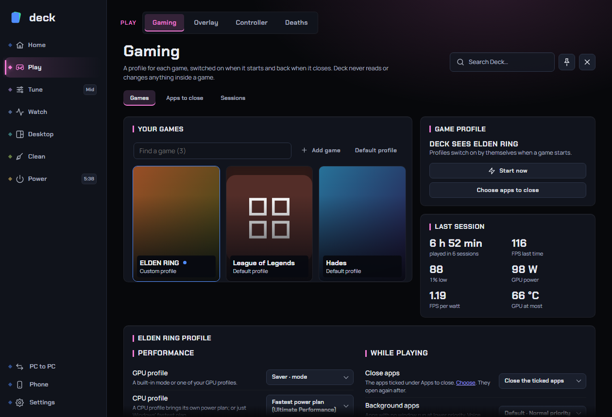

# Gaming

Gaming is where you tell Deck what to do for each game: which graphics and processor profile to use, whether to cap the frame rate, which background apps to close, which fan preset, lights, audio output and display mode to switch to. Deck applies those choices when the game starts and puts everything back when it closes. The same page keeps a report of every session: how long you played, your FPS, temperatures, power use, and what probably caused each frame drop.

**Where to find it:** sidebar > **Play** > **Gaming**. The page has three tabs: **Games**, **Apps to close** and **Sessions**. Deck remembers the tab you used last.

Related pages: [Overlay](overlay.md) (FPS and readings over the game), [Game bar](game-bar.md) (quick controls over the game), [CPU](cpu.md) and [GPU](gpu.md) (where the profiles you pick here are made), [Death counter](death-counter.md).

## Contents

- [How it works in one minute](#how-it-works-in-one-minute)
- [What Deck changes, and what it never touches](#what-deck-changes-and-what-it-never-touches)
- [The Games tab](#the-games-tab)
- [Game mode](#game-mode)
- [A game's settings](#a-games-settings)
- [Target FPS power saver](#target-fps-power-saver)
- [Gaming settings](#gaming-settings)
- [The Apps to close tab](#the-apps-to-close-tab)
- [The Sessions tab](#the-sessions-tab)
- [Why did my FPS drop?](#why-did-my-fps-drop)
- [Energy and cost](#energy-and-cost)
- [Recommended setup](#recommended-setup)
- [Troubleshooting](#troubleshooting)
- [FAQ](#faq)

## How it works in one minute

1. Deck keeps a **default profile** that applies to every game, and lets you give any game its own **custom profile**. A game's own choices override the default; anything you leave alone follows the default.
2. When a game has been in front for a few seconds, Deck turns **Game mode** on by itself (if *Automatic game profiles* is on, which it is by default) and applies that game's profile.
3. While you play, Deck records the session: time played, average FPS, 1% low, GPU power, temperatures and frame drops.
4. When the game closes (after about 45 seconds with no game found, so a launcher handing over to the game, or a match loading, does not end it), Deck puts everything back the way it was and reopens any apps it closed.

If Deck or the PC crashes in the middle of a session, Deck checks at the next start and puts back the power plan, profiles and other settings it had changed.

## What Deck changes, and what it never touches

Game mode can change the following, and only the parts you set up:

| Change | Restored afterwards |
|---|---|
| Switch to a GPU profile or built-in mode | The profile that was active before |
| Switch to a CPU profile or Windows' fastest power plan | The profile or power plan that was active before |
| Give the game higher processor and graphics priority | Priorities put back |
| Close the apps you ticked | The apps are started again |
| Lower the priority of background apps | Priorities put back |
| Free idle memory | Nothing to restore (Windows loads data back as needed) |
| Pause Deck's own app downloads | Downloads carry on |
| Fan preset, lighting effect, audio output, display mode, HDR, digital vibrance | The previous values |
| Target FPS: lower GPU and CPU power limits | The original limits |

Deck **never touches** games, game launchers (Steam, Epic, Battle.net, EA app, Ubisoft Connect, GOG Galaxy, Xbox app and similar), anti-cheat programs, voice chat and music players, mouse and headset software, recording tools, security software, VPNs, terminals and Windows itself. It does not even open a handle to them. The only thing it does to a game's own process is raise its priority when you ask for *Game priority*, using Windows' ordinary priority calls.

Deck never injects anything into a game and never reads a game's memory, so it is safe to use with anti-cheat. Some games' anti-cheat refuses priority changes; Deck then reports that the game did not allow it and carries on with the rest.

## The Games tab

The Games tab has the Game mode bar across the top, your games listed on the left, and the selected game on the right: its picture, name and figures, then its profile.

### Your games

A searchable list of the games Deck knows about, each with a small banner (a gamepad glyph when Deck has no picture) and a line saying whether it uses its **Own profile** or the **Default profile**. A green dot marks the game that is running now ("Playing now"); a small diamond means the game has its own profile. **Default profile** sits at the top of the list, above the games. The number next to the title is how many games there are, and the line at the bottom counts the games with their own profile.

Deck finds games in two ways:

- **Installed games** from Steam, Epic Games, Riot, EA app, Battle.net, Ubisoft, GOG, Rockstar and the Xbox app / Game Pass, each with its artwork. Deck rereads the libraries in the background every few minutes, and a game whose folder has gone (uninstalled, a drive unplugged) disappears from the list at once.
- **Games you play with Deck running.** Deck also recognises a game it has no launcher information about: a program that Windows itself lists as a game, one that runs from a game's folder, or one that takes over the whole screen and is not a browser or video player. Launchers, crash reporters and installers are left out.

| Control | What it does |
|---|---|
| **Find a game** | Filters the list by name. |
| **+** (Add a game) | Opens a picker so you can choose a game's program yourself. Use it for a game Deck has not seen. It joins the list once it has a profile of its own. |
| **Default profile** (top row) | Selects the profile that applies to every game without its own settings. |

**Something is listed as a game but is not one?** On Home, while the program is running, use *Not a game*. Deck stops treating it as a game. To undo it, open [Settings › Games](#gaming-settings) > *Not games* and click the program's name to treat it as a game again. Adding a program with **Add game** also overrides the exclusion.

If the list is empty, it reads "No games found yet. Play one with Deck running, or add it with +."

## Game mode

The **Game mode** bar (across the top of the Games tab) shows what Deck sees and lets you start or stop Game mode by hand.

- **No game running.** Shows "Deck sees <game>" when a game is in front but Game mode is not on, and tells you whether profiles switch by themselves ("Profiles switch when a game starts.") or not ("Automatic profiles are off. Start Game mode to apply them.").
- **Start game mode** turns Game mode on by hand. It applies the profile of the game in front, or of the next game that starts.
- **Playing <game>.** While Game mode is on you see how long it has been on and whether it started automatically or manually, plus live figures when RivaTuner is measuring the game: **FPS**, **1% low**, **GPU power**, **FPS per watt** and **GPU temperature**.
- **Stop** ends Game mode and puts everything back.
- **Changes this session** (fold-out) lists what Game mode did: the GPU and CPU profile, the fastest power plan, the game put first, apps closed, background apps slowed, downloads paused. If it reads "nothing to change, figures only", the profile asked for no changes and only the session figures are recorded.
- **Apps to close** jumps to the [Apps to close](#the-apps-to-close-tab) tab.

**How it ends.** Game mode that started by itself always ends with its game, about 45 seconds after the game is gone. One you started by hand ends the same way while Deck's automatic ending is on (it is by default); if no game was ever found, it ends by itself after 3 hours, so the PC is not left in game mode with your apps closed.

**Turning it off mid-game.** If you press Stop while the game is still running, Deck does not switch it straight back on. It leaves that game alone until the game has been closed for about two minutes.

**Automatic start timing.** Deck waits until the same game has been in front for two checks in a row, so a launcher or loading screen flashing past does not trigger it. A session that would change nothing starts quietly; a session that does change something shows a short notification saying what it did.

Game mode is also available as a **Boost** switch in the [Game bar](game-bar.md).

## A game's settings

Select a game (or *Default profile*) and the right side shows it. At the top, the game's picture with its name and, for a real game, its figures: time played **this week**, **in all, over N sessions**, **FPS last time**, **1% low**, **GPU power**, **FPS per watt** and **GPU at most** (temperature). A *Last time you played* fold-out opens the full report of the last session. Without any data it says "Play it with Deck running to see its FPS, power and play time here."

A game with no settings of its own says "Uses the default profile until you change something here." As soon as you change any setting, the game gets a **custom profile**, and only the settings you change differ from the default. Each dropdown on a custom profile has a first choice of **Default · <what the default is>**, which means "follow the default".

If the game is running when you change a setting, the change applies at once ("Running now: changes apply at once"); otherwise it applies the next time the game starts. Every change is saved immediately.

At the bottom, **Reset this game's profile** > *Use default settings for this game* removes the custom choices. The frame rate limit is kept separately, so it stays.

The settings are in four sections: **Performance**, **Power**, **While playing** and **PC settings**.

### Performance

| Setting | What it does | Default | Notes |
|---|---|---|---|
| **GPU profile** | Switches the graphics card to a built-in mode or one of your saved GPU profiles while the game runs. | Don't change | Needs a GPU Deck can control (the [GPU page](gpu.md); NVIDIA). Built-in modes are listed under *Modes*, your own profiles after them. |
| **CPU profile** | Switches the processor to a built-in mode or a saved CPU profile, or to **Fastest power plan**. | Don't change | The fastest power plan option names the plan Deck will use. A CPU profile brings its own power plan, so you do not need both. |
| **Frame rate limit** | Caps this game's FPS. See below. | No limit | Per game only (not on the default profile). Available once Deck has learned the game's program. |
| **Game priority** | **High: the game first** gives the game higher processor and graphics priority while it runs. | Normal | Some games block priority changes. Deck never uses real-time priority, which can stall drivers. |

**Frame rate limit.** On NVIDIA cards the limit is kept by the **NVIDIA driver** (the same setting as the Control Panel's Max Frame Rate), so it works even when Deck is not running and nothing hooks into the game. On other graphics cards it is kept in the game's **RivaTuner** profile and needs RivaTuner running (see [Overlay](overlay.md) for installing it). The dropdown offers *No limit*, 30, 60, 90, 120, 144, and for each of your monitors its refresh rate and **just under it** (for example 141 for a 144 Hz screen). A cap three frames under the refresh rate keeps G-Sync or FreeSync on without tearing. With more than one monitor the entries are named after the monitor. **Other...** lets you type any number. If neither a supported driver nor RivaTuner is available, the row says "Requires a supported driver or RivaTuner; see Overlay for setup." The change applies at once.

*Recommended:* leave the GPU and CPU profile on *Don't change* until you have profiles you trust. For competitive games, set *Game priority* to High. For demanding single-player games, cap the frame rate just under the monitor's refresh rate: less heat, noise and power, and smoother frame pacing.

### Power

The **Power** section holds [Target FPS](#target-fps-power-saver) and a fold-out **Energy and cost for this PC** (see [Energy and cost](#energy-and-cost)). On the default profile it only says "Select a game to set its target FPS for power saving", because Target FPS is set per game.

### While playing

| Setting | What it does | Default | Notes |
|---|---|---|---|
| **Close apps** | *Close the ticked apps* closes the apps picked on [Apps to close](#the-apps-to-close-tab) while you play and reopens them afterwards. | Leave them open | Save your work first: reopened apps do not restore unsaved changes. |
| **Deck's downloads** | *Pause them* pauses Deck's own app downloads until the game closes. | Keep going | Only the Store-app downloads Deck itself runs. Steam, browsers and other programs keep downloading. |
| **Background apps** (in *Advanced background settings*) | *Lower priority* gives background apps without a window low processor priority. | Normal priority | Voice chat and music players are left alone. Priority returns to normal afterwards. |
| **Free memory** (in *Advanced background settings*) | Asks Windows to move idle memory of background programs aside when the game starts. | Off | *When memory is low (gentle)* acts only when memory use is 85 % or more. *On (full clean)* always runs the full clean, which also trims idle memory and the standby cache, so other apps may load slower afterwards. Nothing is closed. |

*Recommended:* leave *Free memory* off unless the PC regularly runs out of RAM during games; with plenty of memory it only makes background apps slower to come back. Pause downloads if you play online and your connection is shared.

### PC settings

Switches devices for this game, then restores them after you play. Needs *Automatic game profiles* to be on.

- **Use the default PC settings** (custom profiles only): on, the game follows the default profile's PC settings; turn it off to set them for this game.
- **Apply PC settings**: the master switch for the list below.
- **Fan preset**: use one of your saved fan presets while playing (see [Fans](fans.md)).
- **Lighting effect**: use one of your lighting effects while playing (see [Lighting](lighting.md)).
- **Audio output**: switch the PC's audio output while playing, for example to your headset.
- **Monitor**: which display the next settings apply to.
- **Display mode**: a resolution and refresh rate for that monitor while playing.
- **HDR**: turn high dynamic range on or off while playing (only if the monitor supports it).
- **Digital vibrance**: colour intensity through the NVIDIA driver while this game is in front (only if the monitor and card support it). Leave blank to keep the current setting; the previous level returns on the desktop.

Each device row has **Don't change** as its first choice. You only see fan, lighting, audio and display entries that exist on this PC.

## Target FPS power saver

Target FPS saves power and heat in games that run faster than you need. You choose a frame rate, for example 60, 90, 120 or 144. While that game is in front and stays comfortably above the target, Deck lowers the **GPU power limit** and the **processor's long-term power limit** step by step. If the frame rate falls toward the target, Deck raises the limits again. The result is a game running near your target at lower power.

It is **off by default** and set **per game** on **Games > (a game) > Power**.

### Requirements

- An **NVIDIA graphics card** that Deck can control (it changes the card's power limit).
- **RivaTuner** running and measuring the game's FPS (the overlay itself can be off). See [Overlay](overlay.md).
- **Administrator rights** for Deck. Without them the page says "Power saving needs admin rights. Restart Deck with admin rights or use Simulate."
- The processor part works only where Deck can read and write the processor's power limit (see the [CPU page](cpu.md)); otherwise only the graphics card is limited.
- No other tuning program in control: if MSI Afterburner (or another tool) is running, or an anti-cheat has put Deck's hardware driver on hold, Target FPS waits and says why.

### The settings

| Setting | What it does | Default |
|---|---|---|
| **Target FPS** | **Off**, 60, 90, 120, 144, or **Other number** (a whole number from 10 to 1000, then **Apply target**). | Off |
| **Go below the lowest power limit** | Appears once a target is set. When the card is already at its minimum power limit and the game is still far above the target, Deck also lowers the core clock step by step, down to the card's *Minimum* mode measured on the GPU page. | Off |

Under the controls the page shows the live status, for example "87 FPS now, target 60: GPU 140 W (profile 320 W), CPU 45 W (from 125 W)". While waiting it says "Waiting for this game in front with fresh FPS. Limits return when you leave." It also shows the average power cut this session (an estimate, not measured), and after a session the last session's length, average cut and approximate watt-hours saved.

### How the control behaves

- It starts from your active GPU and CPU profile's limits. If the same game and target were held at lower limits last time, it starts there.
- It acts only after a delay: it lowers limits after about 2 seconds above the target band (more than 8 % over), and raises them after about 1 second below it (more than 3 % under). Far from the target it takes two steps at a time. The delays and the band stop it hunting up and down.
- It only lowers a limit the hardware actually runs into. A GPU-bound game gets a lower GPU limit; the CPU limit stays put unless the processor is the one near its limit.
- It never goes below safe floors: the card's own minimum power limit, and for the processor 35 % of its maximum or 25 W, whichever is higher.
- A **frame guard** protects smoothness: if the 1% low of the last few seconds falls under 75 % of the target, or frames become much more uneven than they were at the profile's limits, Deck steps back up ("Stepped back up once: the frames got uneven."). A reduction that failed is not tried again that session.
- Limits go back to the profile's values on a **loading screen or idle menu** (FPS under half of the target, or both processor and GPU nearly idle), when the **FPS reading goes missing for 3 seconds**, and when the game is **not in front**.
- A **heat guard** pauses it when the CPU reaches 92 °C or the GPU 87 °C. It stays paused for that game until you turn Target FPS off and on.
- If you **pick a different profile** while it is running, Target FPS is off for that game until the game restarts.

### Getting your original limits back

Your original limits are written to a protected record on disk before Deck changes anything, and restored when you leave the game, alt-tab, change a profile, change the setting, quit Deck, or when the heat guard trips. If Deck or the PC crashes, the limits are restored at the next start. If that fails the page tells you "Power limits could not be restored. Keep Deck open and retry after closing other tuning programs."

### Simulate power saving

A fold-out lets you watch the controller work on **made-up FPS data**. No game or hardware is touched, and it works on any PC. Pick a target and one of the traces: *Steady headroom*, *Brief FPS spikes*, *Idle menus*, *Loading screen*, *Switch to desktop*, *Missing FPS* or *1% low guard*, then **Simulate**. It plots the power limits and the frame rate over 180 seconds, plus the average power-limit reduction.

*Recommended:* try **Simulate** first. Then set a target a little above what you want to feel (for example 100 for a game you want smooth at 90) and watch the status line for a session. Skip it for competitive games where every frame counts.

## Gaming settings

These live in **Settings › Games**, with the controller battery settings.

| Setting | What it does | Default |
|---|---|---|
| **Automatic game profiles** | Deck notices a game starting, applies its settings and restores them afterwards. Off: nothing switches by itself; use **Start game mode** yourself. | On |
| **Default profile** > **Edit** | Opens Gaming with the default profile selected. | n/a |
| **Not games** | Programs you marked as "not a game". Click one to treat it as a game again. | Empty |
| **Record Windows crash reports** (*Profile stability*) | Reads Windows crash and driver-reset events on the desktop and notes which CPU and GPU profiles were active, so you can spot a profile that is active during repeated crashes. A *Crash history* fold-out lists them, and a profile active in two or more crashes in the last 7 days gets a warning line. | Off |

Being named in a crash report does not prove a profile caused the crash; it is a clue.

## The Apps to close tab

Pick which apps Game mode closes, or close them right now.

At the top are two actions:

- **Close apps now** closes the apps ticked below once. Unsaved work may be lost, and they stay closed (nothing reopens later). The button sits in a fold-out so you do not press it by accident.
- **Free memory now** runs the full clean: every program's idle memory and the standby cache. It shows how much memory is in use and what the last clean did.

Below, **Running now** lists the apps you can close, split into *Open windows* and *Running in the background*, each with its memory use. A switch ticks each one. A counter shows how many are ticked and about how much memory they hold, and a memory bar shows the share held by selected apps (the memory freed in practice may differ).

- **Suggested** apps are ticked for you the first time: cloud sync, torrent clients, updaters and helpers that do nothing for a game. Browsers are suggested only while they have no window open.
- **Only suggested** ticks only the suggestions; **None** unticks everything.
- Apps marked "voice, calls or music" (Discord, Spotify and similar) are shown but never ticked for you and never slowed down.

Games, launchers, anti-cheat, voice chat, and mouse or headset software stay open and are never offered. Apps are asked to close the way clicking X does, so they can save their session. An app that keeps a window open (probably asking to save) is left alone.

Your ticks are used when a game's **Close apps** setting is on, and by **Close apps now**.

## The Sessions tab

At the top is the live [Why did my FPS drop?](#why-did-my-fps-drop) panel, followed by the session reports.

### Session reports

Every time you play a game with Deck running, it records a session, whether or not Game mode was on. When the game closes you get a "Session report" notification with the minutes played and an **Open** button.

The list groups sessions by day (*Today*, *Yesterday*, then dates) and shows six at a time with **Show more** and **Show latest six**. A **Game** filter narrows the list to one game. Each row shows the game, the start time, how long you played, **Average FPS** and **1% low FPS** ("Not recorded" when RivaTuner was not measuring that game). Open a row to see:

- **Frame rate**: average and 1% low. The average is the typical rate; the 1% low is the average of the slowest 1 % of frames, so a higher 1% low means fewer stutters.
- **CPU profile** and **GPU profile** that were active.
- **Highest temperatures** of the CPU and GPU.
- **Deaths** counted during the session (if the [death counter](death-counter.md) is used; older sessions show "Not recorded").
- The session's [frame drops](#why-did-my-fps-drop).
- **Energy estimate** in Wh and how long it was measured.

Use the reports to compare sessions of one game and see whether a profile helped. FPS needs RivaTuner measuring that game; without it the FPS fields say "Not recorded", but time, temperatures and energy are still kept.

*Game mode history* (a fold-out, shown when there is history) lists the older Game mode sessions with the profiles used, apps closed and whether Game mode started by itself.

Session data is stored locally in Deck's data folder. Nothing is uploaded.

## Why did my FPS drop?

After a stutter or a dip, Deck shows when it happened and the most likely causes, with the readings behind them. It is on the Sessions tab, inside each session report, and as the **FPS drops** widget in the [Game bar](game-bar.md).

**Requires RivaTuner** running and reading the game's FPS (the overlay can be off). It pauses while the game is not in front and during loading screens. Nothing runs when no game is open, and it uses only readings Deck already takes; it adds nothing to the game.

### What counts as a drop

Deck keeps the last 30 seconds of readings while you play. A moment is recorded when the frame rate falls by more than about a third against the previous eight seconds' average, or a single frame takes far longer than the usual frame (at least 2.5 times as long and at least 12 ms more). Nearby moments within about 4 seconds merge into one. A moment saves a few seconds of readings around it, and a session keeps up to 20 moments.

Loading screens are recognised conservatively (stalled frames, or a mostly idle game) and are not counted. A busy loading screen can still look like a stutter.

### Reading a moment

Each moment shows the time ("12 s ago" live, or "N min into session" in a report), the speed ("144 -> 61 FPS", or the length of a single long frame) and the top cause. Open it to see up to three likely causes, each with its evidence, and a table of the readings from before, during and after the drop (FPS, slowest frame, busiest CPU thread, GPU load, disk and download rate), plus GPU, video memory, temperatures, RAM and network figures at the moment of the drop. The causes Deck can name:

| Cause | When it is shown |
|---|---|
| GPU slowed down for heat / GPU clock fell while hot | The GPU reported a heat or slowdown limit, or its clock fell while it was 85 °C or more and busy. |
| Video memory nearly full | Video memory use of 97 % or more. |
| GPU hit its power limit | The GPU reported a power limit while heavily loaded. |
| <App> used a lot of CPU | A background program used a large share of the CPU. |
| One CPU thread was maxed out | The busiest thread was at 95 % or more while the GPU was not: the game may be CPU-bound. |
| CPU clock fell while hot | CPU at 90 °C or more, busy, and its clock fell well below its recent average. |
| System memory nearly full / Committed memory near its limit | RAM or Windows' commit charge close to full. |
| Heavy disk activity | Disks moving 100 MB/s or more. This does not prove a disk bottleneck. |
| Heavy download activity | The PC downloading at 10 MB/s or more. The readings do not name the downloader. |
| GPU was fully busy | GPU load of 98 % or more: that part of the game may be GPU-bound. |
| No clear cause in the readings | The sensors do not explain the dip. |

These are **clues, not proof**. Use them to decide what to try: close a heavy background program, lower texture quality when video memory is full, improve cooling when heat is named.

### The current panel

The live panel says "Watching for frame drops.", "Waiting for enough steady gameplay." or "Waiting for the game to return to the foreground." With no game it says "Play a game to start collecting moments."; once a game runs smoothly it says "No drops yet. After a stutter, likely causes show up here." A *How this works* fold-out repeats the points above. If it reports "RivaTuner must be running and reading this game's FPS.", start RivaTuner from the [Overlay](overlay.md) page.

## Energy and cost

Deck adds up the processor's package power and the graphics card's board power while it runs. It is an **estimate of those two parts only**, not of the whole PC (monitor, drives, fans and the power supply's losses are not included), and gaps (sleep, a stalled reader) are never counted as measured time. It needs both power readings to be available; otherwise it says "No power readings".

Where to see it:

- **Games > (a game) > Power > Energy and cost for this PC**: **Today**, **This month**, and **Gaming this month**, in kWh, plus a **Daily energy** fold-out with up to 31 days.
- Each session report's **Energy estimate**.
- **Electricity price per kWh**: type your price in your own currency to show costs next to the energy. Leave it blank to hide costs. The valid range is 0 to 10000.

Use it to compare gaming power over time, or the effect of a frame limit or Target FPS.

## Recommended setup

- **Most people:** leave *Automatic game profiles* on and everything else on its default. You get session reports and the "Why did my FPS drop?" history for free. Add a frame rate limit just under your monitor's refresh rate for the games where you want less heat and noise.
- **Competitive players:** set *Game priority* to High on the default profile, pause Deck's downloads, close sync and update apps, and use a CPU profile you trust. Skip Target FPS. Keep RivaTuner running with the overlay off so session reports have FPS and 1% lows.
- **Laptops and handhelds:** use a frame limit per game, Target FPS where you have an NVIDIA card, and a quiet fan preset in *PC settings*. Leave the electricity price blank unless you track costs.
- **Quiet PCs:** give demanding games a frame limit and Target FPS, a fan preset in PC settings, and watch the temperature numbers in the session reports.
- **Everyone:** tick the apps that clutter your PC (sync clients, torrent clients, updaters) on *Apps to close*, but only turn *Close apps* on for the games where you want it.

## Troubleshooting

**Deck does not notice my game.** Use **Add game** and pick the game's program. Some launchers start the game from another program; add the game's own `.exe`.

**Game mode does not start by itself.** Check *Settings › Games > Automatic game profiles*. If you pressed Stop during that game, Deck leaves it alone until the game has been closed for about two minutes. A game has to stay in front for a few seconds.

**A program is treated as a game.** Use *Not a game* on Home while it runs. You can take it back later under *Settings › Games > Not games*.

**FPS says "Not recorded".** RivaTuner has to be running and drawing in the game. Start it from the [Overlay](overlay.md) page. Games that RivaTuner cannot hook (some anti-cheat protected games, some launchers) have no FPS readings; time, temperature and energy are still kept.

**The Frame rate limit row says it needs a driver or RivaTuner.** Without an NVIDIA card Deck uses RivaTuner's per-game profile. Install and start RivaTuner (Overlay page). The row reads "After the first play" until Deck has learned the game's program.

**Target FPS says it is waiting.** It needs the game in front, a fresh FPS reading from RivaTuner, admin rights, an NVIDIA card, and no other tuning program (such as Afterburner) running. Read the line under the setting; it names the reason.

**Target FPS stopped and says the heat guard paused it.** The CPU reached 92 °C or the GPU 87 °C. Let the PC cool, then turn Target FPS off and on for that game.

**A custom profile did not seem to apply.** Changes are saved at once, but only apply immediately to a running game ("Running now: changes apply at once" appears on its card). Otherwise they apply the next time it starts.

**An app I closed did not reopen.** Deck reopens apps with the command it noted when it closed them and tells you which ones it reopened. If one did not come back, start it yourself. Unsaved work is never restored by Deck.

**Greyed-out or missing choices.** GPU profiles need a supported NVIDIA card. Fan, lighting, audio, monitor and HDR choices appear only if the PC has that device. Digital vibrance needs a supported monitor on an NVIDIA card.

## FAQ

**Will Deck get me banned?** Deck never injects code into a game or reads its memory. Game mode uses ordinary Windows calls (power plan, priorities, closing normal apps) and never touches anti-cheat. The FPS readings come from RivaTuner, which anti-cheat systems already accept. One known exception concerns Deck's hardware driver: FACEIT refuses to run while it is loaded, so when FACEIT's client is running Deck hands the fans back to the BIOS and stops using that driver, with a notification saying why. Both come back when the client closes.

**Does Deck change things while I am playing online?** Only what you set up, at the start of the session. Updates, Windows tweaks, app removal and hardware changes wait until no game is in front.

**What happens if the PC or Deck crashes mid-game?** At the next start Deck puts back the power plan, profiles and other settings it had changed; the Target FPS limits are restored from a record written before the first change.

**Where is my data stored?** Locally, in Deck's data folder: the session history, energy totals and the limits Target FPS learned for each game. Nothing is sent anywhere.

**Why is a newly installed game's profile applied only after its first play?** An installed Steam or Epic game is set up by its folder, and Deck learns the program name the first time it runs. The profile applies as soon as Deck has learned it.

**Does Gaming need RivaTuner?** No. Game mode, profiles, closing apps, priority and the NVIDIA driver frame limit all work without it. RivaTuner adds FPS, 1% lows, FPS per watt, the frame drop explanations and Target FPS.

**Does it work with AMD or Intel graphics?** Closing apps, priority, fan and display changes, session reports and RivaTuner FPS work on any graphics card. GPU profiles and Target FPS need an NVIDIA card. The driver-kept frame cap is NVIDIA only; on other cards the cap is kept in RivaTuner.

**Why is the energy figure lower than my wall meter?** It counts only the processor package and the graphics card board. See [Energy and cost](#energy-and-cost).
