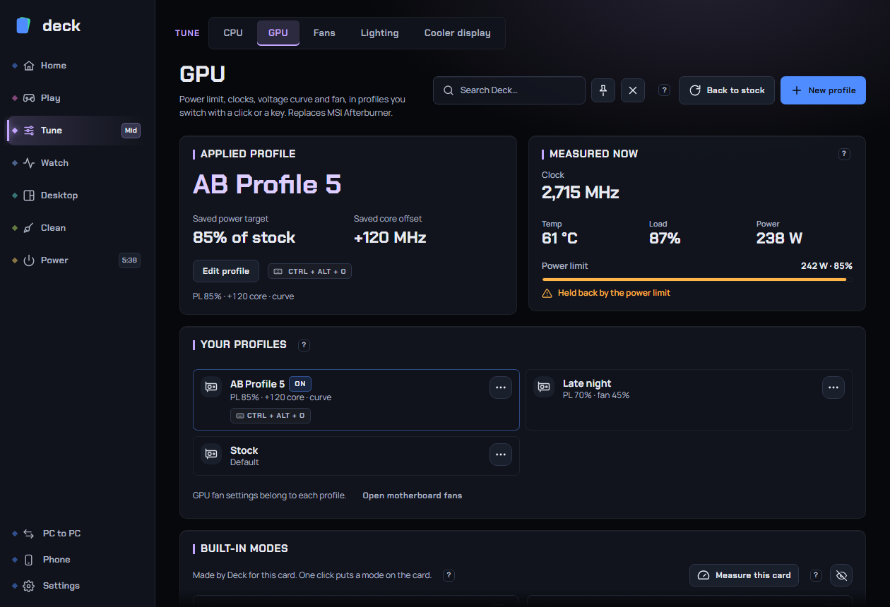

# GPU

The GPU page tunes an **NVIDIA** graphics card with saved **GPU profiles**, the way an MSI Afterburner slot does: a power limit, clock settings or a full voltage/frequency curve, memory speed and a fan setting, switched with one click or a key. It also ships ready-made **built-in modes** worked out from your own card, shows live readings, and can import your Afterburner profiles so you can stop using Afterburner.

**Where to find it:** sidebar > **Tune** > **GPU**. The page has three tabs: **Profiles**, **Readings** and **Settings**. Deck remembers the tab you used last.

*(The screenshot may differ a little from the current layout, which has the tabs described below.)*

Related pages: [CPU](cpu.md) (profiles that work the same way), [Fans](fans.md) (case and CPU fans), [Gaming](gaming.md) (pick a GPU profile per game), [Overlay](overlay.md), [Sensors](sensors.md).

## Contents

- [What you need](#what-you-need)
- [Read this first: safety](#read-this-first-safety)
- [The Profiles tab](#the-profiles-tab)
- [Built-in modes](#built-in-modes)
- [Measure this card](#measure-this-card)
- [The profile editor](#the-profile-editor)
- [The voltage/frequency curve editor](#the-voltagefrequency-curve-editor)
- [The Readings tab](#the-readings-tab)
- [Settings for GPU profiles](#settings-for-gpu-profiles)
- [Back to stock](#back-to-stock)
- [MSI Afterburner: import and coexisting](#msi-afterburner-import-and-coexisting)
- [Crash guard and automatic re-applying](#crash-guard-and-automatic-re-applying)
- [Switching profiles without opening the page](#switching-profiles-without-opening-the-page)
- [Recommended setups](#recommended-setups)
- [Troubleshooting](#troubleshooting)
- [FAQ](#faq)

## What you need

- An **NVIDIA** graphics card. Deck uses NVIDIA's own tuning interfaces (NVML for the documented controls, NvAPI for the curve and voltage). **AMD and Intel graphics get sensors only**: the page does not appear for them, and [Sensors](sensors.md) shows what they report. On an NVIDIA card or driver without tuning support the page says "GPU tuning isn't supported by this graphics card or driver" and offers **Open Sensors for readings**.
- **Administrator rights.** Without them the page shows "Changing the card's settings needs Deck to run as admin" with a **Set up** button (one admin prompt, then Deck starts with the right access and never asks again).
- Some features depend on the card generation:
  - Core clock locks (**Highest speed**, **Lowest speed**): NVIDIA Volta and newer.
  - Memory speed locks (**Memory speed**): NVIDIA Ampere (RTX 30 series) and newer.
  - **Temperature limit**, **Voltage boost** and the voltage curve: only shown when the card and driver offer them.
- **Laptops:** some laptop graphics cards do not let the power limit change at all. Then every mode keeps 100 % and the power slider has nothing to move. Highest speed and Memory speed (when the card offers them) still reduce power.

Each control only appears if your card supports it, so the page you see may have fewer controls than this guide describes.

## Read this first: safety

Most of what the page does is safe: lowering the power limit, capping the highest speed, slowing memory and setting a fan curve cannot run the card past what it was built for. Settings that make the card run **faster than stock** (a positive core or memory offset, a voltage boost, a curve raised at high voltages) are an **overclock**. Overclocking can crash games, freeze the PC or cause driver resets.

Deck helps:

- The editor always shows a banner: **Safe settings: nothing here runs the card faster than it was made to** or **Overclock: can crash games or the PC. After a crash Deck starts at stock.**
- The first time you create an overclock, Deck stops you with "This is an overclock" and asks you to confirm (**I understand**) or it undoes your change.
- **Try it** puts settings on the card without saving them; **Cancel** restores the card.
- The **crash guard** (see below) starts the card at stock if the PC restarted while an overclock was on.
- Settings reset when the PC restarts. A restart always returns the card to stock unless Deck applies a profile at start.

How to undo anything: press **Back to stock** at the top of the page. Your profiles are kept.

## The Profiles tab

**Applied profile.** The profile that is on now, with its **Saved power target** (percent of stock) and **Saved core offset**, an **Edit profile** button and its shortcut key. If no profile is active it says **Stock**.

**Warning banners** you may see on this tab:

| Banner | Meaning and what to do |
|---|---|
| **MSI Afterburner is running.** | Afterburner's startup profile, hotkeys and fan control can override Deck. Use **Stop Afterburner from tuning...** (see below). The banner only shows while Afterburner could still override Deck. |
| **Started at stock.** | The PC restarted unexpectedly during an overclock, so Deck did not re-apply it. **Apply anyway** puts it on once you are sure it's stable. |
| **The GPU power limit differs from the profile** | The measured limit does not match what the profile asked for (a short difference just after a switch is normal). **Re-apply profile** sends it again. |

**Your profiles.** A card per profile with its name, a summary line (for example "PL 85% - +120 core - curve"), shortcut key, shortcut icons, and chips: **On**, **OC** (the profile overclocks, so it is not re-applied automatically after an unexpected restart) and **Taken by another app** (another program already uses the shortcut key). Click a card to put the profile on the card. The pencil edits. The **...** menu has **Edit profile**, **Duplicate profile** and **Delete profile and shortcuts**.

**Page buttons:** **New profile** opens the editor, and **Back to stock** (with a **?**). If Afterburner is installed, **Import from Afterburner** appears too.

Under your profiles, a line says "GPU fan settings belong to each profile", with a button to the [Fans](fans.md) page for case and CPU fans.

## Built-in modes

Open the **Built-in modes (n)** fold on the Profiles tab. Modes are ready-made profiles that Deck works out from **your card's own limits**, so another card gets different numbers. One click puts a mode on the card, just like a profile. They can't be edited: use **...** > **Copy to my profiles** to make an editable copy, or **Shortcut key and shortcuts...** to give a mode a shortcut. Four everyday modes (Normal, Quiet, Efficient, Saver) are listed first; the rest are under them.

| Mode | What it does | Risk |
|---|---|---|
| **Fastest** | Top speed for longer: the card's highest power limit and highest temperature limit. Hotter and louder. Only appears when your card has headroom above stock. | More heat |
| **Normal** | The card as sold: its own limits and speeds. | None |
| **Quiet** | Power limit about 75 % (or the card's minimum if higher): a few frames less, cooler and quieter. | Safe |
| **Efficient** | Full memory speed, the core held at the fastest speed it reaches at its **lowest voltage**. Most frames for far less power. | Safe |
| **Saver** | Most frames per watt: lower memory speed too (the fastest step under about 90 % of the top one, at least half of it) and the core held at the fastest speed it reaches at that memory speed's lowest voltage. Games run a little slower. On cards without clock locks it is just the lowest power limit the card accepts. | Safe |
| **Low power** | Fewer watts than Saver: the core at a lower share of Saver's speed. For lighter games. | Safe |
| **Lowest power** | The least power that still runs games. Heavy games stutter; best for light use. | Safe |
| **Minimum** | The lowest memory speed and a very low core speed. **Light games only**: heavier games drop to a few frames. | Light games only |

Which modes appear depends on the card: a mode that would come out the same as an earlier one is left out, and a card with no clock locks only gets the modes it can express. Modes below Saver need core clock locks.

Efficient, Saver and the lower modes use numbers from the card's voltage table until you press **Measure this card**; their description says "Estimated from the driver's table" or "Measured on this card ...".

The eye button on the header folds all modes away. Profile pickers elsewhere (GPU profile when Deck starts, Gaming, plugged in / on battery) show modes behind one "Modes" row, and the tray puts them under a **Modes** submenu.

Modes set the fan to **Card decides**.

## Measure this card

**Measure this card** (**Measure again** afterwards, with a **?**) finds the lowest voltage and the fastest clock your card really holds, so Efficient, Saver and the lower modes use your card's real numbers instead of estimates from the driver's table. The table can be off: on one RTX 3080 measuring gave about 10 % more frames per watt.

- Where: on the **Built-in modes** header. It only shows when Deck has admin rights, the card supports core clock locks, an Efficient or Saver mode exists and the modes are not folded away.
- How long: about three minutes. No game may be open (a game in front stops it).
- What happens: Deck holds the card slower than stock under a light Direct3D load and reads the voltage. **It never runs the card above stock.** The screen may flicker once. Leave the PC alone while it runs.
- Afterwards a summary lists, for each memory speed, the lowest voltage and fastest speed there, and what each mode had before and has now. Your profile is put back on the card; if none was on, the card goes to stock.
- Results are saved for this card and driver version. **Redo it after a driver update.**

## The profile editor

Click **New profile**, a profile's pencil, or **Edit profile**. The editor opens in place with **Back to GPU** and three tabs: **Profile**, **Tuning & curve** and **Fan**. (A built-in mode opens with **Profile** and **Mode settings**, which only lists what it sets.)

The strip at the top, **On the card now**, shows power, core clock, memory clock, temperature, fan and load, updated every second, so you can see what a change does. If the card is idle it hints "Light load now: start a game to see what it does under load."

Buttons at the bottom:

| Button | What it does |
|---|---|
| **Try it** (**?**) | Puts the settings on the card now without saving. Test in a game; Deck can stay in the background. |
| **Cancel** | Closes the editor and restores the card to what it was (the active profile or stock). |
| **Save** | Saves the profile. If it is the active one it is applied. |
| **Back to GPU** | Same as Cancel. |

### Profile tab

The same fields as the CPU editor: **Use a lighting colour while this profile is active** (see [Lighting](lighting.md)), icon, **Name** (40 characters), **Shortcut key** (Ctrl, Alt or Win with a key; works from inside a game), and under **...** the **Desktop shortcut** and **Start menu** switches. A new profile can be filled from a mode with **Start from** (Fastest, Normal, ...): the name, icon and fan stay yours.

### Tuning & curve tab

Every setting shows a plain name and under it the technical name (for example "power target"). A dot marks a setting that differs from the card's own, and the small undo arrow puts that one back.

**Power**

| Setting | What it does | Default |
|---|---|---|
| **Power limit** (**?**) | How much power the card may draw, as a share of its default, with watts shown beside it. The easiest way to a cooler, quieter card; many cards lose only a few percent of speed at 80 %. Higher (if the card allows) lets an overclock hold its clocks. When you reach the card's minimum a note says so and suggests lowering **Highest speed** and **Memory speed** instead. | 100 % |
| **Temperature limit** (**?**) | The temperature the card slows itself down to stay under. Lower makes a cooler card that gives up clock sooner. | **Card's own** (NVIDIA's default, kept even after Afterburner is uninstalled) |

**Speed**

| Setting | What it does | Default |
|---|---|---|
| **Highest speed** (**?**) | The fastest the graphics chip may run (a clock lock, like `nvidia-smi -lgc`). It can still slow down when there is little to do. Most of the power goes into the top of the range, so capping it saves a lot for few lost frames. This is how a profile goes below the card's lowest power limit. | **No limit** |
| **Lowest speed** | Shown after **Also set a lowest speed**: keeps the card above this speed. | Card decides |
| **Adjust speed by** | **One offset** (simple) or **Voltage curve** (per voltage point). Switching to Curve starts from the current offset; switching back to Offset drops the curve. Hidden when Highest speed is so low that no offset or curve could change anything. | One offset |
| **Speed offset** (**?**) | Adds or removes MHz at every point of the card's boost curve. Higher is faster until unstable (crashes, glitches, driver resets). Go up in steps of 15 to 30 MHz and test. | 0 MHz |
| **Voltage boost** (**?**) | Lets the card use the top voltage steps NVIDIA normally holds back (+0 to +100 %). Helps an overclock hold a higher clock; rarely helps alone. More heat and power. NVIDIA's safety limit still applies. | None |

A line under the Speed block, **Runs at N MHz at most**, tells you the fastest the card will run with these settings and which setting decides it. It can be lower in games when the power limit or temperature holds it back.

**Memory**

| Setting | What it does | Default |
|---|---|---|
| **Memory speed** (**?**) | How fast video memory runs: **Card decides**, or **Full**, **Half**, **Low**, **Lowest** (the steps the card's firmware offers, with their MHz). Fast video memory uses power even when idle; slowing it saves most on desktop and video. Lower means much less power but slower games, and Lowest can stutter video. | Card decides |
| **Memory offset** (**?**) | Adds MHz to the memory clock. Helps games that move a lot of data. Too high often shows as lower FPS, so benchmark each step. A memory offset only moves the top steps of the card; at other steps the editor says so and offers to clear it. | 0 MHz |

**Fan** is on its own tab (below).

### Fan tab

| Choice | What it does |
|---|---|
| **Card decides** | The driver's own fan curve. |
| **Quiet** | A quieter curve: 30 % at 40 C rising to 100 % at 90 C. |
| **Cool** | A cooler curve: 40 % at 30 C rising to 100 % at 85 C. |
| **Fixed** | One speed (from the card's minimum to 100 %). |
| **My curve** | Your own curve: drag points; the graph covers 25 to 95 C and 0 to 100 %. The orange marker shows the temperature now. |

With Quiet, Cool, Fixed or My curve, Deck sets the fan speed from the GPU temperature once a second and never goes below the card's own minimum fan speed. **The driver takes the fan back when Deck quits.**

Safety: a fixed speed or a curve gives way to **100 % at 85 C or when the temperature can't be read, until the card is back at 80 C**. A card whose fans stop when cool ("zero-RPM") keeps doing so while it is cool and its temperature is known.

Case and CPU fans are on the [Fans](fans.md) page, not here.

### Mode settings

When you open a built-in mode, **Mode settings** lists exactly what it sets (**Power limit**, **Temperature limit**, **Highest speed**, **Memory speed**, **Fan**) and a **Copy to my profiles to change it** button.

### Undervolt curves and the automatic cap

A warm card lowers its clocks at low voltages more than at high ones, so a curve that was flattened from a low voltage can tilt upwards and the card can climb to 1 V or more for 15 to 30 MHz. To stop that, when a profile has a curve with a flat part and no **Highest speed** of its own, Deck adds a clock cap at the flat part and re-checks it every five seconds. You do not need to do anything.

## The voltage/frequency curve editor

Choose **Voltage curve** under **Adjust speed by**. The graph shows one point per voltage and the clock the card runs at it. The card picks a point by load and temperature. **Undervolting** means the same clock at a lower voltage: the same frames with less heat and quieter fans.

Colours: **grey** is the stock curve, **blue** is yours, **red** is your **Highest speed** line (the curve cannot be drawn above it), **orange** is where the card is now, **green** is a locked point. A grey area shows where the curve cannot go (NVIDIA lets each point move at most 1000 MHz from stock). The curve never falls to the right, so raising a point lifts the points after it and lowering one pulls the ones before it down, like Afterburner.

| Action | How |
|---|---|
| Move a point | Drag it |
| Select a range | Shift + drag |
| Move the selected range | Drag a selected point |
| Move the whole curve | Ctrl + drag |
| Bend the neighbours along | Alt + drag |
| Add or remove a point | Ctrl + click |
| Nudge | Up / Down arrows: 15 MHz (Shift: 1 MHz, Ctrl: 100 MHz) |
| Next point | Left / Right arrows (Shift extends the selection) |
| Lock the card to the point | L, or the **Lock point** button |
| Flatten from the point | Ctrl + F |
| Selected points back to stock | Delete |
| Reset the curve | Ctrl + D, or **Reset the curve** |
| Undo / redo | Ctrl + Z / Ctrl + Y |
| Select all / none | Ctrl + A / Esc |

Click the graph first so the keys reach it. **Shortcuts** shows this list in the app.

**Curve tools** (a button above the graph; nothing applies until you press Try it or Save):

- **Undervolt: keep [MHz] from [mV] up** with **Apply to the curve**: from that voltage up, the curve runs at the clock you give. This is the quickest undervolt (Afterburner's flat-line trick). A common start is your normal game clock at 850 to 900 mV. If a game crashes, raise the voltage or lower the clock.
- **Flatten from that voltage**: keeps the clock the curve already has at that voltage, from there up.
- **Move the whole curve by [MHz]** with up and down buttons: fine-tunes without reshaping. Up is faster and less stable; down is slower and more stable.
- **Reset the curve** goes back to the stock curve.

**Lock point** keeps the card at the selected point's voltage and clock whatever the load. Use it to test one point's stability or hold a clock in a benchmark. The card stays at that clock on the desktop too, so it runs warmer. **Unlock** releases it. A lock is not used while **Highest speed** is on (turn that off first).

**Back to the card's own curve** (under the graph) drops the curve completely.

## The Readings tab

- **Measured now**: the core clock with a one-line reason ("Held back by the power limit", "Held back by temperature", "At the voltage limit" or "Idle"), **Temp**, **Load** and **Power**, and **Power limit** in watts and percent with a bar. **Held back by the power limit** shows when the card is at its limit.
- The card's name and driver version, then **Memory** clock, **Fan** (percent, marked **Deck** when Deck controls it or **Driver**), **Voltage** and **Video memory** used out of total.
- **GPU over the last minute**: a chart of the clock, temperature, load or power (pick one above it), with numbers on both axes.

## Settings for GPU profiles

These live in **Settings › CPU and GPU**.

**GPU profile when Deck starts** (**?**): the profile put on the card when Deck starts with Windows. Card settings reset on every restart; this brings your usual setup back. Default **None (leave the card alone)**. After an unexpected restart, an overclocked profile is skipped in case it caused the restart.

The same part holds the settings CPU and GPU profiles share: profile keyboard shortcuts, the notice when a profile switches, and **Repair** for shortcuts (see [CPU](cpu.md#settings-for-cpu-profiles)).

## Back to stock

The **Back to stock** button (top of the page, with a **?**) puts the card back to NVIDIA's defaults: power limit, clocks, voltage curve and fan. It applies at once and keeps your profiles. Use it when something feels unstable or to compare against normal behaviour. Locked clocks are let go too.

## MSI Afterburner: import and coexisting

**Import from Afterburner** (shown when Afterburner is installed; **?**) opens a list of Afterburner's five profiles with their hotkeys. It copies:

- the profiles and curves (they match Afterburner's point for point)
- the Ctrl+Alt hotkeys
- optionally the **startup profile**, so Deck applies it when it starts ("Apply the startup profile when Deck starts, like Afterburner")
- optionally the **overlay items** (what Afterburner showed in RivaTuner's overlay; see [Overlay](overlay.md))

It only adds profiles to Deck. Afterburner's own files are not changed.

**Stop Afterburner from tuning...** (on the banner that appears while Afterburner could override Deck): asks for confirmation, **backs up** Afterburner's settings, then clears its startup profile, hotkeys and fan control so it no longer applies anything. A message shows the backup folder and an **Undo** button that puts Afterburner's settings back.

**You can uninstall Afterburner** once you have imported what you need. If its uninstaller offers to remove **RivaTuner Statistics Server** too, say **no**: the in-game overlay uses it. Afterwards turn on **Deck overlay** and **Start RTSS with Deck** on the [Overlay](overlay.md) page.

Do not run Afterburner's startup profile or fan control together with Deck's: two programs setting the same card will fight.

## Crash guard and automatic re-applying

- **Crash guard.** If the PC restarted while an overclock was on, the next start puts the card at stock and shows an **Apply anyway** toast and banner. Deck cannot tell whether the overclock caused the restart, so it plays safe. Lower-power profiles and undervolt curves are not counted as overclocks.
- **After a driver reset** puts the card back to stock, Deck re-applies the profile once.
- **After the PC wakes from sleep** Deck re-applies the profile about five seconds later (like Afterburner's "restore after suspended mode").
- **Fan settings** are re-sent every ten seconds.
- **Clock locks** are let go when Deck quits, on **Back to stock** and after a crash.
- **One apply at a time**: switching quickly never runs two applies together.
- When a profile is applied, Deck first holds the core, then sets power limit, temperature limit, curve and memory lock, and only then the profile's own core lock or the release, so a half-applied profile never runs unlocked.
- Switching profiles in a game is safe: no driver resets.
- If another program changed Deck's settings files, Deck waits for you instead of applying them (see the [FAQ](#faq)).

## Switching profiles without opening the page

Profile cards, the tray's **GPU profile** submenu (modes under **Modes**), the profile's shortcut key, desktop and Start menu shortcuts, the [phone remote](phone.md), Home's GPU drop-down and [Gaming](gaming.md) (per game) all run the same switching code.

## Recommended setups

**Most people:** apply **Efficient** or **Saver** for everyday gaming (try **Measure this card** once). Efficient gives most frames for far less power; Saver goes a step further. Use **Normal** when you want the card as sold, **Quiet** when you want less noise.

**A simple undervolt:** use the voltage curve. Pick your usual game clock and a voltage around 850 to 900 mV, use **Undervolt: keep [MHz] from [mV] up**, press **Try it**, play for a while, and **Save** if it is stable. If a game crashes, raise the voltage or lower the clock.

**A small overclock:** add a core offset in 15 to 30 MHz steps with **Try it**, then add a memory offset the same way, watching FPS and heat on [Sensors](sensors.md). Take a step back from the first unstable value.

**Quiet at the desktop:** a fan curve that stays low at idle temperatures, or **Quiet**.

**Laptops:** modes that lower power are the most useful ones. Power limits can be locked by the laptop; **Highest speed** and **Memory speed** still work where the card allows.

## Troubleshooting

**There is no GPU page.** The page only appears for an NVIDIA card with Deck's access. AMD and Intel graphics have no tuning page; they have sensors. If you have an NVIDIA card, make sure Deck has admin rights (**Set up**) and that the NVIDIA driver is installed.

**The page says "GPU asleep. Readings resume when Windows wakes it."** The NVIDIA card is powered down, which is common on laptops with switchable graphics. It wakes when a program uses it.

**"Finding graphics hardware..." stays on screen.** Wait a few seconds after start-up. If it stays, open the support report on [This PC](this-pc.md).

**Some controls are missing in the editor.** The card or driver doesn't offer them: for example Highest speed needs Volta or newer, Memory speed needs Ampere or newer, and some laptop cards have no power-limit range.

**The card is not holding my settings after a restart.** GPU settings reset on every restart. Choose a profile under **GPU profile when Deck starts** (Settings › CPU and GPU). Remember an overclocked profile is skipped after an unexpected restart.

**A profile says "Started at stock".** The crash guard held it back. Press **Apply anyway** only if you think the restart had another cause.

**The measured power limit differs from the profile.** The banner shows both. The card cannot go below or above its own range: 41 % of 240 W asks for 98 W but the card runs 100 W. Press **Re-apply profile** if the difference is large.

**My fan speed isn't what I set.** The card's minimum fan speed still applies, and the 85 C safety (100 % above 85 C or with no reading, until 80 C) overrides a fixed speed or curve.

**Afterburner and Deck disagree.** Afterburner's startup profile, hotkeys or fan control are overriding Deck. Use **Stop Afterburner from tuning...** or close Afterburner.

**My game crashes after an undervolt.** Raise the voltage or lower the clock of the flat part. Use **Try it** before saving.

## FAQ

**Is it safe with anti-cheat?** Deck does not touch games: it talks to NVIDIA's driver through its tuning interfaces, the same way Afterburner does, and never reads or injects into a game's memory. Switching profiles inside a game is safe because no driver reset is needed. For the one anti-cheat client that refuses to run next to Deck's hardware driver (FACEIT), see [Fans](fans.md#what-happens-with-anti-cheat): the GPU interfaces are NVIDIA's own and are not that driver.

**Can this damage my card?** Power limits, temperature limits, speed caps, memory slowing and fan curves stay inside what the card and driver allow. Deck never goes past NVIDIA's own safety limits, and the fan safety rule gives the fan 100 % when hot or when the temperature can't be read. An overclock is the same risk as in Afterburner: instability, not usually damage.

**What does Deck do when it quits or crashes?** The driver takes the fan back when Deck quits, panics, signs out or is killed from outside (a small watchdog process gives the GPU fan back to the driver within seconds). Locked clocks are let go when Deck quits. Offsets, power limit and curve you applied stay on the card until the PC restarts or you press **Back to stock**.

**Do profiles survive a driver update?** The profiles are saved by Deck. After a graphics driver update Deck comes back by itself, and re-applies the profile once if the driver reset put the card back to stock. Run **Measure this card** again, because voltage tables can change.

**Can I use a profile only for some games?** Yes: in [Gaming](gaming.md) pick a GPU profile for each game. It is applied when the game starts and put back when it closes.

**What does "hardware held" mean?** If another program edits Deck's fan, CPU or GPU settings files, Deck does not act on them: fans stay on the BIOS, no overclock is applied and profiles do not switch by themselves until you click **Apply them** in the toast. Apply only if you made the change.

**Can I use Afterburner and Deck together?** Only if Afterburner is not applying profiles, hotkeys or fan control. Deck warns while Afterburner could still override it.

**Where are my profiles stored?** In Deck's settings folder. Deck keeps a record of the card's factory temperature limit and a cache of its stock curve there too, plus the measured numbers from **Measure this card** per card and driver. Afterburner backups from **Stop tuning** are in a `backups` folder beside them.
