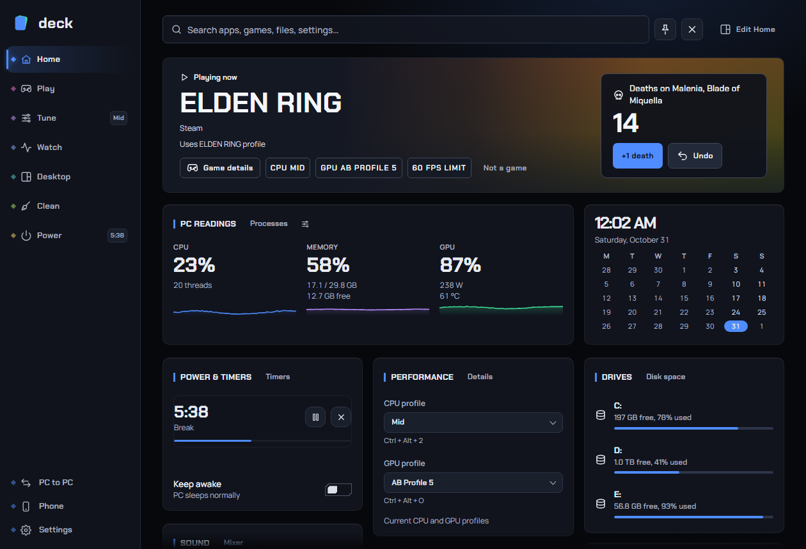

# Home, the tray icon and how Deck opens

Home is the first page you see when you open Deck. It is a board of small panels ("tiles") that show what your PC is doing right now and give you quick controls: the game you are playing, live readings, volume, timers, the clipboard and more. This page also explains the ways to open Deck (hot corner, tray icon, shortcut), the two window modes, the tray menu and the sidebar.

**Where to find it:** the sidebar group **Home**. The settings that control how Deck opens (window mode, hot corner, shortcut) live under **Settings > General**; see [Settings](settings.md).

## Contents

- [Opening and closing Deck](#opening-and-closing-deck)
- [Quick panel and App window](#quick-panel-and-app-window)
- [The top bar: search, pin and close](#the-top-bar-search-pin-and-close)
- [The sidebar](#the-sidebar)
- [The tray icon and its menu](#the-tray-icon-and-its-menu)
- [The Home tiles](#the-home-tiles)
- [Editing Home](#editing-home)
- [Active changes](#active-changes)
- [Recommended setup](#recommended-setup)
- [Troubleshooting](#troubleshooting)
- [FAQ](#faq)

## Opening and closing Deck

Deck lives in the Windows notification area (the tray) and runs in the background. You can bring it up in any of these ways:

| Way | What it does | Notes |
|---|---|---|
| **Hot corner** | Rest the mouse pointer in a screen corner and Deck opens. | Quick panel mode only. Top left by default, with a 250 ms delay. Details below. |
| **Tray icon, left-click** | Opens Deck, or closes it if it is already showing. | In App window mode it brings the window forward, or minimises it if it is already in front. |
| **Tray icon, right-click** | Opens the tray menu. | See [The tray icon and its menu](#the-tray-icon-and-its-menu). |
| **Keyboard shortcut** | Opens and closes the panel (Quick panel), or brings the window forward / minimises it (App window). | Empty by default. You choose the keys in Settings > General. |
| **Start menu** | Starts Deck, or shows it if it is already running. | Starting Deck a second time never runs a second copy; it just shows the first. |
| **Phone** | The phone remote can drive many of Deck's controls. | See [Phone](phone.md). |

Pressing the **X** in Deck's top-right corner **hides** Deck. It does not quit: Deck keeps running in the tray, so timers, the hot corner, fan control and the other background jobs carry on. To really quit, use **Quit Deck** in the tray menu or in Settings > About. See [What quitting does](#what-quitting-does).

### Hot corner details

The hot corner is deliberately careful so it does not open by accident:

- It only works at an **outer corner of your whole desktop**. With two monitors side by side, the corner where one monitor continues into the other does not count, because the pointer passes through it on its way across.
- The pointer must **rest** in the corner for the delay you set (**Hot corner delay**: 0 to 1000 ms in steps of 50; default 250 ms). A quick flick through the corner does nothing.
- It does nothing while a **mouse button is held** (dragging a window or a selection), and stays quiet until you leave the corner again. Screenshot tools (Snipping Tool, ShareX, Lightshot, Greenshot and similar) are also ignored, because their "drag a box" screen sends the pointer into the corners.
- By default it is **off over fullscreen games and videos**. If you turn on **Works over fullscreen games and videos**, the corner opens Deck over a game too. Deck then opens *without taking focus* from the game, so the game does not minimise or "tab out". The keyboard shortcut works over games either way.
- Deck reads the pointer position at short intervals. It installs no mouse hook and touches no game, so anti-cheat has nothing to see.

Choose the corner (Off, Top left, Top right, Bottom left, Bottom right) in **Settings > General > Opening Deck**.

## Quick panel and App window

**Settings > General > Opening Deck > Window mode** has two choices. The default is **Quick panel**.

| | Quick panel (default) | App window |
|---|---|---|
| Looks like | A panel over a dimmed screen, covering the monitor the mouse is on. No title bar, no taskbar button. | A normal resizable window with a title bar and a taskbar button. |
| Opens from | Hot corner, tray icon, shortcut. | Tray icon, shortcut, taskbar. |
| Closes | When you click elsewhere (**Hide when clicking elsewhere**), after you launch an app (**Hide after opening an app**), with the X, or with the shortcut. | Only when you close or minimise it yourself. |
| Position | Fills the monitor the mouse is on. | Remembers where you left it and whether it was maximised. The first time it opens centred at up to 1280 x 900 (smaller if the screen is smaller); the smallest it will be is 700 x 500. |
| The pin | Turns the panel into a floating, always-on-top window the size of the panel, so you can keep using other apps. | Keeps the window above other windows. |
| Hot corner | Available. | Its settings are not shown. |

Pick **Quick panel** if you want Deck to be something you flick open, glance at and dismiss. Pick **App window** if you want it on a second monitor or open beside your apps like any other program.

The keyboard shortcut means the same in both modes: show Deck / hide Deck.

## The top bar: search, pin and close

At the top right of every page:

- **Search box** ("Search Deck…"): finds apps (Start menu and Store apps), Deck pages, settings and actions, tweaks, games, files (from Deck's own index, see [Settings > Search](settings.md#search)), clipboard items and the web. It also does arithmetic, unit, currency and number-base conversions, and understands commands such as `timer 10m`, `sleep in 30m`, `shutdown in 2h`, `awake 2h`, `cancel` and `kill discord`. Power commands ask for confirmation and show up as a plan you can cancel; `kill` asks before it ends a program. More in [Launcher](launcher.md).
- **Pin:** in Quick panel mode, pinning keeps Deck open and floating on top while you use other apps. In App window mode it keeps the window above other windows. The pinned and unpinned states have their own opacity (Settings > Appearance).
- **X:** hides Deck (does not quit it).

## The sidebar

The sidebar has seven groups. Clicking a group opens it; its pages show as a row of tabs at the top of the page.

| Group | Pages |
|---|---|
| **Home** | Home |
| **Play** | Gaming, Overlay, Controller, Deaths, Game bar |
| **Tune** | CPU, GPU, Fans, Lighting, Cooler display |
| **Watch** | Sensors, Processes, Network, Drives, This PC |
| **Desktop** | Windows, Display, Sound and mic, Flyouts, Clipboard, Screen tools |
| **Clean** | Clean up, Disk space, Apps, Startup apps, Startup optimizer, Tweaks |
| **Power** | Keep awake, Timers & breaks, Shut down when… |

Below those, always visible: **PC to PC**, **Workspace Sync** (hidden unless you turn it on), **Phone** and **Settings**.

Good to know:

- **Hardware pages hide themselves.** CPU, GPU, Fans, Lighting, Cooler display and Sensors only appear when this PC has something Deck can use for them. A page that is missing is normally not broken: your PC simply has nothing for it. [This PC](this-pc.md) shows what Deck found.
- **Live hints and badges.** Some groups show a small live hint (Play shows "Live" during a Game mode session, Tune shows your CPU profile, Power shows your next timer or "Awake"), and some pages show a badge (the number of timers, "On" for keep awake, "Set" for a shutdown plan).
- **Reorder and fold.** Drag a sidebar group or a page tab to move it, and fold a group to hide its pages. **Settings > General > Sidebar > Reset order** puts everything back.
- **Workspace Sync** only shows while it is on, or when you switch on **Show Workspace Sync** (Settings > General > Sidebar).

## The tray icon and its menu

The Deck icon sits in the notification area at the bottom right. If you cannot see it, click the small up-arrow ("Show hidden icons") next to the clock; you can drag Deck's icon onto the bar to keep it visible. **Left-click** toggles Deck. **Right-click** opens the menu below. Items marked "only if" appear only when they apply to your PC.

| Item | What it does |
|---|---|
| **Open Deck** | Shows Deck. |
| **Game bar** | Shows or hides the [Game bar](game-bar.md). Only if the Game bar is turned on. |
| **Show music card** | Previews the now-playing card. Only if that feature is on. |
| **Game mode** | A check item: turns Game mode (see [Gaming](gaming.md)) on or off. |
| **Clean up background apps** | Runs Gaming's background-app clean-up. |
| **CPU profile / GPU profile** | Submenus listing your profiles, with the built-in modes grouped under **Modes**. A tick shows the active one; picking one switches at once. Only if the PC has CPU / GPU profiles. See [CPU](cpu.md) and [GPU](gpu.md). |
| **All fans** | Sets every fan to one mode at once. Only if fan control is available and allowed. See [Fans](fans.md). |
| **Lights off** | Turns supported lighting off or on. Only if the PC has controllable lighting. See [Lighting](lighting.md). |
| **Cooler display off** | Turns a supported cooler display off or on. |
| **Clear RAM** | Runs Deck's Clear RAM tool. Only when Deck runs as admin. |
| **Death counter** | Submenu: +1 death, undo, boss-fight actions and a switch to count deaths in the current game. Only if the death counter is on. See [Death counter](death-counter.md). |
| **Controller overlay** | Submenu: show the overlay, move / resize it, controller or keyboard-and-mouse, demo input, settings. See [Controller](controller.md). |
| **Clipboard history** | Opens the Clipboard page. |
| **Pick a colour from the screen**, **Copy text from the screen** | Start the screen tools directly. |
| **Keep the PC awake** | A check item for keep awake "until I turn it off". See [Power](power.md). |
| **Active changes** | Opens Home with the Active changes list. |
| **Settings** | Opens Settings. |
| **Quit Deck** | Quits Deck completely. |

If a controller reports a battery level, Deck can also show one small tray icon per controller (the Controller page can turn that off); left-click opens the Controller page, right-click shows this same menu.

### What quitting does

Quitting from the tray or from Settings > About stops everything Deck runs in the background: the hot corner, clipboard history, timers, keep awake, the phone link and shutdown plans (a plan cannot run while Deck is closed). Fans and the GPU fan are handed back to BIOS / driver control, and Deck undoes a Game mode session it started. A shutdown plan that was still set is saved and carries on when Deck starts again in the same Windows session; see [Power](power.md).

## The Home tiles

Home is made of the tiles below. All of them can be hidden, resized and moved ([Editing Home](#editing-home)). The default order is: Playing now, PC readings, Power & timers, Performance, Drives, Clock, Sound, Clipboard, Now playing, Pinned & frequent, Quick actions, Network.

Tiles refresh live while Deck is open. A tile you are using (a slider being dragged, a menu open) is left alone until you finish, so it never jumps under your hand.

### Playing now

A wide banner for the game that is in front, or the game you played last (or a welcome on a fresh install).

- The artwork, the game's name and store (Steam, Epic Games, GOG, EA app, Battle.net, Ubisoft, Riot Games or "Installed game"), and which game profile applies: "Uses *name* profile", "*name* profile on" while Game mode is active for it, or "Default game profile".
- **Game details** opens that game on the Gaming page. Chips show the active **CPU** and **GPU** profile (click to open the page) and the **FPS limit** when the game has one.
- **Not a game** (shown while a game is running) tells Deck to stop treating that program as a game. You can take that back on the Gaming page.
- If the game has a death counter, the right side shows the **death count** (this session, this boss fight, or the whole game) with **+1 death** and **Undo**. Otherwise it shows time played, sessions, time this week and the FPS from last time, once Deck has that data.

See [Gaming](gaming.md) and [Death counter](death-counter.md).

### PC readings

Live cards for your hardware, each with a small graph. The default cards are **CPU, Memory, GPU and Graphics memory**. Each card shows usage, then details (clock and power, or memory used / total), then temperature.

- The CPU's **clock, power and temperature need Deck to run as admin**. Without admin the CPU card says "Needs admin" and offers the one-step setup.
- Click the sliders icon on the tile ("Choose what this shows") to pick the cards and their order (CPU, Memory, Graphics card, Graphics memory, Network) and whether **Drives and free space** shows. Press **Save PC readings**.
- When Deck has measured power, a quiet line gives an energy estimate for today and this month. It counts CPU package and graphics card power only; the full figures are on the Gaming page.
- The graphics cards only appear if Deck can read a graphics card.

### Drives

Each fixed drive with its free space, percent used and a bar. A drive over 95 % used says "Low space". Clicking a drive opens Disk space. If drives are hidden in the PC readings editor, the tile says so and offers a button to change it.

### Clock

The time, the date and a month calendar (Monday first). When something is running, chips replace the greeting: **Staying awake**, your **shutdown plan** and up to two **timers**. Click a chip to open the matching Power page. A short tile loses the calendar first.

### Now playing

What your PC is playing (music or video, through Windows' media controls): title, artist, source app, progress, and previous / play-pause / next. A link shows how many other players are active.

### Performance

Two drop-downs, **CPU** and **GPU**, to switch profiles without leaving Home. Each shows the profile's shortcut key (if you gave it one) and a short summary. A line under them says whether a game profile has set them. A kind is only listed if this PC has that page and at least one profile. See [CPU](cpu.md) and [GPU](gpu.md).

### Sound

The master volume ("Everything") with mute and a level meter; a row of chips to switch the default output when you have more than one; and up to three apps with their own volume and mute. The apps shown are the game in front first, then apps that made sound in the last minute, then the rest by name. See [Sound](sound.md).

### Pinned & frequent

Up to eight app buttons: your pins first, then your most-used apps (Deck learns from apps you open through it), then, on a fresh install, well-known apps it finds on your PC. **Right-click** an app for **Show file**, **Pin to home** / **Unpin** and **Open**; click to launch. Apps start as your normal user, not elevated.

### Quick actions

| Button | Does |
|---|---|
| Keep awake / Staying awake | Turns keep awake "until I turn it off" on or off. |
| Dark mode / Light mode | Switches Windows between dark and light. |
| Pick colour | Screen colour picker. |
| Copy text | Select an area of the screen and copy the text in it. |
| Measure | Ruler for distances on the screen. |
| Screen off | Turns the monitors off (move the mouse to wake them). Instant. |
| Lock | Locks Windows. Instant. |
| Sleep | Puts the PC to sleep, after a confirmation. |

### Clipboard

The five most recent clipboard items. Click one to paste it. Whether that pastes into your last window or only copies is the **Paste or copy** setting on the Clipboard page. See [Clipboard](clipboard.md).

### Power & timers

Your running shutdown plan (with **Cancel**), up to two timers, one-tap timer presets (5, 10, 15, 25 and 60 minutes), a **Keep awake** switch, and **Shut down or sleep when…** to open the plan builder. See [Power](power.md).

### Network

Current download and upload speed and a graph. The **Speed test** link opens the Network page. See [Network](network.md).

## Editing Home

Press **Edit Home** (top right of Home). While editing:

- **Drag a tile's bar** to move it anywhere and **drag its corner** to resize it. The minus / plus buttons on its bar make it narrower or wider, **Fit** shrinks it to its content, and the eye button hides it.
- Below the board, **All Home tiles** lists every tile with a switch to show or hide it, a width (Narrow, Medium, Wide, Full width) and **Move up / Move down**.
- **Fit every panel** shrinks every tile to its content and pulls the others up into the space.
- **Put everything back** (with a "Reset layout?" check) restores the default positions, widths and visibility. Your other settings are untouched.
- Press **Done** to finish. If you hide every tile, Home says so, and Edit Home brings some back.

Your layout is saved with your settings, so a [backup](settings.md#backups) includes it.

## Active changes

At the top of Home is a collapsed panel called **Active changes**. It lists temporary changes Deck is holding right now, when each one ends, and the previous value it will restore. **Release** ends a change early and puts the previous value back. When nothing is active it says "Deck has no active changes to release." You can open it from the tray (**Active changes**) too.

## Recommended setup

- **Most people:** keep Quick panel, the top-left hot corner and the default delay, and leave "Works over fullscreen games and videos" off. Add a keyboard shortcut if you like.
- **Gamers:** use the shortcut over games, or turn on the over-fullscreen hot corner if you want it (it opens without taking focus). Keep Performance, Sound and Power & timers where you can see them.
- **Laptops:** App window mode suits a small screen, and the Performance tile switches CPU profiles quickly when you unplug.
- **Two-monitor setups:** put the hot corner on an outer corner or use the shortcut.
- **Everyone:** run Deck as admin (the **Set up** button on the CPU card) if you want CPU temperature, clock and power on Home, and keep **Start with Windows** on so Deck is ready in the tray.

## Troubleshooting

**The hot corner does nothing.** Check it is not Off and that Window mode is Quick panel. It only works at an outer corner of the whole desktop. A fullscreen game, video or presentation blocks it unless you turned on the fullscreen option. A held mouse button, or a screenshot tool in front, also blocks it: move out of the corner and back in. Try a different delay.

**Deck opens by accident.** Choose another corner, raise the delay, or set the hot corner to Off and use the shortcut.

**The tray icon is missing.** Look behind the up-arrow near the clock and drag it onto the bar. If Deck is not running at all, start it from the Start menu.

**The shortcut says "Taken by another app".** Another program already uses those keys. Click the shortcut button again and press different keys (Escape cancels, Backspace clears it).

**The CPU card says "Needs admin".** CPU clock, power and temperature come from Deck's hardware engine, which needs admin. Press **Set up**; it creates Deck's own scheduled task so there is no prompt at each start.

**A tile is blank or empty.** Games, deaths and FPS appear only after you have played with Deck running. Drives and PC readings can be hidden in the editor. Performance hides CPU / GPU kinds this PC does not have.

**Home looks wrong after I rearranged it.** Edit Home > **Put everything back**.

**I pressed X and Deck is still running.** That is intended: X hides Deck. Quit from the tray.

## FAQ

**Do the hot corner or the other ways of opening Deck touch my game or trigger anti-cheat?** No. The hot corner only reads the mouse position; there is no hook and nothing is injected into any game. Deck never reads game memory.

**Does Deck start with Windows?** By default yes, hidden in the tray (**Start with Windows**). You can turn it off in Settings > General.

**What if Deck crashes?** With **Start again after a crash** on (the default) Deck reopens itself. If it is ended three times within ten minutes it stops restarting, and the next start comes up with fans on BIOS control and no overclock. See [Settings](settings.md#start-again-after-a-crash).

**Where is my Home layout saved?** In Deck's settings file; see [where Deck stores data](settings.md#where-deck-stores-data).

**Can I hide the Playing now banner?** Yes: Edit Home and hide the tile.

**Is the pin the same as "always on top"?** In App window mode, yes. In Quick panel mode it also stops the panel closing when you click elsewhere and shrinks it into a floating window.
