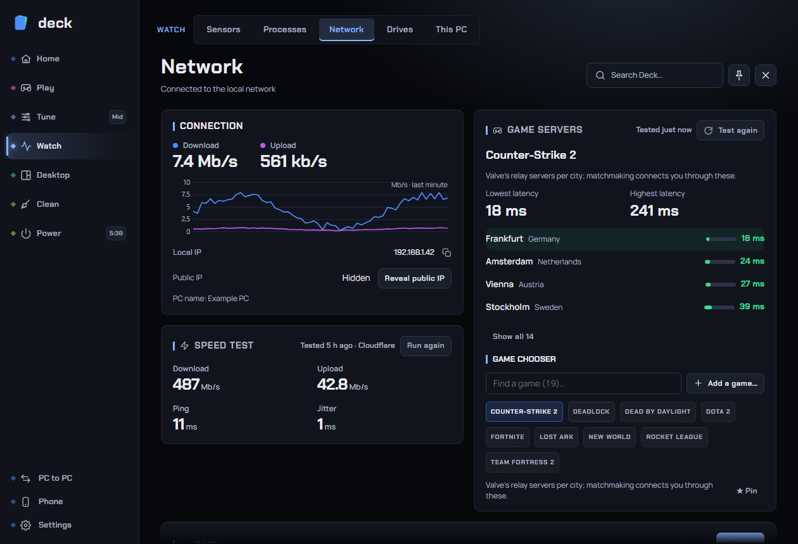

# Network

The **Network** page shows what your connection is doing right now and helps you find out why it is slow or laggy. It has a live speed graph, your addresses, a speed test, a "does a download make my games lag?" test, a ping monitor, an optional record of connection quality over time, an optional count of the data each app uses, and a ping check against game servers.

Find it under **Watch > Network** in the sidebar. The page has four tabs: **Overview**, **Tests**, **Data per app** and **Game servers**.

> Deck only measures your connection and sends ordinary pings and test downloads. It does not touch any game, inject into any game or read any game's memory, so none of this affects anti-cheat.

Speeds are shown in megabits per second (Mb/s) by default. If you prefer megabytes per second (MB/s, where 8 megabits equal 1 megabyte), change **Network speed** under **Settings > Performance and units**. The graph, the speed test and the per-app figures all follow that setting.

---

## Tab 1: Overview

### Connection

| Item | What it shows |
|---|---|
| **Download** and **Upload** | The current speed of the whole PC, updated every second. |
| Graph | The last minute of download and upload together. The scale adjusts itself, and the unit is printed in the corner. |
| **Local IP** | Your PC's address on your home or office network. Click it to copy. |
| **Public IP** | The address the internet sees. It is **hidden** until you click **Reveal public IP**, so a screenshot of this page does not leak it. Revealing it makes one request to a public lookup service (ipify) and the address is then click-to-copy. |
| **PC name** | Your computer's name on the network. |

If your PC has no network connection the card is titled **Connection unavailable**.

### Connection quality

A record of how steady your connection is, kept over days. It is **off by default**. Turn it on with the switch on the card.

While it is on, and only while Deck is running, Deck sends a few small pings every minute to two places:

- **Router**: your own router (the gateway). If the delay or loss shows here, the problem is inside your home network (Wi-Fi, cable, router).
- **Internet**: 1.1.1.1, a public address. If the router looks fine but the internet line shows problems, the fault is on your provider's side.

Deck keeps 10-minute averages for 30 days on your PC. Nothing is uploaded.

| Control | What it does |
|---|---|
| **24 hours / 7 days / 30 days** | The period to summarise. |
| **Router** and **Internet** lines | Average delay, jitter (how much the delay wobbles) and the percentage of lost replies for that period. "No pings yet" until some have been recorded. |
| Strip graph | One bar per time slice for the internet line. Bar height is the delay. A slice in which 20% or more of the replies were lost is coloured as lost, and a slice with no reply at all fills the strip. Hover a bar for numbers. |
| **Clear history** | Deletes the saved record. Turning the switch off keeps the history; only **Clear history** removes it. |

**Recommended:** turn it on if you have intermittent drops or lag spikes you cannot reproduce on demand. Leave it on for a few days, then look at the 24-hour or 7-day view to see *when* it goes wrong. If you have no problem, leave it off.

---

## Tab 2: Tests

### Speed test

Measures download, upload, ping and jitter against Cloudflare's speed servers. Press **Run speed test** (it changes to **Run again** after the first run).

| Result | Meaning |
|---|---|
| **Download** | How fast data arrives. The test streams data for up to about 10 seconds. |
| **Upload** | How fast you can send data. It uploads for up to about 8 seconds. |
| **Ping** | The typical delay of small requests to the server, in milliseconds. Lower is better. |
| **Jitter** | How much the delay varies from one request to the next. Lower is better; high jitter hurts calls and games more than a slightly higher ping. |

The line under the title says "Uses about 100 MB of data" before the first run and "Tested <time ago>" afterwards. The test runs for a fixed time rather than a fixed amount, so a very fast connection moves more than 100 MB. **Cancel** stops the test and keeps your previous result.

**For the best reading:** pause other downloads and streaming first, and plug in by cable if you can. Wi-Fi alone can explain a low result. If you are on a metered or limited connection, avoid running it often.

### Lag while busy

Answers: "when something downloads, does my game or call start to lag?" Slow responses under load are called *bufferbloat*: your router queues too much data, so everything waits in line.

Press **Run the check**. It takes about 30 seconds and uses up to 50 MB. Deck:

1. Measures the delay to the internet (and to your router) with the line quiet.
2. Starts a download (capped at 50 MB and 12 seconds) and measures the delay again while the line is full.

The result is a **grade** and a sentence, for example "Delay rose by 45 ms at 300 Mb/s":

| Grade | Delay rise | Meaning |
|---|---|---|
| **A** | under 30 ms | No real extra lag while busy. |
| **B** | 30 ms or more | A little extra lag. |
| **C** | 60 ms or more | Noticeable in fast games. |
| **D** | 150 ms or more | A big download is felt in games and calls. |
| **F** | 300 ms or more, or more than 10% of replies lost | Very laggy while busy. |

The **Test details** fold shows the median delay with the line quiet and busy for the internet and the router, the worst busy reading and the percentage lost. If the grade is worse than B, Deck suggests looking for a **Smart Queue Management** (SQM) setting on your router, which is the usual cure. Deck changes no router settings. **Cancel** stops the check.

**Tip:** if the test says it could not fill the line or got no reply from the internet, try again with nothing else using the network.

### Ping

Watches the delay and lost replies to addresses you choose. The list starts with `1.1.1.1`, `8.8.8.8` and `discord.com`.

- One round of pings runs when the page opens. After that it only keeps pinging while you press **Start**; **Stop** pauses it. Leaving the page stops it too, so Deck never pings in the background.
- Each host shows a strip of its last 60 rounds, the latest delay, the average and the percentage lost.
- Colour: under 40 ms is good, under 90 ms is a warning, anything else (or no reply) is bad.
- Type a name or address into the box and press **Add host** (or Enter) to watch another one, for example your game's website or your router. The small cross removes a host.

---

## Tab 3: Data per app

Shows how much each program has downloaded and uploaded, so you can find what is using your data allowance or your bandwidth. It is **off by default**; turn it on with the switch on the card.

- Deck uses Windows' own network events (the same source Task Manager uses) and **needs administrator rights**. No driver is installed.
- It counts only while Deck is running, so close-and-reopen gaps are not counted.
- Totals are added up per program per day and kept on your PC for 30 days.
- Choose **Today**, **7 days** or **30 days**. Apps are listed biggest first, each with a bar and "down / up" totals.
- Straight after switching on it says "Counting..." until some traffic has been seen (a few minutes of normal use).
- **Clear totals** deletes the saved counts.

If it shows an error instead of a list, it is almost always because Deck is not running as administrator.

---

## Tab 4: Game servers

Shows the delay from your PC to the places a game's servers run, so you can see which region is closest, or whether your ping to a region has changed.

Deck measures the way the games do:

- **Valve games** (Counter-Strike 2, Dota 2, Deadlock, Team Fortress 2) connect through Valve's relay servers. Deck pings every relay in each city and shows the best one, like Steam's own route choice.
- **Games on Amazon's servers** (for example Fortnite, Rocket League, Dead by Daylight, New World, Lost Ark) are measured with Amazon's UDP game-ping servers, grouped into each game's matchmaking regions.
- **Any game on Amazon servers** and **Any game on Valve's network** measure a whole network, for a game that is not in the list.

Games whose servers cannot be measured from outside (some publishers' own networks) are not listed. A real match's ping can still differ a little from these numbers.

### Using it

1. Pick a game from the **Game chooser** chips. Games installed on this PC come first, then the rest. Use **Find a game** to search, or **Show all N games** to see every chip.
2. The first look at a game tests it automatically (about 3 seconds). Press **Test again** to repeat it.
3. Read the rows: each region with its delay, a bar and the percentage of lost replies. Four rows show at first; **Show all N** reveals the rest. **Lowest latency** and **Highest latency** are summarised above the rows. Colour: under 60 ms is good, under 110 ms a warning, otherwise bad.

### Pin and add

- **Pin** puts a game at the front of the list; **Unpin** takes it off.
- **Add a game...** lets you add a game that is not listed. Type its name (or pick from your installed games) and say which network its servers are on: **Amazon servers (AWS)** or **Valve's network**. Deck cannot find this out by itself, so only add a game if you know. Games you add can be removed with **Remove**.

---

## Recommended setup

- Most people can leave everything alone and use the page when something feels wrong.
- **Gamers:** run **Lag while busy** once. If it grades C or worse, enabling SQM on your router (or pausing big downloads while you play) will help more than any PC setting. Use **Game servers** before picking a region.
- **Laptops on Wi-Fi:** use the **Router** line of **Connection quality** to separate Wi-Fi trouble from provider trouble.
- **Limited data plans:** turn on **Data per app** to find the app that eats your allowance, and avoid running the speed test repeatedly.

---

## Troubleshooting

**The speed test result is lower than my plan.** Wi-Fi, a busy network and a VPN can all reduce results. Test by cable, with other downloads paused, and compare with **Run again**.

**The speed test fails with an error.** The page shows the error. It usually means no internet connection, or a firewall or VPN blocking Cloudflare. Try again, or turn the VPN off.

**Public IP will not reveal.** Deck needs the internet to look it up. Check your connection and try again.

**Data per app shows an error or nothing.** Counting needs Deck to run as administrator, and shows "Counting..." until traffic has been seen.

**Game servers shows "No reply" for some regions.** Some networks block ICMP (ping) or UDP. Other regions of the same game still give you a useful comparison.

**The ping list is empty.** Add a host with **Add host**. An address that does not exist shows "No reply".

---

## FAQ

**Does this send my data anywhere?** The speed test and the lag check download from and upload to Cloudflare's test servers. The ping features send ordinary ping packets to the addresses you can see. Revealing the public IP asks a public lookup service. Everything else (history, per-app totals) stays on your PC.

**Does Deck run these in the background?** Only **Connection quality** and **Data per app**, and only if you turned them on, and only while Deck is running. The speed test and lag check only run when you press the button; the ping monitor only while it says Live.

**Can I use these during a game?** The tests use bandwidth and add delay of their own, so run them outside matches. Deck never touches the game itself.

**How do I delete what Deck recorded?** **Clear history** (Connection quality) and **Clear totals** (Data per app) delete the saved records.
