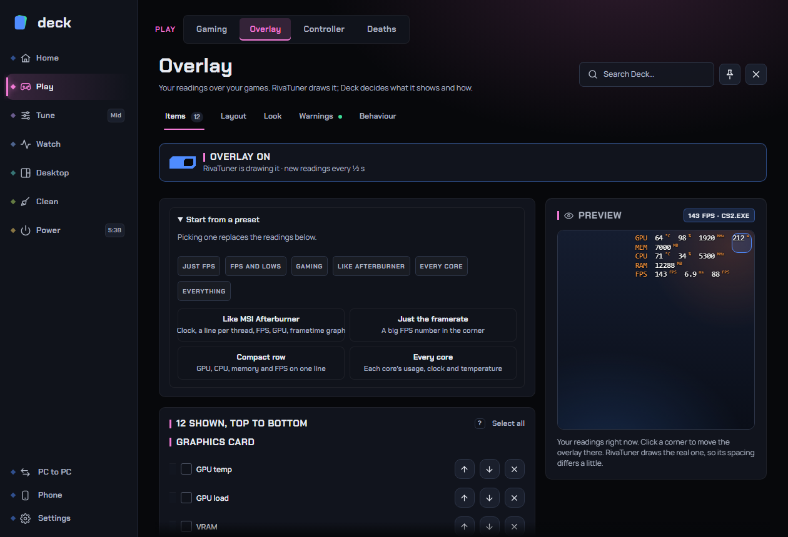

Where to find it: Gaming › Performance overlay

# Performance overlay

Live sensors over your game (FPS, frame time, temperatures, load, clocks, power), drawn by RivaTuner in a corner of the screen.

Deck decides what the overlay shows and how it looks; **RivaTuner** Statistics Server (RTSS), a free tool from Guru3D, draws it inside the game. It can match MSI Afterburner's look. The page has four tabs: **Items**, **Format**, **Look** and **Behavior**.

Related pages: [Game profiles](gaming.md) (session reports use RivaTuner's FPS), [Deck bar](game-bar.md), [Sensors](sensors.md).

## What RivaTuner does

Deck never draws over games itself. It writes its text into one RivaTuner slot, and RivaTuner draws it and fills in FPS and frame time.

- You need RivaTuner installed and running. **Install RivaTuner** installs it with Windows' package manager (`winget`) and starts it, in about a minute. Without `winget`, get it from guru3d.com.
- FPS everywhere in Deck comes from RivaTuner: [session reports](gaming.md#session-reports), Deck game mode, [Why did it stutter?](gaming.md#why-did-it-stutter) and [Target FPS](gaming.md#target-fps-power-saver). RivaTuner must be measuring the game; the overlay itself can be off.
- The overlay works on any CPU and graphics card. A sensor the PC doesn't have shows **No data** and is skipped.
- Deck keeps its own windows, game launchers and the NVIDIA, AMD and Xbox Game Bar overlays out of RivaTuner's hooks, so nothing is drawn over them or twice.
- If a game's anti-cheat blocks RivaTuner, the overlay can't show there and Deck can't read that game's FPS. Safety and anti-cheat are covered in the [FAQ](faq.md).

## The top of the page

The band at the top shows the game screen with your overlay drawn in place, and on the right:

- **Show overlay**: the main switch, off by default.
- The game's FPS in large figures, or the state: **Overlay off**, **Waiting for a game**, **RivaTuner stopped** or **Not installed**.
- **Install RivaTuner** or **Start RivaTuner** when needed.
- Tiles for **Sensors** shown, **Lines** (**Text box full** when RivaTuner cut lines) and **Updates**.
- RivaTuner health chips: **Slot free** or **No free text slot**, **Frames flowing**, **No game** or **No frames for N s**.
- A chip for each running vendor app that can reset Deck's settings (iCUE, G HUB, Armoury Crate), with a Pause button (such as "Pause G HUB") for this session and **Start again** to bring it back.

**Preview scene** switches the picture behind the overlay between **Dark game**, **Bright game** and **Busy**, so you can check your colors stay readable. The preview uses your real sensors; a tall overlay is shrunk to fit it (**Shown at N %**). On Items, clicking a line in the preview selects its sensor.

## Items tab

What the overlay shows and in what order.

### Sensors

**Sensors** lists every sensor by part (graphics card, processor, memory, game and frames, fans and network, info). Each row's switch puts it on the overlay or takes it off. Sensors that are off wait folded under their part: press **+ 6 more** (for example) to see them. **Find a sensor** searches them all.

Click a sensor (or its line in the preview) to open it on the right. The panel shows its value now (or **No data yet**) and:

- **This sensor**: **Order** (move up, down, **Top**, **Bottom**), **Line** (**Share a line…** or **Own line**) and **Warning** (its limit, with a link to Look).
- **Shared by every sensor** (or every sensor of its part, with **A color per part** on): its **Color** and **Unit**.

Drag the grip to reorder. To change several at once:

1. Switch from **Order** to **Select** above the list, and select the rows (Shift-click selects a range; **Select all** and **Select none** help).
2. Use the bar that appears: move up, move down, **Top**, **Bottom**, **One line** (puts them on one line with a label you choose, such as GPU, CPU or SYS), **Own lines**, or the bin to take them off the overlay.

Per-core and per-thread rows take several lines, so they can't share one. Sensors tagged **Frames** are counted from every frame over **Average over the last** on [Behavior](#behavior-tab).

### Available sensors

| Part | Sensors |
|---|---|
| Graphics card | Temperature, usage, memory used (MB and %), memory controller load, core and memory clock, power (W and % of the default limit), fan, voltage, what holds the clock back |
| Processor | Temperature, usage, clock, power, voltage (VID); per thread usage; per core clock, temperature, or all three; per thread usage and clock |
| Memory | RAM used, commit charge, RAM used by the game |
| Game and frames | Framerate, frame time, average, 1% low, 0.1% low, lowest, highest |
| Fans, sensors and network | Download and upload speed, and every fan and motherboard temperature this PC has, by its own name |
| Info | Game name, resolution, graphics API, clock |

Deck works out the average, lowest, highest and lows from RivaTuner's frame history; they start over when you switch game. The 1% and 0.1% lows are the average of the slowest 1 % and 0.1 % of frames.

### Presets

Six starting points, each drawn with your PC's sensors. Picking one replaces your sensors (and for most, the look); **Undo** shows for a few seconds.

| Preset | What it sets |
|---|---|
| **FPS only** | One big FPS number. |
| **Smoothness** | FPS, frame time, 1% and 0.1% lows on their own lines, and the frame time graph. |
| **Essentials** | GPU and CPU temperature and load, VRAM, RAM, FPS, frame time and 1% low. |
| **One line** | The essentials in a row, a color per part. |
| **Every core** | Each core's load, clock and heat, plus GPU and FPS. |
| **Full detail** | The clock, a line per thread, every GPU figure and the graph. |

Start from the closest one, then adjust. For everyday use, **Essentials** or **One line**.

### Frame time graph

The **Frame time graph** card (under the selected sensor) draws every frame's time. RivaTuner redraws it with every frame, so stutter shows as spikes even when the average FPS looks fine.

| Setting | What it does | Default |
|---|---|---|
| **Show the graph** | Turns the graph on. | Off |
| **Width** | **Fill the line** matches the overlay's longest line; **Set it** uses 8 to 128 characters. | Fill the line |
| **Height** | 1 to 24 lines. | 4 |
| **Style** | **Lines**, **Filled** or **Bars**. | Lines |
| **Top of the graph** | **Auto** is four average frames (about 33 ms at 120 FPS). Drag right for a fixed top; 16 ms is about 60 FPS. | Auto |
| **Title above the graph** | A small label above it. | Off |
| **Frame time bar** | A thin strip on the screen edge that changes color every frame, for capture and frame analysis tools. | Off |

## Format tab

How the lines are laid out.

| Setting | What it does | Default |
|---|---|---|
| Arrangement | **Grouped** (a line per part, like Afterburner), **List** (a line per sensor) or **One line** (all in a row). | Grouped |
| **Labels** | GPU, CPU, FPS before the numbers. | On |
| **Line up the values** | Numbers start in one column. | On |
| **Tidy columns** | A fixed width per sensor, so lines don't jump when a number grows (9 to 10). Best with a monospace font. | Off |
| **Framerate lines** | FPS, lows, min and max get a line each (Grouped only). | Off |
| **Small thread numbers** | CPU₁ instead of CPU1 in the thread table. | Off |
| **Cores per row** | 4 to 16, for core grids. | 8 |
| **Units** | **Small**, **Normal** or **None** for °C, % and MHz. | Small |
| **Decimals in the framerate** | 143.4 instead of 143. | Off |
| **Memory in** | MB or GB. | MB |
| **Clock** | 24 h or 12 h, with or without seconds. | 24 h |

## Look tab

### Position and text

| Setting | What it does | Default |
|---|---|---|
| **Corner** | **Top left**, **Top right**, **Bottom left** or **Bottom right**. Pick one clear of the game's map and HUD. | Top right |
| **From the side**, **From the top or bottom** | Distance from the edges, 1 to 600 px. | 1 px |
| **Shrink to fit the screen** | For long overlays on small screens. | Off |
| **Text size** | 1 to 8. Bigger on 4K or a TV, smaller on a laptop. | 2 |
| **Font** and **Bold** | Any installed font, suggested overlay fonts first. Monospace fonts keep numbers still. RivaTuner can't draw most non-Latin text. | Unispace |
| **Shadow** | Keeps letters readable. | On |
| **Dark box behind the text** | A see-through box, with **Opacity** 5 to 100 %. | Off |

### Colors

Seven color sets: **Classic**, **By part**, **Ice**, **Neon**, **Matrix**, **Sunset** and **Mono**. Below them, one tile per color (**Labels**, **Numbers**, **Warm**, **Hot**), each with a reset button, and three switches:

- **A color per part**: GPU, CPU, memory, framerate and other lines each get their own color. **Color the numbers too** colors the numbers as well as the labels.
- **Color by load and heat**: numbers turn warm from 70 % load and hot from 90 %, and warm near a temperature limit and hot past it.

### Turn red when…

| Setting | What it does | Default |
|---|---|---|
| **Highlight limits** | A number turns hot when a temperature reaches its limit, or the framerate falls below yours. | On |
| **GPU temperature**, **CPU temperature** | The limits (GPU 60 to 100 °C, CPU 60 to 105 °C). | 85 °C, 90 °C |
| **Framerate under** | 0 is off. | Off |
| **Load** | GPU and CPU load, warm from 70 % and hot from 90 %; the same switch as **Color by load and heat**. | Off |

## Behavior tab

| Setting | What it does | Default |
|---|---|---|
| **Show or hide overlay** | A key that turns the overlay on and off in games. | None |
| **Frame rate limit on/off** | A key that turns RivaTuner's frame rate limit on and off. | None |
| **Frame rate limit** | **Set in Game profiles** opens the limit (see [Frame limiter](#frame-limiter)). | |
| **Update interval** | How often Deck sends new values: ¼ s, ½ s, 1 s or 2 s. | 1 s |
| **Average over the last** | The window for the average, lows, min and max: 30 s to 5 min. | 1 min |
| **Reset averages** | A key, and **Reset averages now**, to start the figures over (for example at the start of a match). | None |
| **Use this look in every game** | Also games with their own RivaTuner profile. Your originals are kept in RivaTuner's `Profiles\Deck backup` folder. | On |
| **Start RivaTuner with Deck** | Starts RivaTuner whenever Deck starts. | Off |
| **Hide RivaTuner's tray icon** | RivaTuner keeps running without its icon. | Off |
| **Share sensors with other tools** | Publishes the sensors the way Afterburner does, so stream widgets and RivaTuner's own editor can read them. Turn it off while Afterburner runs. | On |
| **Open RivaTuner** | Opens RivaTuner's window. It restarts RivaTuner, so a game's overlay blinks for a moment. | |
| **Restore RivaTuner's own look** | Puts RivaTuner's profiles back as they were before Deck. | |

Keys: click the box and press the keys; Esc cancels, Backspace clears. Deck registers them like any program and uses no keyboard hook.

If the page says RivaTuner has no profiles yet, open RivaTuner once from its own icon, then come back.

## Frame limiter

RivaTuner can hold every game to a maximum frame rate. Set the limit in Game profiles › Games › the **Default** profile › Performance (see [Game profiles](gaming.md#performance)); 0 means no limit.

- This is RivaTuner's global limit, for games without their own. A per-game RivaTuner limit replaces it; an NVIDIA driver limit also applies, and the lower one wins.
- To cap one game, set that game's limit on [Game profiles](gaming.md#performance).
- The [Deck bar](game-bar.md)'s **Frame rate limit** widget sets this same limit.
- A cap just under your refresh rate (141 on a 144 Hz screen) keeps variable refresh smooth and saves heat, noise and power. It applies at once while RivaTuner runs.

## Recommended setup

- First time: turn on **Show overlay**, let Deck install RivaTuner, then pick **Essentials** or **One line**.
- Chasing stutter: **Smoothness**, **Color by load and heat** on, and **Reset averages** on a key.
- FPS in session reports without an overlay: turn on **Start RivaTuner with Deck** and leave the overlay off.
- Laptops and small screens: **One line** and **Shrink to fit the screen**.
- 4K or TV: **Text size** 3 or 4 and the dark box.

## Troubleshooting

**Nothing shows in my game.** Check that **Show overlay** is on and RivaTuner is running. Some games can't be hooked by RivaTuner; try borderless windowed mode.

**The overlay shows twice or is frozen.** A launcher or overlay window that was already open keeps its old hook. Restart the game or launcher.

**Some sensors say "No data".** The PC doesn't provide that sensor right now; it is skipped until it appears.

**FPS and frame time are empty.** RivaTuner must be measuring the game. Games it can't hook have no FPS.

**Averages look wrong after a loading screen.** Use **Reset averages**. The figures also start over when you switch game.

**One game ignores my look.** It has its own RivaTuner profile. Turn on **Use this look in every game**.

**Long overlays are cut off.** RivaTuner's text field is limited (**Text box full**). RivaTuner 7.3.5 and newer gives more room; otherwise remove sensors.

**I also use MSI Afterburner.** Turn off **Share sensors with other tools** and use one overlay only.

**RivaTuner's window is black.** Open it with Deck's **Open RivaTuner** button.

**I want RivaTuner back as it was.** Behavior › **Restore RivaTuner's own look**.

## FAQ

**Do I need MSI Afterburner?** No, only RivaTuner Statistics Server.

**Does a faster update cost more?** ¼ s does a little more work than 1 s. RivaTuner fills in FPS and frame time at its own pace either way.

**Is RivaTuner safe?** It is a long-standing tool from Guru3D, and Deck installs it from there. Deck checks RivaTuner's shared memory before using it.

**Does it work on AMD or Intel graphics?** Yes. Each sensor appears when the hardware provides it.

**Why does the frame rate limit need RivaTuner?** RivaTuner applies the global limit. On NVIDIA cards a per-game limit on Game profiles is kept by the driver instead.

**What does Deck change in RivaTuner?** Its look and the global frame rate limit in RivaTuner's profiles, the list of programs it stays out of, and optionally its tray icon. **Restore RivaTuner's own look** undoes the profile changes.
