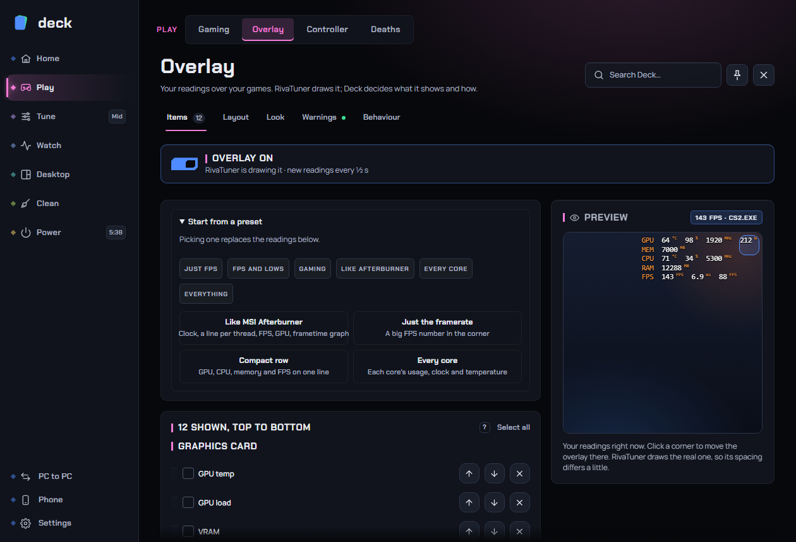

# Overlay (in-game readings)

The overlay puts live readings over your game: FPS, frame time, GPU and CPU temperature and load, clocks, power, memory and more, in a corner of the screen. It is the same idea as the MSI Afterburner overlay, and it can copy Afterburner's look. Deck decides what the overlay says and how it looks; **RivaTuner Statistics Server** (RTSS) is the program that actually draws it inside the game.

**Where to find it:** sidebar > **Play** > **Overlay**.

Related pages: [Gaming](gaming.md) (per-game profiles and session reports that use RivaTuner's FPS), [Game bar](game-bar.md) (its *Readings* and *Frame limit* widgets), [Sensors](sensors.md) (the full list of readings and the frametime chart).

## Contents

- [What RivaTuner is and how Deck uses it](#what-rivatuner-is-and-how-deck-uses-it)
- [Is it safe with anti-cheat?](#is-it-safe-with-anti-cheat)
- [The top strip](#the-top-strip)
- [The preview](#the-preview)
- [Items tab](#items-tab)
- [Layout tab](#layout-tab)
- [Look tab](#look-tab)
- [Warnings tab](#warnings-tab)
- [Behaviour tab](#behaviour-tab)
- [Frametime graph](#frametime-graph)
- [Frame limiter](#frame-limiter)
- [Hotkeys](#hotkeys)
- [Recommended setup](#recommended-setup)
- [Troubleshooting](#troubleshooting)
- [FAQ](#faq)

## What RivaTuner is and how Deck uses it

**RivaTuner Statistics Server** is a free program from Guru3D that hooks into games to draw text over them and to measure frame rate and frame time. MSI Afterburner uses it for its overlay too. Deck does not draw over games itself: it writes its text into one overlay slot in RivaTuner (labelled "Deck"), and RivaTuner shows it and fills in the FPS and frame time itself.

What this means in practice:

- **You need RivaTuner installed and running.** Deck can install it for you from the Overlay page (it uses Windows' package manager, `winget`, which downloads Guru3D's own package). If `winget` is missing, get RivaTuner from guru3d.com.
- **FPS-related features in Deck depend on RivaTuner**: the FPS and lows in [session reports](gaming.md#session-reports), the live figures in Game mode, [Why did my FPS drop?](gaming.md#why-did-my-fps-drop) and [Target FPS](gaming.md#target-fps-power-saver). For these, RivaTuner must be measuring the game; the overlay itself can be off.
- The overlay shows on every PC. It does not depend on which CPU or graphics card you have: readings the PC does not have are marked **No reading** and skipped.
- Deck publishes the same readings in the way MSI Afterburner does, so RivaTuner's own tools (its Overlay Editor, stream widgets) can still read them (see *Share readings like Afterburner* under [RivaTuner](#rivatuner)).

## Is it safe with anti-cheat?

Deck never injects into games and never reads a game's memory. The overlay is drawn by RivaTuner, a widely used program that anti-cheat systems already allow; Deck only gives RivaTuner text to draw. Deck's own windows, the game launchers (Steam, Epic, Battle.net, EA app, Ubisoft Connect, GOG Galaxy, the Xbox app, Overwolf, Discord, Spotify and others) and the NVIDIA, AMD and Xbox Game Bar overlay windows are kept out of RivaTuner's hooks, so RivaTuner does not draw over them or twice.

If a particular game's anti-cheat blocks RivaTuner itself, the overlay will not show there, and Deck cannot read that game's FPS. Deck still records time, temperatures and energy for the session.

## The top strip

The strip at the top of the page is the overlay's main switch and RivaTuner's status.

- **Overlay on / Overlay off** switch. Off by default. Turn it on to see your readings over games. The line under it says what is happening:
  - "RivaTuner draws the overlay. Deck installs and sets it up in about a minute." (RivaTuner is not installed; use **Install RivaTuner**)
  - "RivaTuner isn't running, so nothing is drawn." (use **Start RivaTuner**)
  - "RivaTuner is drawing it · new readings every 1 s" (all is well; the interval is your *Update every* setting)
- **Install RivaTuner** installs RivaTuner and starts it ("this takes about a minute").
- **Start RivaTuner** starts it when it is installed but not running.

If you use a keyboard shortcut to hide or show the overlay, that is set in [Behaviour](#behaviour-tab).

## The preview

On the right a live preview shows your overlay at your screen's proportions. It is built from the same lines Deck sends to RivaTuner, using your real readings, so it matches what the game shows (spacing may differ slightly, and the preview font approximates yours). Click a corner of the preview to move the overlay there. A tall overlay is shrunk to fit the little preview; the real one is drawn at full size. It also shows the game's FPS and name when a game is running ("No game running" otherwise).

## Items tab

The Items tab chooses **what the overlay shows and in what order**. A counter on the tab shows how many readings are on.

### Readings

Each reading you have added appears in a list, grouped under its section. Use the grip to drag a reading, the arrows to move it up or down, or the cross to remove it. Click a reading (or tick its box) to select it; **Shift-click** selects everything between two readings. With several selected a bar appears:

| Control | What it does |
|---|---|
| **Move up / down**, **Top**, **Bottom** | Moves the selected readings together, keeping their order. |
| **One line** | Puts the selected readings on one line with a label you choose (GPU, CPU, SYS...). Per-core and per-thread rows take several lines, so they cannot share one. |
| **Own lines** | Takes the selected readings off a shared line. |
| **Remove** (bin) | Takes the selected readings off the overlay. |
| **Select all / none**, clear (x) | Selection helpers. |

Readings tagged **From frames** are counted from every frame over the time set under *Average and lows cover* in [Behaviour](#behaviour-tab). Readings tagged **No reading** are not available on this PC right now (for example a sensor your hardware lacks) and are skipped until they appear.

At the bottom, **Add readings** lists everything you have not added, by section, as chips you click to add.

### The available readings

| Section | Readings |
|---|---|
| **Graphics card** | Temperature, usage, memory used, memory used (%), memory controller load, core clock, memory clock, power, power (% of the default limit), fan, voltage, what is holding the clock back |
| **Processor** | Temperature, usage, clock, power, voltage (VID), usage of each thread (grid), clock of each core, temperature of each core, each core (usage, clock and temperature), each thread (usage and clock, like Afterburner) |
| **Memory** | RAM used, commit charge, RAM used by the game |
| **Game and frames** | Framerate, frametime, average framerate, 1% low, 0.1% low, lowest framerate, highest framerate |
| **Fans, sensors and network** | Download speed, upload speed, plus every fan speed and motherboard temperature sensor this PC has, listed by its own name |
| **Info** | Game name, resolution, graphics API, clock |

The default set for a fresh install is the Afterburner-style GPU, CPU, memory and FPS readings (temperature, usage, memory, clocks, power and fan for the GPU; temperature, usage, clock and power for the CPU; RAM; FPS; frametime).

The average, lowest, highest, 1% low and 0.1% low are measured by Deck from RivaTuner's per-game frame history over the window you choose, and restart when you switch game. The 1% and 0.1% lows are the average of the slowest 1 % and 0.1 % of frames.

### Start from a preset

A fold-out at the top. Picking one **replaces** the readings below.

- **Readings only**: *Just FPS*, *FPS and lows*, *Gaming* (GPU and CPU temperature, load, memory, FPS, frametime and 1% low), *Like Afterburner*, *Every core* and *Everything*.
- **Readings with their own colours and layout**: complete looks.
  - **Like MSI Afterburner**: clock, a line per thread, FPS, GPU, frametime graph, in Afterburner's orange, blue and green, at top left.
  - **Just the framerate**: a big FPS number in the corner.
  - **Compact row**: GPU, CPU, memory and FPS on one line.
  - **Every core**: each core's usage, clock and temperature.

*Recommended:* start from the look closest to what you want, then tweak. For everyday use, *Compact row* or *Just the framerate* hides the least of the game.

## Layout tab

How the lines are laid out.

| Setting | What it does | Default |
|---|---|---|
| **Layout** | **Grouped**: a line per group (like Afterburner). **List**: a line per reading. **One line**: everything in a row, taking the least room. Lines made with *One line* in Items stay together in Grouped and One line. | Grouped |
| **Labels** | GPU, CPU, FPS... in front of the numbers. | On |
| **Line up the values** | Numbers start in one column. Needs labels and not One line. | On |
| **Tidy columns** | Pads numbers so they line up, with units in their own column, so the line stops jumping when a number changes width (9 to 10). Best with a monospace font (Unispace, Consolas). | Off |
| **Framerate figures on their own lines** | FPS, Min, Avg, Max and the lows each get their own labelled line. Grouped layout only. | Off |
| **Small thread numbers** | Writes CPU₁ instead of CPU1 in the thread table (when that reading is on). | Off |
| **Cores per row** | 4, 6, 8, 10, 12 or 16 (when a per-core reading is on). | 8 |
| **Units** | Small, Normal or None for the °C, % and MHz after each number. | Small |
| **Decimals in the framerate** | Shows 143.4 instead of 143, also for the average and lows. Useful for close comparisons, distracting otherwise. | Off |
| **Memory in** | MB or GB (when a memory reading is on). | MB |
| **Clock** | 24 h or 12 h, with or without seconds (when the clock is on). | 24 h, hh:mm |

## Look tab

Where the overlay sits, how the text looks and its colours.

### Position

| Setting | What it does | Default |
|---|---|---|
| **Corner** | Top left, top right, bottom left or bottom right. | Top right |
| **From the side** / **From the top or bottom** | Distance from the edges, 1 to 600 px. | 1 px |
| **Shrink to fit the screen** | For long overlays on small screens. | Off |

Pick a corner that stays clear of the game's map, health bar or chat. RivaTuner moves the overlay at once in running games.

### Text

| Setting | What it does | Default |
|---|---|---|
| **Size** | RivaTuner's zoom, 1 to 8: how many screen pixels each pixel of text takes. Bigger on 4K or TV screens, smaller on a laptop. Larger text covers more of the game. | 2 |
| **Font** and **Bold** | Any font installed on this PC, with a short list of suggested overlay fonts first (Unispace, Consolas, Lucida Console, Courier New, Cascadia Mono, Segoe UI, Tahoma, Arial, Verdana, Calibri). Monospace fonts stop numbers from jumping. The font is written to RivaTuner's profile; the preview only approximates it. RivaTuner cannot draw most non-Latin text, including Japanese. | Unispace |
| **Shadow** | A dark outline that keeps the letters readable. | On |
| **Dark box behind the text** | A translucent box behind the overlay, with an *opacity* slider (5 to 100 %). | Off |

### Colours

Seven ready-made colour sets: **Classic**, **By part**, **Ice**, **Neon**, **Matrix**, **Sunset** and **Mono**. Under them:

- **Your colours**: *Labels*, *Numbers*, *Warm* and *Hot*. Each swatch has a button back to the default colour.
- **A colour for each part**: GPU, CPU, memory, framerate and other lines each get their own colour (*GPU*, *CPU*, *Memory*, *Framerate*, *Other* swatches appear), with **Colour the numbers too** to colour the numbers as well as the labels.
- **Colour by load and heat**: numbers turn warm from 70 % load (or 12 °C under the limit) and hot from 90 % (or the limit). It uses the limits on the [Warnings](#warnings-tab) tab. Handy for spotting trouble at a glance.

## Warnings tab

| Setting | What it does | Default |
|---|---|---|
| **Turn a number red when it gets too high** | A number turns the hot colour when a temperature reaches its limit, or the framerate falls below yours. | On |
| **GPU temperature** / **CPU temperature** | The limits: GPU 60 to 100 °C, CPU 60 to 105 °C. They also set where the warm colour starts when colouring by heat. | 85 °C / 90 °C |
| **Framerate under** | The FPS below which the framerate turns red; 0 is off. | Off |

## Behaviour tab

### In-game controls

- **Show or hide overlay**: a keyboard shortcut. See [Hotkeys](#hotkeys).
- **Frame limit**: RivaTuner's frame limiter, with its own key. See [Frame limiter](#frame-limiter).

### Readings

| Setting | What it does | Default |
|---|---|---|
| **Update every** | How often Deck sends new readings: ¼ s, ½ s, 1 s or 2 s. ¼ s feels live; 1 s is easier to read and costs a little less. RivaTuner fills in framerate and frametime itself, at its own pace. | 1 s |
| **Average and lows cover** | How far back the average, lowest, highest and the 1% and 0.1% lows look: 30 s, 1 min, 2 min or 5 min. Short shows the current scene; long suits comparing settings. The figures start over when you switch game. | 1 min |
| **Start the figures over** | A key (and a **Now** button) that clears the average, lows, lowest, highest and the graph and counts again from that moment. Use it at the start of a match or benchmark run to keep loading screens out of the numbers. | No key |

### RivaTuner

| Setting | What it does | Default |
|---|---|---|
| **Use this look in every game** | A game with its own RivaTuner profile ignores the global look. This also writes the look into each game profile RivaTuner has. Your originals are kept in RivaTuner's `Profiles\Deck backup` folder. | On |
| **Start RivaTuner with Deck** | Starts RivaTuner whenever Deck starts. | Off |
| **Hide RivaTuner's tray icon** | RivaTuner keeps running but its taskbar-corner icon is removed and kept away. Turn the switch off and the icon comes back at once. | Off |
| **Share readings like Afterburner** | Publishes the readings the way MSI Afterburner does, so RivaTuner's Overlay Editor, stream widgets and similar tools keep working. Turn it off if Afterburner itself is running so the two do not fight. | On |
| **Open RivaTuner** | Opens RivaTuner's own window. It restarts RivaTuner to do this, so a running game's overlay blinks for a moment. | n/a |
| **Put RivaTuner's look back** | Restores RivaTuner's profiles to how they were before Deck changed them, from the backup. | n/a |

If the page says "Start RivaTuner once first so it creates its profiles", open RivaTuner once from its own icon so it can create them, then return.

## Frametime graph

A graph of every frame's draw time, drawn by RivaTuner itself as in MSI Afterburner. It redraws with every frame, so it moves as smoothly as the game, and stutter shows as spikes even when the average FPS looks fine. It is found as a fold-out under **Frametime** in the Items tab (or at the bottom of the readings if Frametime is not on).

| Setting | What it does | Default |
|---|---|---|
| **Frametime graph** | The master switch. Sits on its own FT line, lined up with the others. | Off |
| **Width** | **Fill the line** makes the graph as wide as the overlay's longest line (and follows it as you add or remove readings); **Set it** uses a width from 8 to 128 characters. | Fill the line |
| **Height** | 1 to 24 lines of text. | 4 |
| **Style** | **Lines**, **Filled** or **Bars**. | Lines |
| **Top of the graph** | The frame time at the graph's top edge. All the way left is **Auto**: four average frames (about 33 ms at 120 FPS), so a normal frame sits a quarter of the way up and a frame twice as slow reaches halfway. Drag right for a fixed top in ms; 16 ms is about 60 FPS. Slower frames touch the top edge. | Auto |
| **Afterburner layout** | A small "Frametime" label above the graph. | Off |
| **Frame time bar** (Screen edge) | A thin strip along the screen edge that changes colour on every frame. Capture cards and frame analysis tools use it to spot dropped or repeated frames. Most people leave it off. | Off |

## Frame limiter

RivaTuner can hold every game to a maximum frame rate. In Behaviour > In-game controls, **Frame limit** shows:

- the limit in FPS (0 means no limit),
- a switch to turn the limiter on and off now,
- a key that turns it on and off in games.

This is the **global** limiter RivaTuner applies to every game while it is on. To cap one game, set that game's limit on [Gaming](gaming.md#performance) instead (on NVIDIA cards it is kept by the driver). The [Game bar](game-bar.md)'s *Frame limit* widget sets this same global limit and turns it on in one press.

A cap just under your monitor's refresh rate (for example 141 for a 144 Hz display) keeps variable refresh smooth, and less heat, noise and power result when a game would otherwise run far above your screen. The limit applies at once, also in running games; RivaTuner needs to be running.

## Hotkeys

There are three optional keys, all empty by default. Click the key box, press the combination you want, and it is recorded. **Esc** cancels and **Backspace** clears it. Deck checks that the combination is usable and tells you if not. The keys work in games while Deck's profile shortcuts are on.

| Key | What it does |
|---|---|
| **Show or hide overlay** | Flips RivaTuner's on-screen display switch the moment you press it, also in busy games. |
| **Frame limit key** | Turns the RivaTuner frame limiter on and off. |
| **Start the figures over** | Restarts the average, lows and graph. |

Keys are registered with Windows' standard hotkey call, the same way any program does it. Deck uses no keyboard hook and sends nothing to the game.

## Recommended setup

- **First time:** turn the overlay on, let Deck install RivaTuner if needed, then start from *Compact row*.
- **Just curious about FPS:** use *Just the framerate*, or *FPS and lows* if you care about stutter.
- **Troubleshooting stutter:** use the *Gaming* preset with the frametime graph on, *Colour by load and heat* on, and *Start the figures over* on a key.
- **Always-on FPS for session reports:** keep RivaTuner running (*Start RivaTuner with Deck*) and the overlay off. Reports and Target FPS only need RivaTuner measuring.
- **Laptops and small screens:** use a smaller size, *One line* layout, and *Shrink to fit the screen*.
- **4K or TV:** raise *Size* to 3 or 4 and use the *Dark box* so the text stays readable.

## Troubleshooting

**Nothing shows in my game.** Check the top strip: the switch is on and RivaTuner is running. Some games (some anti-cheat protected games, some launchers) cannot be hooked by RivaTuner, and then nothing can be drawn there. Try the game in borderless windowed mode if the game offers it.

**The overlay shows twice or is frozen.** NVIDIA, AMD and Xbox Game Bar overlay windows are kept out of RivaTuner's hooks, but a window that was already open when this was set keeps its old copy until it restarts. Restart the game or launcher, or the PC.

**Some readings say "No reading".** The PC does not provide that sensor right now. It is skipped until a reading appears. Fan and motherboard sensors depend on your hardware.

**FPS and frametime are empty.** RivaTuner has to be measuring that game. Games it cannot hook have no FPS. The overlay's other readings still work.

**Average FPS / lows look wrong after alt-tabbing or a loading screen.** Use *Start the figures over*. The figures also restart when you switch game.

**The game's own overlay look differs from my settings.** A game with its own RivaTuner profile ignores the global look. Turn on *Use this look in every game*.

**Long overlays are cut off.** RivaTuner has a limited text field. With RivaTuner 7.3.5 and newer Deck uses the larger one; on older versions whole lines at the end are left off. Updating RivaTuner or removing readings fixes it.

**I use MSI Afterburner too.** Turn off *Share readings like Afterburner* so the two do not fight over the readings, and use only one overlay.

**Open RivaTuner shows a black window.** Use Deck's **Open RivaTuner** button: RivaTuner draws its window properly only when it opens it itself.

**I want RivaTuner back as it was.** Behaviour > RivaTuner > **Put RivaTuner's look back** restores the profiles Deck changed.

## FAQ

**Do I need MSI Afterburner?** No. Deck replaces Afterburner's overlay and monitoring. You only need RivaTuner Statistics Server.

**Does a faster update cost more?** A shorter update interval (¼ s) does a little more work than a longer one (1 s or 2 s). RivaTuner fills in framerate and frametime itself at its own pace, whatever you choose.

**Is RivaTuner safe?** It is a long-standing, widely used tool from Guru3D, and Deck installs it from there. Deck checks RivaTuner's shared memory before using it, so a program pretending to be RivaTuner cannot make Deck read or write outside it.

**Does it work on AMD or Intel graphics?** Yes. The overlay itself works on any PC that RivaTuner supports. Individual readings appear when the hardware provides them.

**Why do I need RivaTuner for the game bar's frame limit and for FPS in reports?** RivaTuner is the program that measures frame times and applies the global limiter. On NVIDIA cards, the per-game frame limit on the Gaming page does not need it (the driver keeps it).

**Does Deck change RivaTuner's other settings?** Deck writes its look and the global framerate limit into RivaTuner's profiles, hides its game-launcher hooks, and can hide its tray icon. It keeps backups of the profiles it rewrites, and **Put RivaTuner's look back** restores them.
