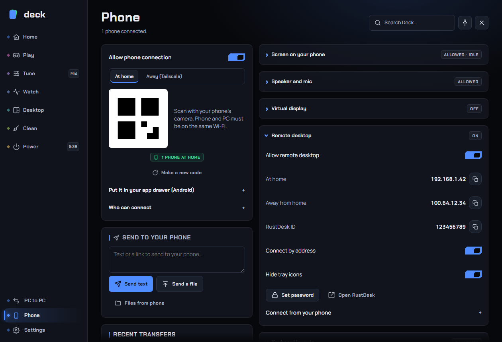

Where to find it: Connections › Phone

# Phone

The Phone page turns your phone into a remote for your PC: sound, media, timers, power, text and files both ways, and, if you allow it, the PC's screen, a controller, and the phone as speaker or microphone.

You scan a code once; the phone opens a small web app (in its browser, or the Deck Android app). The tabs are **Connect**, **Transfers**, **Screen**, **Speaker & mic** and **Layouts**. On a new install the remote is off: turn on **Phone connection** first.

## What you need

- A phone with a browser.
- At home: phone and PC on the same network. Windows Firewall must allow Deck; with administrator, Deck adds a "Deck phone remote" rule for private networks.
- Away from home: the free Tailscale app on both, signed in to the same account.
- Optional: VB-CABLE for the phone as a microphone, RustDesk for remote desktop, and the ViGEmBus driver for the phone as a controller.

## Connect

### Connecting a phone

1. Turn on **Phone connection**. A QR code appears.
2. Scan it with the phone's camera.
3. The phone warns that the page is not private, because Deck made its own certificate. Choose **Advanced**, then **Proceed** (the pairing list says **Browser warns “not private”: Advanced › Proceed**). The Deck Android app skips this step.
   The Deck Android app can also take the link by hand: under the QR code, **Copy link**, then paste it in the app's "Enter the link by hand".
4. The page shows your PC's name and the controls. The first time it shows **Not secure? Expected**; **Got it** hides it.

To add it to the home screen, open **Install on phone**: scan the code and choose ⋮ › Install app. If Chrome offers no Install app, follow the steps under **No Install app?** (`chrome://flags`, **Insecure origins treated as secure**). **Get the Android app** shows a code for the app download when one is available.

The server listens on port 47830, HTTPS only. The code holds a key and the certificate's fingerprint; afterwards every request is signed and works only once, so the key never travels again.

**Make a new code** replaces the key. Phones with the old code are disconnected and must scan again. Use it after losing a phone or showing the code to someone you don't trust.

The chips under the code count phones connected **At home** and **Away**.

### Away from home

With Tailscale on this PC, a switch offers **At home** and **Away from home**.

1. Install Tailscale on the phone. If none of your phones is on Tailscale yet, the Away view shows a code to get the app (**Scan this to get Tailscale**) and the account to sign in with.
2. Sign in with the same account as this PC and turn Tailscale on.
3. Scan the Away code. It works anywhere while the phone is connected in Tailscale. **My phone is set up: show the code** skips the guide.

Nothing is opened to the internet.

### Why can't my phone reach this PC?

Under **Your phones**, this lists read-only checks: the connection is on, the port is free, the network profile, the firewall rule, and this PC's addresses. Each says **OK**, **Needs fixing**, **Worth checking**, **Unknown** or **Note**, with a **Fix:** line where it helps. Below are the **Pairing links** for **At home** and **Away from home**, with copy buttons.

If the last phone runs a Deck app this Deck no longer supports, a banner asks you to update the phone app.

### Connection limits

| Setting | What it does | Default |
|---|---|---|
| **Phones at home** | How many phones may connect at once: **No limit**, 1, 2, 3 or 5. | No limit |
| **Phones away** | The same, through Tailscale or from outside this network. | No limit |
| **Home phone shuts out away phones** | While a phone is connected at home, away phones can't connect. | Off |
| **Away phone shuts out home phones** | The reverse. | Off |

A phone counts once. Changes apply to new connections.

### Power commands

| Setting | What it does | Default |
|---|---|---|
| **Allow power commands from phones** | Lets phones shut down, restart, sleep, hibernate and sign out. Lock and Screen off always work. | On |
| **Ask here before a phone powers this PC off** | The PC shows a notification first; choose Allow within 30 seconds or it is canceled. | Off |

Turn on **Ask here before a phone powers this PC off** if someone else could pick up your phone.

## What the phone page can do

The page has four tabs: **PC**, **Screen**, **Sound** and **Send**; the one you used last opens first.

- **Plan**: a shutdown or sleep plan running on the PC, with Cancel.
- **Screen**: see, and if allowed control, the PC's screen.
- **Now playing**: title, cover, progress, previous, play or pause, and next.
- **Sound**: output devices, the master volume with mute, app volumes (**All apps** for more) and **Chat mix**.
- **Speaker and mic**: when turned on.
- **Voice** (in the Android app: **Sound › Voice**): [Mic and Soundboard](voice.md) from the phone. **Turn Voice on** starts it with the same checks as the PC (it says why when it can't), then **Mute**, **Stop all** and **Clean and stop**, a light that shows when you talk, the **To others** level and **Processing**. Pick an effect (starred ones first, **All effects** for the rest). Search the soundboard, filter by **Favorites**, **Short** or **Long**, tap a sound to play it and tap it again to stop just that one; **Others hear** and **You hear** set the soundboard levels. **Say it** speaks typed text (up to 500 characters) into the call and keeps nothing. On the web page, **Vibrate on taps** turns the tick off. A Deck from before this shows **Update Deck on the PC**.
- **Chat mix**: the Game to Chat balance, next to the volumes (its program lists are set on the PC).
- **PC**: Deck game mode, the Deck bar, Keep awake, Lock, Screen off, Sleep, CPU and GPU profiles, quick plans (**Snooze 15 min** on a running plan) and live temperature, memory, network and power. **Restart** and **Shut down** are in their own **Power** card.
- **Deaths**: the open game's death counter with **+1 death** and **Undo**, for when the screen reader misses one.
- **Microphones** (Sound): the PC's microphones as Mixer > Devices lists them, each with mute, level, **Boost** where the driver has one, and **Apps and games** or **Calls** to choose which one is used. A Deck from before shows **Update Deck on the PC**.
- **Batteries**: controllers, headsets and mice with their level, lowest first.
- **Alerts**: the PC's recent notifications.
- **Android app only**: **Output profiles** on Sound › Mixer, **+5** on a running timer, and a **Stats** page (tap the numbers card on the PC page, **Big view**): the PC's load, temperatures, power, clocks and network as large tiles, with the screen kept on, for a second screen while you play. In the Android app's Settings, under **PC controls**: **Volume keys control the PC** (off; the phone's volume keys change **Device volume** while the app is open) and **Media controls on the lock screen** (on; the PC's player on the phone's lock screen while connected). When the PC doesn't answer, **Wake the PC** sends a wake-on-LAN packet; it needs a code made by this version of Deck and the PC set up to wake (see Wake readiness on PC to PC).
- **Output profiles**: your saved output profiles as chips in the Sound card (they never change the microphone).
- **Timers**: 5 to 60 minutes or any number of minutes, with running timers and **+5** to add five minutes.
- **Send to PC**: text or a link (**Copy on PC**, **Open on PC**), files, and **PC clipboard** to get what is on the PC's clipboard right now (only when you tap it; private copies and text over 1 MB are not sent). In the Android app a **Mute voice** button joins the notification while Voice is on.
- **Between phone and PC**: what was passed each way.

Power buttons ask the phone user first, and plans warn on the PC. "Sleep in 30 min" counts on the PC's clock. Files shared to Deck from another app are copied first, so a big file needs that much free space on the phone until it is sent.

## Transfers

- **Send to phone**: type text or a link and press **Send text**, or **Send a file**. Until a phone connects it says **Connect your phone to send text or files**.
- **Files from phone** opens the folder for files from the phone (Downloads\From phone). Text from the phone goes to the PC's clipboard.
- **Passed between phone and PC**: recent transfers marked **From phone** or **To phone**, with **Show in Explorer**, open, copy and **Remove from list** (the file stays).
- **Upload limits**: **Largest file a phone may send** and **Most space phone uploads may use** (**No chosen limit**, 100 MB, 1 GB, 10 GB or 100 GB). Uploads always leave 2 GB free on the drive.

You can also send to the phone from the [Clipboard](clipboard.md) page.

## Screen

### Right now

**Streaming now** or **Nobody is watching**, the permission, and while someone watches: **Round trip**, **Frame rate**, **Video format** and **Data use** (Mb/s).

### Screen on phone

| Setting | What it does | Default |
|---|---|---|
| **Screen access** | **Off**, **View** (watch only) or **Control** (also tap, click and type). Control asks once: "A paired phone can then click and type on this PC as you; it pauses while a game is in front." Only paired phones can connect. | Off |
| **Picture size** | **Full**, **Medium** or **Small**. Full keeps small text sharp. | Full |
| **Frame rate** | 15, 24, 30 or 60 fps. | |
| **On a slow link** | What to give up first: **Smooth** (keep the frame rate, shrink the picture), **Balanced** or **Sharp** (keep the picture, drop frames). | Balanced |
| **Advanced picture** › **Data use (bitrate)** | **Auto** or a fixed limit in Mb/s. | Auto |
| **Advanced picture** › **Video format** | **H.264 (less data)** or **JPEG**, for every phone. A phone's own Video choice applies to that phone only. | H.264 |

The picture goes over your own network only.

### On the phone

Tap **See the PC's screen** (or **See and control the PC**). The picture fills the screen with a small handle on the edge; tap it for the menu:

| Menu item | What it does |
|---|---|
| **Keyboard** | Types on the PC as you type. A keyboard or mouse connected to the phone works too. |
| **Mouse mode** | **Trackpad** (default) or **Touch**. |
| **Keys** | Ctrl, Alt, Shift, Win, Lock, Task Manager, Esc, Tab, Alt+Tab, arrows, F1-F24. Windows does not let a remote tool send Ctrl+Alt+Del, so **Lock** and **Task Manager** are there instead. The row also rides above the phone keyboard while it is open. |
| **Right-click**, **Hold click** | Click modes for Touch mode and games. |
| **Controller**, **My keys** | The on-screen game pad and your own buttons. |
| **Quality** | **Smooth**, **Balanced**, **Sharp** or **Custom** (the bitrate, frame rate and size choices show only for Custom). Also **Pointer speed** (0.5x to 2x), **Natural scroll**, and **Lock the PC when I disconnect** (off by default). |
| **Fill**, **Gestures** | **Fill** makes the picture cover the whole view (slide to see the rest), for a phone whose shape is not the PC's. **Gestures** shows the table below. The view turns with the phone, portrait too. |
| **Screen** | Which monitor, when there are several. |
| **Fit PC to this phone** | Off by default, remembered on each phone. Gives the PC the shape of your phone so there are no black bars (like Chrome Remote Desktop's "Resize desktop to fit"). Needs the virtual display (below) and Deck running as administrator; otherwise the switch says so and nothing changes. It does nothing when the phone's shape is the PC's. |
| **Sound**, **Stats**, **Fit to screen**, **Full screen** | Switches. **Stats** shows the route, frame rate, delay, data rate, size and how long the phone takes to decode a picture. |
| **Control**, **Disconnect** | Control is remembered (the PC must still allow it). |

The gestures (the Android app has the same table, under menu › Gestures):

| Gesture | What it does |
|---|---|
| Tap | Click |
| Two-finger tap | Right-click |
| Three-finger tap | Middle-click |
| Three-finger swipe up | Keyboard |
| Slide | Move the pointer |
| Tap then slide, or hold then slide | Drag |
| Two-finger slide | Scroll |
| Pinch | Zoom |

In Touch mode a tap clicks where you touch and a long press right-clicks. When the picture is zoomed in, it follows the pointer so the pointer never leaves the view. A two-finger scroll keeps going for a moment after you lift your fingers. A "Weak connection" note shows on the picture when it arrives late or pictures are dropped.

Taps and keys pause while a game is in front unless **Control in games** is on in the phone's menu (off by default). Some online games' anti-cheat may dislike input from another device, so leave it off for those. Deck sends normal Windows input, like any remote desktop tool.

### Use as a controller

In Control mode, **Use as a controller (no screen)** on the phone shows only a game pad, with the lowest delay and little data. The PC sees an Xbox 360 controller (players 1 to 4, one per phone). It needs the free ViGEmBus driver. Arrange its parts on the **Layouts** tab.

### Virtual display

Optional: gives the Screen view a screen when the monitor is unplugged or the lid is closed. It uses the free, signed Virtual Display Driver and isn't installed until you press **Install the virtual display**.

- **Use it**: **Off**, **No monitor** (on only while no real monitor is connected) or **Always**. With Always, Windows treats it as a second screen, so windows can drift onto it. Automatic switching needs administrator.
- **Uninstall** removes the device and driver.

**Fit PC to this phone** (a switch in the phone's Screen menu, in the Android app and the phone page) uses it too. While the phone watches with the switch on, Deck saves the PC's display layout, gives the virtual display a size with the phone's shape (the longest side up to 2560 pixels) and makes it the only display. **The PC's real monitors go dark meanwhile**, and windows move to the virtual display. The layout comes back, exactly as it was, when you stop watching, the phone disconnects or goes to the background, you turn the switch off, Deck quits, or pictures go unanswered for 30 seconds. If Deck or the PC ended while it was changed, the next start puts it back (saved in `fit-layout.json` in Deck's data folder). Don't use it while a game is running.

### Remote desktop

Another way to see and control the PC, with RustDesk (free, open source).

1. Press **Install RustDesk**.
2. Turn on **Allow remote desktop** (off stops RustDesk completely).
3. **Set password** (at least 8 characters; asked when you connect).
4. On the other device, install RustDesk and enter the **At home** or **Away from home** address (Away needs Tailscale), then the password.

**Connect by address** connects straight to this PC (port 21118), not through RustDesk's servers. **RustDesk ID**, **Hide tray icons** and **Open RustDesk** are there too.

## Speaker & mic

### Use phone as speaker

1. Turn on **Use phone as speaker**.
2. On the phone, tap **Use phone as speaker** in the Speaker and mic card.

The PC's sound plays on the phone, about a third of a second late over Wi-Fi. **PC speakers off while playing** (on the phone) mutes the PC meanwhile. Keep the phone page open.

### Use phone as microphone

Windows only lists microphones made by a driver, so the phone mic goes through VB-CABLE, a free virtual audio cable from VB-Audio. Deck can't include it, so:

1. Turn on **Use phone as microphone**.
2. If VB-CABLE is installed but off, press **Turn VB-CABLE on** (needs administrator). If it isn't installed, press **Get VB-CABLE**: Deck downloads VB-Audio's own package, checks its signature and opens its setup. Click **Install Driver**, then restart the PC.
3. On the phone, tap **Microphone: open the secure page**, accept the warning once, tap **Use phone as microphone** and allow the mic. A bar moves when you talk.
4. In Discord, the game or the call app, choose **CABLE Output** as the microphone, or turn on **Default mic while the phone talks** here (your mic comes back when it stops).

While voice effects run, the phone mic goes through the same clean-up and effects as the PC mic. Deck notes what it muted or switched, so it can undo it after a crash.

### If something doesn't work

- **No sound on the phone:** tap the phone page once (phones mute until touched) and check its volume.
- **The PC is silent:** Windows may have switched to VB-CABLE; pick your speakers again with the buttons Deck shows.
- **The bar moves but nobody hears you:** choose CABLE Output in the app's voice settings.
- **Echo:** use headphones on the phone, or keep its volume low.
- **It stops when the screen turns off:** keep the phone page open.
- **Choppy or late:** move closer to the router or use USB tethering.

## Layouts

### Phone button layouts

The phone's controller page has a keyboard button with a full keyboard, a gaming set (WASD, mouse buttons, a mouse pad) and your own buttons: keys or combos, mouse buttons, a touchpad, scrolling, typed text, macros (`ctrl+c, wait 200, ctrl+v`) and **Run on PC** buttons. A button can hold while touched, fire once, or stay on until pressed again.

| Control | What it does |
|---|---|
| **Edit** | Opens the layout on a drawing of the phone held sideways: drag to move, drag a corner to resize, set keys, color and size. Save sends it to every phone. |
| **Rename**, **Copy**, **Delete** | Copy puts the layout on the clipboard as text, for **Import a layout** on another PC. |
| **Use for a game** | Shows that layout while the game is in front, then your previous one. |
| **Switch layout by game** | Turns that on or off. On by default. |
| **New layout**, **Start from a layout** | An empty layout, or a copy of a starter (Presenter, Media, Browser) with **Use this**. |
| **Import a layout** | Paste text copied from another PC. |

A **Run on PC** button runs one action from Deck's fixed list (**Does**): mute the mic or sound, switch a CPU or GPU profile, Keep awake, the Deck bar, lock, sleep or screen off. Sleep, lock and screen off follow **Allow power commands from phones**.

If no layouts show, open the controller page on the phone and tap ⌨ once: the Keyboard and Gaming layouts appear.

Keys pause while a game is in front unless **Allow keys in games** is on in the phone's keyboard settings. When a game comes to the front, held keys are released and a macro stops. If the PC stops hearing from the phone, it lets go of every key.

### Controller layout

**Edit the layout** moves and resizes the on-screen controller's sticks and buttons; every phone shares it. **Put every part back** restores the default.

## Recommended setup

- Keep **Phone connection** on only if you use it, and turn on **Ask here before a phone powers this PC off** if others can use your phone.
- Use Tailscale away from home; don't forward ports on your router.
- **View** is enough to check a download. Use **Control** on purpose and turn it off when done.
- For gaming, leave **Control in games** off and use the controller with a layout per game.

## Troubleshooting

**The phone can't connect.** Both on the same network (not a guest network)? PC awake? **Phone connection** on? Firewall allows Deck? Try **Why can't my phone reach this PC?**, or **Make a new code**.

**The phone warns the page isn't secure.** Expected; accept it once. If it asks again, the PC's address changed and Deck made a new certificate; the saved code still works in the browser. The Android app, once it has connected with this version, stays paired when that happens; an app paired earlier shows "This PC's security certificate changed" once, and scanning the QR code again fixes it.

**"This PC is busy" or "Update the app".** The PC has no room for another phone session right now (the app tries again in 10 seconds), or the app is older than Deck on the PC supports (update the app).

**The Android app and battery.** With the app closed, the link stays up only while "Stay connected" is on; a PC that is off or asleep is then tried every few seconds at first and later only every few minutes, and the PC sends its state every 5 seconds instead of every 1.5. Android may stop the background link after about 6 hours; Deck says so in a notification, and a tap reconnects.

**No QR code.** The connection is off, or the certificate couldn't be made (the page says why).

**The phone connects only through Tailscale.** The Android app tries the home address first on every reconnect and repairs itself once it reaches the PC at home. If the Phone page says **Network set to Public**, tap **Open network settings** and set the network to Private.

**Away, the phone never connects.** Tailscale must be on and signed in on both with the same account.

**The screen is black or laggy.** Choose **Smooth** under **On a slow link**, or lower **Picture size** or **Frame rate**. With no monitor, install the virtual display.

**Taps do nothing on the PC.** **Screen access** must be **Control**, Control must be on in the phone's menu, and no game may be in front (or **Control in games** on).

**The phone mic doesn't work.** Check Deck shows **VB-CABLE ready**, the bar moves on the phone, and the app uses CABLE Output.

## FAQ

**Is it safe?** Every request is signed with a key that never leaves your devices and works only once, and the connection is encrypted. Anyone who scans your code can use what you allowed, so treat the code like a password and **Make a new code** after sharing it.

**Does it work away from home without Tailscale?** No. Deck doesn't open your router to the internet.

**Is it safe with anti-cheat?** The remote doesn't touch games. Phone input pauses in games unless you allow it, and the controller appears as an ordinary Xbox 360 pad.

**What does Deck change on my PC?** A firewall rule for its port, and, while the phone plays or talks, your default speakers or mic (restored afterwards, also after a crash). VB-CABLE, the virtual display and RustDesk are installed only when you press their buttons.

**How many phones can connect?** As many as **Connection limits** allow; no limit by default.
