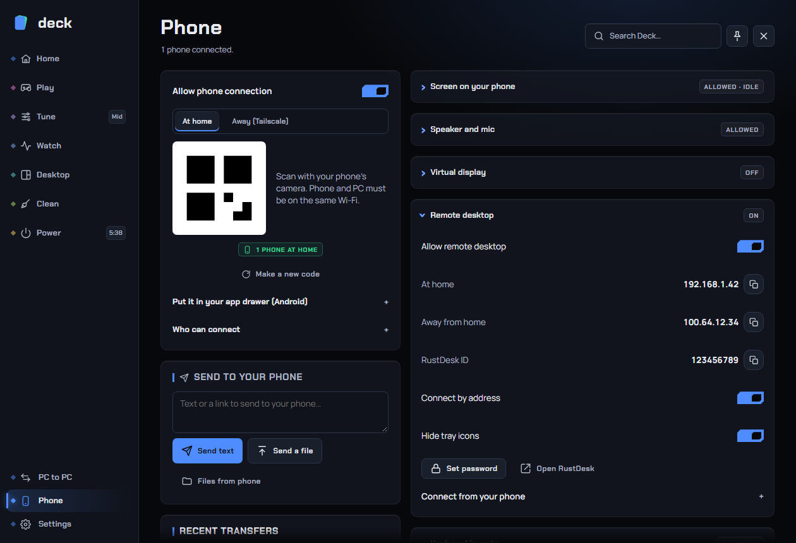

# Phone

The **Phone** page turns your phone into a remote for your PC. You scan a code once, and the phone opens a small web app (it works in the browser and can be added to your home screen) with sound controls, media buttons, timers, power controls, a way to pass text and files both ways, and, if you turn them on, a live view of the PC's screen, an on-screen controller and keyboard, and the phone as the PC's speaker or microphone.

Find it at the bottom of the sidebar: **Phone**. The tabs are **Connect**, **Transfers**, **Screen**, **Speaker & mic** and **Layouts**. Deck remembers the tab you used last.

---

## What you need

- Windows PC running Deck, and a phone with a browser.
- For home use: both on the same network (Wi-Fi or cable). Windows Firewall must allow the connection: when Deck has administrator rights it adds a firewall rule called "Deck phone remote" for private and domain networks.
- For away from home: the free Tailscale app on both the PC and the phone, signed in to the same account.
- Optional: VB-CABLE (free) only for using the phone as a microphone; RustDesk (free) only for the remote desktop option; the ViGEmBus driver for the phone as a controller (see the Screen section).

---

## Tab 1: Connect

### Allow phone connection

| Setting | What it does | Default |
|---|---|---|
| **Allow phone connection** | Turns the phone server on or off. Off, nothing listens and no phone can connect. | On |

While it is on, the server listens on port 47830 on your network. It speaks HTTPS only: Deck makes a self-signed certificate for this PC's addresses. Because the certificate is Deck's own, your phone warns once ("not private" or "not secure"); choose Advanced and Proceed. If a plain http address is tried, Deck answers with one page that sends you to the https address, and the connection is closed before it reaches your router. If a certificate cannot be made, the server does not start and the page tells you why.

### Connecting a phone

1. Make sure **Allow phone connection** is on. A QR code appears.
2. Scan it with the phone's camera (the phone and PC must be on the same Wi-Fi or network).
3. Open the page. It shows your PC's name and the controls.
4. Optional: add it to your home screen from the browser menu so it opens like an app.

The code carries a key and the certificate's fingerprint. The key itself never travels over the network afterwards: the page opens a session and signs every request, and each signed request works only once. Requests must name this PC, and the page uses a content-security policy.

**Make a new code** replaces the key. Phones using the old code are disconnected and must scan again. Use it if you scanned the code in front of someone you do not trust, or after losing a phone.

The status chips under the code show how many phones are connected "at home" and "away". A phone is counted once, whatever it has open.

### At home / Away (Tailscale)

When Tailscale is available, a switch shows **At home** and **Away (Tailscale)**. For away from home:

1. The phone needs Tailscale too. If none of your phones is on your Tailscale network yet, the Away view shows a code that opens the Tailscale app in the phone's store, and the account to sign in with.
2. Sign in with the same account as this PC and turn Tailscale on (allow its VPN).
3. Scan the Away code, or use the PC's Tailscale address. It works anywhere while the phone is connected in the Tailscale app. If your phone is already set up, **My phone is set up: show the code** skips the guide.

Tailscale is a private network: nothing is opened to the internet.

### Put it in your app drawer (Android)

Chrome on Android only offers "Install app" for trusted pages. Deck's certificate is its own, so in Chrome open `chrome://flags`, find **Insecure origins treated as secure**, add the address shown on the page, set it to Enabled, relaunch, scan the code, and choose the menu > Install app. This is only for the app-drawer icon; the page works without it.

### Don't have the Android app yet?

If an app download is available, a QR code in this fold gets the file to your phone. You can also just use the web page.

### Who can connect

Open the **Who can connect** fold.

| Setting | What it does | Default |
|---|---|---|
| **Phones at home at a time** | No limit, 1, 2, 3 or 5. | No limit |
| **Phones away at a time** | The same, for phones using Tailscale. | No limit |
| **A phone at home shuts out phones away** | While a phone is connected at home, away phones cannot connect. | Off |
| **A phone away shuts out phones at home** | The reverse. | Off |

Changes affect new connections. "Away" means via Tailscale or from outside this network.

### Power and uploads

These live in **Settings › Connections** (*Phone*).

| Setting | What it does | Default | Recommended |
|---|---|---|---|
| **Allow power commands from phones** | Lets phones request shutdown, restart, sleep, hibernate and sign-out plans. Off blocks them; Lock and Screen off stay available. | On | Off if others can use your phone. |
| **Ask here before a phone powers this PC off** | Shows a notification on the PC before a phone's shutdown, restart, sleep or hibernate runs. Choose Allow within 30 seconds; ignoring it cancels. Lock and Screen off need no approval. | Off | On, unless the PC has no screen you watch. |
| **Largest file a phone may send** | The largest single file a phone may upload: no limit, 100 MiB, 1 GiB, 10 GiB or 100 GiB. | No limit | |
| **From-phone folder limit** | The most the "From phone" folder may hold, with the same choices. Unfinished uploads count. | No limit | |

Uploads always leave 2 GiB free on the drive.

---

## What the phone page can do

When connected, the phone page shows cards for:

- **Plan**: any shutdown/sleep/restart plan running on the PC, with Cancel.
- **Screen** (when you allowed it): see, and optionally control, the PC's screen.
- **Now playing**: title, artist, cover, progress and previous / play-pause / next. When the player has no previous/next, the buttons jump 10 seconds instead.
- **Sound**: the playback device chips, the master volume ("Everything") with mute, and per-app volumes (the two loudest, **All apps** shows more).
- **Speaker and mic**: when you turned those on.
- **PC**: Game mode and Clean up background (the Gaming page's actions), the Game bar on the PC, Keep awake, Lock, Screen off, Sleep, Restart, Shut down, your CPU and GPU profile chips, quick plans (Sleep in 30 min / 1 h, Off when downloads finish, Sleep when music stops) and live temperature, memory, network and power readings.
- **Timers**: 5, 10, 15, 25 or 60 minutes, with the running timers.
- **Send to PC**: text or a link (**Copy on PC**, **Open on PC**), **Send files**, and **PC clipboard** to get what is on the PC's clipboard.
- **Between phone and PC**: what has been passed back and forth, with download, open and copy buttons.

Power buttons ask the phone user to confirm. Shutdown, restart and sleep plans warn on the PC first.

---

## Tab 2: Transfers

### Send to your phone

Type text or a link and press **Send text**, or press **Send a file** to pick a file. Both reach the connected phone. **Files from phone** opens the folder that receives files sent from the phone (Downloads\From phone). Text sent from the phone goes to the PC's clipboard.

Until a phone is connected, a note says "Connect a phone to receive text or files."

### Passed between phone and PC

A list of recent transfers, newest first, each marked "From phone" or "To phone". Buttons: show in folder, open (links), copy (text and links), remove from list (the file itself is not deleted).

You can also send the selected text or a copied file to the phone from the [Clipboard](clipboard.md) page.

---

## Tab 3: Screen

### Screen on your phone

| Setting | What it does | Default |
|---|---|---|
| **Screen access** | **Off**: no screen access. **View only**: the phone can watch. **View and control**: the phone can also tap, click and type on the PC. | Off |
| **Picture size** | The largest the picture may be: **Full**, **Medium** or **Small**. Full keeps small text sharp. | Full |
| **Smoothness** | 15, 24, 30 or 60 frames per second. | 30 |
| **Bitrate** | **Auto** (follows your connection), a fixed limit from 0.5 to 30 Mb/s, or **Type...** for your own. | Auto |
| **Slow connection** | **Smoother** (keep motion, may blur) or **Sharper** (keep detail, may drop frames). | Smoother |
| **Video** | **H.264** (light on data) or **JPEG**. | H.264 |

A chip shows "N watching" when someone is viewing. The picture is the PC's screen (DXGI capture with a fallback), sent over your network only; nothing goes through an outside server.

On the phone: tap **See the PC's screen** (or **See and control the PC**). The bar has Close, full screen, **Control** on/off, sound from the PC, keyboard, Keys, Right-click, **Controller**, **My keys**, Hold click, Fit, a monitor picker, and a settings panel for bitrate, frame rate and picture. Tap to click, hold for right-click, slide to move the pointer, two fingers to scroll or zoom (view only: pinch to zoom).

Safety notes:

- Control is off until you choose View and control **and** turn Control on in the phone.
- **Control in games** is a phone-side setting, off by default: taps and keys pause while a game is in front unless you allow them. Some online games' anti-cheat may not like input that arrives from another device, so leave it off for those games. Deck sends the input through normal Windows input, as any remote desktop tool does; it does not inject into the game.
- The PC's sound can be played on the phone while viewing.

### Use as a controller

In View and control mode, **Use as a controller (no screen)** on the phone gives you only an on-screen game pad with the lowest delay and almost no data or battery use. The PC sees a virtual Xbox 360 controller, for players 1 to 4 (several phones are several players). This needs the free ViGEmBus driver on the PC. The pad can be shown over the screen view as well. Controller parts can be moved and resized on the **Layouts** tab.

### Virtual display

Optional. Gives the Screen view (and remote desktop) a screen to show when the monitor is unplugged or a laptop lid is closed. It uses the free, signed Virtual Display Driver (by VirtualDrivers, MIT licence). It is **not installed** until you press **Install the virtual display**.

| Control | What it does |
|---|---|
| **Use it** | **Off**, **When no monitor is connected** (it turns on by itself with no real monitor, off again when one returns), or **Always**. Switching applies at once. |
| **Uninstall** | Removes the device and driver after confirming. The Screen view then needs a real monitor. |

Notes: with **Always** and a real monitor connected, Windows treats the virtual display as a second screen, so windows can drift onto it. Automatic switching needs Deck's admin rights. Installation uses administrator rights and downloads the pinned driver package, verifying its checksum and signer.

### Remote desktop app (RustDesk)

An alternative way to see and control the PC from a phone or another computer, using RustDesk (free, open source).

| Control | What it does |
|---|---|
| **Install RustDesk** | Downloads and installs it; shows progress with Cancel. |
| **Allow remote desktop** | Master switch. Off stops RustDesk completely, also after a restart. |
| **At home** / **Away from home** | The addresses to type into RustDesk on the other device (copy buttons). Away needs Tailscale (the row offers Get it / Sign in). |
| **RustDesk ID** | RustDesk's own ID. |
| **Connect by address** | Direct connection to this PC (port 21118), not through RustDesk's public servers. |
| **Hide tray icons** | Hides the RustDesk and Tailscale tray icons; they keep working. |
| **Set password** | At least 8 characters. Asked when you connect. Set one before you use it. |
| **Open RustDesk** | Opens the RustDesk window. |

To connect from a phone: install RustDesk on the phone, enter the address, then the password. Away from home the phone needs Tailscale too.

---

## Tab 4: Speaker & mic

### Phone as speaker

Turn on **Phone as speaker**, open the phone page and tap **Phone as speaker** in its Speaker and mic card. The PC's sound plays on the phone. **PC speakers off while playing** (on the phone) mutes the PC's default output while the phone plays and brings the sound back after. Over Wi-Fi expect about a third of a second of delay. Keep the phone page open: it keeps the screen on while playing. Wi-Fi only.

### Phone as mic

Turn on **Phone as mic**. Windows only lists a microphone that a driver creates, and Deck has no driver of its own (a test-signed driver would break many anti-cheats), so the mic goes through **VB-CABLE**, a free virtual audio cable from VB-Audio. Its licence does not allow bundling it, so Deck does the following:

1. If VB-CABLE is installed but turned off, **Turn VB-CABLE on** enables it (needs Deck's admin rights).
2. If it is not installed, **Get VB-CABLE** downloads VB-Audio's own package unchanged, checks it is signed by VB-Audio and opens VB-Audio's setup. Click **Install Driver**, then restart the PC once.
3. On the phone, tap **Mic: open the secure page**, accept the certificate warning once, tap **Phone as mic** and allow the microphone. A bar moves when you talk.
4. In Discord, the game or the call app, choose **CABLE Output** as the microphone, or turn on **Make it the default mic while the phone talks** here (your previous microphone is restored when the phone stops).

If VB-CABLE became your default speakers by mistake, Deck shows buttons to pick your real speakers again.

When the phone is playing or talking, Deck writes down what it muted or switched first, so it can put everything back after a crash.

### If something does not work

- **No sound on the phone:** tap the page once (phones mute until touched) and check the phone's volume.
- **The PC is silent:** Windows may have switched to VB-CABLE; pick your speakers again with the buttons.
- **The bar moves but nobody hears you:** the app is not set to CABLE Output.
- **Echo:** use headphones on the phone or keep its volume low.
- **It stops when the screen turns off:** keep the phone page open.
- **Choppy or late:** move closer to the router or try USB tethering; about 0.1 s of delay is normal.
- **"Not secure" every time:** Deck made a new certificate (the PC's address changed); accept it once more.

---

## Tab 5: Layouts

### Keyboard layouts

The phone's controller page has a keyboard button (the keyboard icon) with a full keyboard, a small gaming set (WASD, mouse buttons, a mouse pad, scrolling) and buttons of your own: any key or combo (such as Ctrl+Shift+Esc), mouse buttons, a trackpad area, scrolling, typed text and macros (such as `ctrl+c, wait 200, ctrl+v`). Each button can hold while touched, fire once, or stay on until pressed again.

On this tab:

| Control | What it does |
|---|---|
| Layout list | Each layout with its button count and the games it is tied to. |
| **Edit** | Opens the layout on a drawing of the phone held sideways. Drag buttons to move them, drag a corner to size them, and set their keys, kind, colour, size and opacity on the side. Undo, Cancel and Save are on top; saving sends it to every connected phone. |
| Rename (pencil) | Renames it. |
| Copy | Copies the layout as text; paste it into **Import a layout** on another PC. |
| Delete | Removes it from this PC and every phone, after asking. |
| **Game** | Ties the layout to a game, by the name Deck shows. When that game comes to the front the phone shows its layout, and restores your previous layout afterwards. |
| **Switch layout by game** | Master switch for that behaviour. On by default. |
| **New layout** | Makes an empty layout and opens the editor. |
| **Import a layout** | Paste text copied from another PC. |

Layouts are stored on the PC and checked for shape and size when saved. If no layouts appear, open the controller page on the phone and tap the keyboard button once: the Keyboard and Gaming layouts are created.

**Keys in games.** Keys pause while a game is in front unless **Allow keys in games** is on in the phone's keyboard settings. When a game comes to the front, whatever the phone holds is released at once and a playing macro stops. The phone sends everything it holds twice a second; the PC lets go of every key if it stops hearing from the phone.

### Controller layout

**Edit the layout** lets you move and resize the on-screen controller's sticks and buttons for when the phone is held sideways. Every phone shares it. **Put every part back** returns everything to the default positions.

---

## Recommended setup

- Keep **Allow phone connection** on only if you use it; turn on **Ask here before a phone powers this PC off** (Settings › Connections) if anyone else can pick up your phone.
- Use Tailscale for away-from-home; do not forward ports on your router.
- Screen access: **View only** is enough for checking on a download or a render. Use **View and control** deliberately and turn off **Control** on the phone when finished.
- For gaming, leave **Control in games** off, and use the Controller mode with a dedicated layout per game.
- For calls from the phone, install VB-CABLE, then use **Make it the default mic while the phone talks**.

## Troubleshooting

**The phone can't connect.** Make sure both are on the same network (not a guest network that isolates devices), the PC is awake, **Allow phone connection** is on, and Windows Firewall allows Deck on private networks (Deck adds a rule when it has admin rights). Try making a new code.

**The phone warns the page is not secure.** Expected: Deck's certificate is its own. Accept it once. If it asks again, the PC's address changed and Deck made a new certificate.

**The QR code does not appear.** The connection is off, or the certificate could not be made (the page says why).

**The phone shows "Connecting to your PC" forever (away).** Tailscale must be on and signed in on both devices with the same account.

**Screen is black or laggy.** Lower the bitrate or picture size, pick 30 fps, or choose Sharper/Smoother for your connection. With no monitor, install the virtual display.

**Taps do nothing on the PC.** Check Screen access is **View and control**, **Control** is on in the phone, and a game is not in front (**Control in games**).

**Phone mic does not work.** Check VB-CABLE shows "VB-CABLE ready", the phone page shows the bar moving, and the call app uses **CABLE Output**.

## FAQ

**Is it safe?** Every request is signed with a key that never leaves your devices, each signed request works only once, the connection is encrypted, and Deck only accepts requests for this PC. Anyone who scans your code can control the things you allowed, so treat the code like a password and use **Make a new code** after sharing it.

**Does it work outside my home without Tailscale?** No. Deck deliberately does not open your router to the internet.

**Is it safe with anti-cheat?** The phone remote does not touch games. Input from the phone reaches the PC like a normal remote desktop tool; it pauses while a game is in front unless you allow it, and some online games may dislike input from other devices. The virtual controller appears as an ordinary Xbox 360 pad.

**What does Deck change on my PC?** It adds a firewall rule for its port, may mute or switch your default speakers and microphone while the phone plays or talks (restored afterwards and after a crash), and can install the optional VB-CABLE, virtual display and RustDesk only when you press their buttons.

**How many phones can connect?** As many as you allow in **Who can connect**. The default is no limit.
