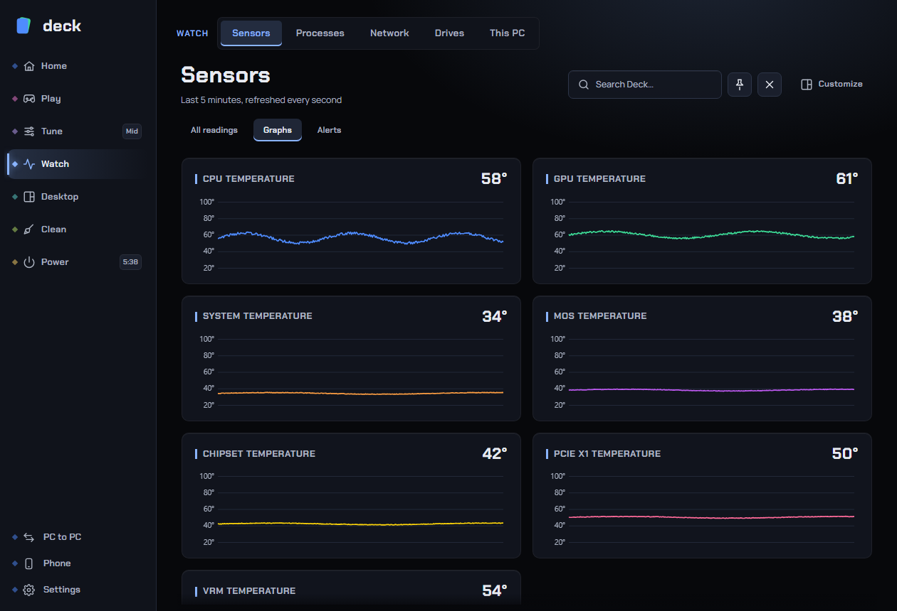

# Sensors

The Sensors page is where you look at what your PC is doing right now and what it did earlier: every temperature, clock, load, power, voltage, fan speed and drive or network reading Deck can find, live graphs for the last five minutes, a day, week or month of history, frame times, and the settings for heat alerts and logging to a file. It only reads: nothing on this page changes your hardware.

**Where to find it:** sidebar > **Watch** > **Sensors**. The page has three tabs: **All readings** (opens first), **Graphs** and **Alerts**. Deck remembers the tab you used last.

*(The screenshot may differ a little from the current layout.)*

Related pages: [CPU](cpu.md), [GPU](gpu.md), [Fans](fans.md), [Overlay](overlay.md) (the same readings drawn over a game), [Alerts](alerts.md) (alert rules and notifications), [Drives](drives.md), [This PC](this-pc.md).

## Contents

- [What you need](#what-you-need)
- [Where the readings come from](#where-the-readings-come-from)
- [The All readings tab](#the-all-readings-tab)
- [The Graphs tab](#the-graphs-tab)
- [The Alerts tab](#the-alerts-tab)
- [Units](#units)
- [Recommended setup](#recommended-setup)
- [Troubleshooting](#troubleshooting)
- [FAQ](#faq)

## What you need

- **Administrator rights** for readings that come through Deck's hardware driver: CPU temperature and power, per-core clocks, and the motherboard's temperatures, voltages and fan speeds. Without them the page shows **One-time set up: Hardware control needs admin rights** with a **Set up** button. One admin prompt, then Deck starts with the rights it needs and never asks again.
- **RivaTuner Statistics Server (RTSS)** for the frametime graph (frames per second, 1 % and 0.1 % lows). See [Overlay](overlay.md); Deck can install it.
- Which readings exist depends on your PC. Laptops, AMD CPUs, graphics cards from other makers and boards with different chips report different sets. The page shows what is there and hides what isn't.

## Where the readings come from

The page can tell you, for any reading, which collector produced it and how far to trust it: open **Where these readings come from** at the bottom of a device on the All readings tab. In short:

| Device | Where the numbers come from | Good to know |
|---|---|---|
| **CPU** temperature | The CPU's own thermal sensor, read through Deck's hardware driver (a thermal register on Intel, the SMN thermal register on AMD). | The **package temperature** is the one fans and alerts use. Intel CPUs report each core; AMD reports one package value. Needs admin. |
| **CPU** clock | Each thread's cycle counters through the driver, else Windows' own estimate. | An average over the last second, not an instant value. |
| **CPU** load | Windows processor performance counters. | How busy it was over the last second. |
| **CPU** power | The CPU's own energy counters, differenced every second. | Power the CPU estimates for itself. It is not measured at the socket or the wall. |
| **CPU** voltage (VID) | The CPU's performance status register. | The voltage the CPU **asks** the board for, not what the board delivers. |
| **GPU** | The graphics driver's own library: **NVIDIA** (NVML) or **AMD** (ADL). Load can also come from Windows' GPU counters. | Board power can differ from what a meter at the wall shows. The GPU's fan reading is the speed it was asked for in percent, not RPM. On graphics from other makers, GPU readings can be missing or limited. |
| **Motherboard** temperatures, voltages, fan speed and duty | The board's monitoring chip (Super I/O), through the hardware driver. | What a temperature is attached to depends on the board; the name is the chip's own. Voltages can be off by a few percent; compare with the BIOS before trusting small differences. A header with no fan reads 0. |
| **Memory** | Windows' memory status and performance counters. | |
| **Drive** | The drive's own sensor through Windows' storage interface (also NVMe and SMART logs), plus Windows disk performance counters for traffic and busy time. | Not every drive reports a temperature. For health see [Drives](drives.md). |
| **Network** | Windows' network adapter counters. | Traffic over the last second. |

Everything is read on your PC; nothing is sent anywhere.

## The All readings tab

This is a table of every sensor, like HWiNFO: for each reading the value **Now**, and its **Min**, **Max** and **Average** since Deck's hardware engine started or since you last reset.

**Left: your devices.** One button per device (for example CPU, GPU, Motherboard, Memory, a drive, a network adapter), each with a headline: how hot it is and how busy it is (or how many fans spin). Click one to see its readings.

**Find a reading...** (the search box above the list) searches every device at once by name. The device list then shows how many matches each device has, and the right side lists every match with its device. Press **Esc** in the box to clear it. If nothing matches it says no reading has that text in its name.

**Right: the device's readings.**

- A table of the single readings (**Reading**, **Unit**, **Now**, **Min**, **Max**, **Average**).
- Readings that repeat for every core or every fan (such as "P-core 3 temperature" or a fan's speed and duty) are folded into one grid, **Cores** or **Fans**, with their **Temp**, **Clock**, **Load**, **Speed** and **Duty** side by side (**Now** and **Max**). A fold underneath, **Minimum and average per item**, holds the rest.
- Temperatures are coloured: amber from 85 C, red from 95 C.
- **Where these readings come from** (a fold): the collector of each reading, a plain-words meaning, and how fresh it is ("Updating", "Last seen 40 s ago").

At the top of the right side:

- **Collecting for N min**: how long the minimum, maximum and average have been running.
- **Reset statistics**: starts the min, max and average again from now. Use it before you test something, so earlier peaks don't hide it.

Rows that are missing a reading show a dash, not a wrong number. A reading that stops arriving shows its age.

## The Graphs tab

Live graphs updated every second. The status line says "Last 5 minutes, refreshed every second".

The **Customize** button at the top moves, resizes, hides and shows the panels on this page (press **Done** to keep the changes, or **Cancel** to undo them). Deck remembers your layout.

| Panel | What it shows |
|---|---|
| **Temperatures** | One small graph for the CPU, one for the GPU, and one for each motherboard temperature (not the CPU's own, which is already drawn), with the latest value. |
| **Load · 5 min** | CPU and GPU load. |
| **Power · 5 min** (**?**) | CPU package power and graphics card board power in watts. Shows what a power limit or undervolt really changed, and what a game draws. CPU power needs admin. |
| **History** (**?**) | A **day**, **week** or **month** of CPU and GPU **Temperature**, **Load** or **Power**. Each point is an average (day: every minute, week: every 10 minutes, month: every hour); the legend says each line's highest value. Gaps mean no readings. It collects only while Deck is running and keeps a small file (well under a megabyte), so a restart can lose up to the last minute to an hour. Use it to compare sustained use with short peaks. |
| **Frametimes** (**?**) | How long each frame took (from RivaTuner) with the average FPS, the **1 % low** and **0.1 % low**, **Lowest** and **Highest**, for the game that is drawing. **Reset** starts the average and lows over (the same as the overlay's reset key). The average hides stutter; the lows and spikes show it. A smooth game is a flat line. Needs RivaTuner running and a game it draws in; otherwise the panel says what is missing. |
| **Fan speeds** | One graph per fan that has reported a speed, in RPM. **Show unused connectors** lists the headers with no speed. |

Frame times are counted while the overlay is on or this page is open.

## The Alerts tab

Alerts and logging are saved together with **Apply changes** (the bar at the bottom: "Draft" with **Discard changes**). Heat alerts are **off by default**.

**Temperature alerts**

| Setting | What it does | Default |
|---|---|---|
| **Warn me when it gets hot** (**?**) | A Windows notification when the CPU or graphics card goes above your limit: it catches a stopped fan, a clogged filter or a runaway overclock before it crashes. At most one alert every five minutes per part, so a long hot game doesn't spam you. The cooler display can show "HEAT" too if you enabled its messages. | Off |
| **CPU above** | 60 to 105 C. | 90 C |
| **GPU above** | 60 to 100 C. | 85 C |
| **Flash the board lights red** | A few seconds of red on the board lights when an alert fires, then your effect returns. See [Lighting](lighting.md). | Off |

**Sensor logging**

| Setting | What it does | Default |
|---|---|---|
| **Log every sensor to a CSV file** (**?**) | Writes every reading from the All readings tab, once a second, to `monitor.csv`, which Excel opens. A new file is started at 50 MB and the latest five are kept, so it can't fill the disk. Use it to see what happened before a crash or to compare two settings over a session. A new header row is written when the set of sensors changes. | Off |
| **Slow readings during games** | While a game is in front, reads drive counters and idle fan chips every three seconds instead of every second, so Deck's own load stays small. Manual fan curves keep their one-second timing. | On |
| **Open folder** | Opens the folder holding `monitor.csv`. | |

**Alert rules** and **Notifications out** (below these two panels) are covered in [Alerts](alerts.md): rules like "this reading above that value for N seconds", with a toast, a message to your phone, flashing lights or a profile switch as the action.

## Units

**Settings > Appearance > Performance and units** picks MHz or GHz, Mb/s or MB/s and degrees C or F for every page, the readings table, the phone and the overlay (see [Settings](settings.md)). Values you type in elsewhere (fan curves, GPU offsets, temperature limits) stay in MHz and degrees C.

## Recommended setup

- For a first look at a new PC, open **All readings** and click through the devices; use **Find a reading...** to jump to what you care about.
- Before and after changing a profile, a fan curve or an undervolt, press **Reset statistics**, run the same game or test, and compare **Max** and **Average**. The **Power** graph shows what a power limit really changed.
- Turn on **Warn me when it gets hot** if you tune the CPU, GPU or fans. The defaults (90 C and 85 C) suit most PCs; lower them if you want an early warning.
- Turn on **Log every sensor to a CSV file** only while you're investigating something, then turn it off.
- Gamers: use the **Frametimes** graph (with RivaTuner running) to see stutter that the FPS average hides, and **History** to compare a week of use.

## Troubleshooting

**The CPU temperature or power is missing.** These need admin rights. Press **Set up** (or open any hardware page and follow the prompt). If readings stay empty, open the readings' **Where these readings come from** fold to see which collector is silent.

**An AMD CPU shows one temperature, not one per core.** AMD reports a single package value.

**A graph or table shows a dash or "Unavailable".** The device doesn't report that value, or the reading stopped arriving. The fold shows how long ago it was last seen.

**The GPU page is missing but Sensors shows my card.** GPU tuning is NVIDIA only; AMD and Intel graphics get sensors only.

**Frametimes says RivaTuner isn't installed / isn't running / no game is drawing.** Install or start RivaTuner (see [Overlay](overlay.md)) and start a game it draws in.

**A fan isn't in the Fan speeds graph.** Only fans that have reported a speed are drawn. **Show unused connectors** lists the rest.

**History is empty.** It only collects while Deck's hardware engine runs. Leave Deck running; the page says "No history yet. Leave Deck running to collect readings."

**Temperatures look different from another program.** Each tool may read a different sensor (package versus core versus board). Compare the same named reading; the **Where these readings come from** fold names what Deck reads.

**monitor.csv grows too big.** Turn **Log every sensor to a CSV file** off. Deck starts a new file at 50 MB and keeps only the latest five.

## FAQ

**Is it safe with anti-cheat?** Deck's sensors never read a game's memory or inject into a game. CPU and board readings come through Deck's signed hardware driver, and GPU readings through your graphics driver's library, as monitoring tools do. The frametime graph uses RivaTuner's own counters. For the one anti-cheat client that refuses to run next to Deck's hardware driver (FACEIT), see [Fans](fans.md#what-happens-with-anti-cheat): Deck stops using the driver while it runs, so readings that need it (CPU temperature, board sensors) can pause.

**Does Deck write anything to my hardware from this page?** No. The only things written are Deck's own files: `monitor.csv` (if you turn logging on) and the history file in Deck's settings folder.

**Does monitoring slow my game?** Readings are taken once a second, and with **Slow readings during games** on, the heavier ones every three seconds while a game is in front. The numbers cost very little.

**Can I see these readings over my game?** Yes: the [Overlay](overlay.md) page draws chosen readings in the game through RivaTuner.

**Why do min, max and average start empty?** They start counting when Deck's hardware engine starts and restart when you press **Reset statistics**.

**Where is the history stored?** In a small file in Deck's settings folder (`hardware`). It is bounded to well under a megabyte however long Deck runs.

**Can I export the data?** Yes: turn on **Log every sensor to a CSV file** and open the file in Excel or any tool that reads CSV.

**What does Deck do with the alerts?** Shows a Windows notification, optionally flashes your board lights, and can pass the message on if you set up **Notifications out** (see [Alerts](alerts.md)).
