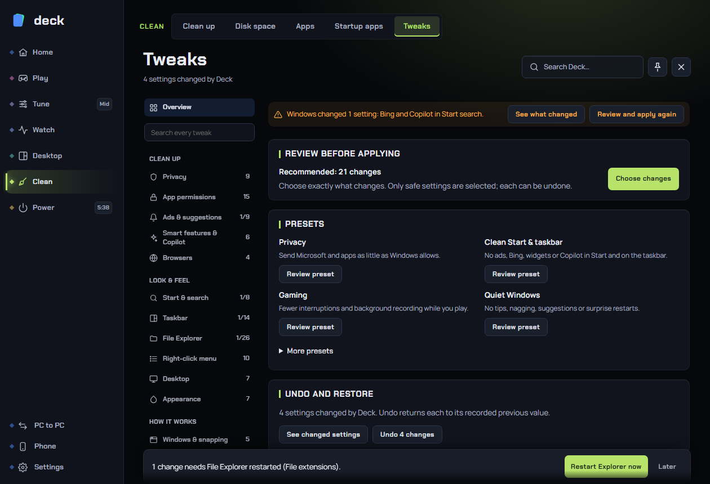

Where to find it: Startup › Windows tweaks

# Windows tweaks

A searchable panel of Windows settings that shows each one's real value now and undoes any change to the exact value it had before.

There are 193 tweaks in 19 categories. A tweak shows only if your Windows version and edition have it (see [Tweaks that are hidden](#tweaks-that-are-hidden)). The recipes come from Win11Debloat and WinUtil (both MIT) plus Deck's own, each reviewed. Nothing here removes Microsoft Edge, turns off Windows Update or Defender, or activates Windows.

## How tweaks work

### A row

| Part | Meaning |
|---|---|
| Name | What the setting controls (**Copilot button**, **Activity history**). |
| **Advanced** chip | A tweak that can reduce protection, stability or update safety. |
| Tradeoff chip | What you give up, in a few words, or **Has a tradeoff**. |
| **Restarts Explorer**, **Sign out to finish**, **Restart to finish** | What has to happen before the change takes full effect. |
| Control | The state in words beside a switch: **On** / **Off**, or the result (**Shown** / **Hidden**, **Allowed** / **Blocked**). A value that isn't Windows' default is bold. Choices use buttons or a list. |

The control always shows Windows' current value, so a change made in Windows' own Settings shows too. When a choice holds a value none of its options match, it shows **Custom** with that value, for example "Custom: 300" for a 300 ms menu delay, or your own DNS servers.

If another tool set only some parts of a tweak, the row shows **Mixed** with how many parts match, and offers all on or all off.

Select a row for details on the right: its state, what you gain and give up, the registry values it sets (with **Now** and Windows' default), the recipe's source, and when Deck changed it.

### Risk levels

Of the 193 tweaks, 123 are safe, 48 have a tradeoff (location, Game Bar, automatic Store updates) and 22 are **Advanced** (Recall, Memory integrity, reserved storage).

**Advanced** tweaks open **Review change** first, with the setting as now and after, the effect and the registry values. **Apply 1 change** then offers a restore point (once per session; Windows allows one a day). Turning Recall off asks **Delete all Recall snapshots?**; **Unpin all Start apps?** also confirms.

### Draft changes

Turn on **Draft changes** (beside the filters; off each time Deck opens) to collect changes before writing anything.

1. Change tweaks as usual. Each row shows **Draft:** and your choice; Windows isn't changed.
2. Press **Review N changes**. Each shows now and new, its effect and tradeoff. Clear any you don't want.
3. Press **Apply N changes**. They are applied in order, each with its own undo.

Afterwards each tweak shows **Applied**, **Not confirmed yet** or **Failed** with the reason, with **Undo** on those made. **Discard draft** drops the choices.

### What Undo restores

Before a change, Deck records exactly what was there: the value and type, "not set", a service's start type or a task's state. **Undo** puts back that value, not a textbook default, even months later. Applying a tweak twice never overwrites the first record. If the undo list was changed outside Deck, it is set aside and Deck says so.

If a value changed after Deck applied it, Undo first shows **Review changed settings before putting them back** with **Before**, **Applied** and **Current**, and lets you **Keep current values** or **Restore previous values**.

### After a change

Changes that need Explorer restarted, a sign-out or a restart are collected in one bar: **Restart Explorer now** / **Later**, "Sign out to finish: …", "Restart to finish: …". You choose when.

### Rules Deck follows

- **Never while a game is in front.**
- **Machine-wide changes need administrator.** Without it, the page shows **Limited without admin** (press it to **Restart as administrator**). Per-user settings work without it. See [Getting started](getting-started.md#why-deck-needs-administrator).
- **Right account.** If Deck runs as a different administrator account than yours, per-user tweaks are turned off so it never changes the wrong account.
- **Windows changing things back.** Feature updates sometimes reset settings. Deck notices and lists them under **Changed back**.

### Tweaks that are hidden

A tweak is hidden when it isn't for your PC: it needs another Windows build, Windows Pro, a battery, an installed app (Chrome, Brave) or hardware you don't have. A note under the category says "N more aren't for this PC or this Windows version."

## The page

### The left list

| Entry | What it opens |
|---|---|
| **Overview** | Recommended changes, presets, saving and undo. |
| **Search every tweak** | Searches names, descriptions and groups in every category. |
| The 19 categories | In three sections: **Privacy & ads**, **Look & feel** and **Behavior**. Each shows its count and how many are changed. |
| **Built-in apps**, **Store apps & updates** | Open those tabs on [Apps](apps.md). |
| **Changed by Deck** | Every tweak Deck has changed, with **Undo N changes**. |
| **Changed back** | Shows when Windows reset something. Each tweak has **Apply again** and **Forget** (Deck stops tracking it; the setting stays). |

Inside a category, filter by **All**, **Not Windows default**, **Changed** or **Low risk**. **Show values** shows the registry values for every tweak in the history lists.

The page draws at once from the last state read and shows **Checking…** while it reads the PC again.

### Overview

| Panel | What it does |
|---|---|
| **Recommended safe changes** | Safe tweaks Deck recommends that your PC doesn't have yet. **Review N changes** opens a checklist (now → new); clear any, then **Apply N changes**. |
| **Presets** | Ready-made sets that open the same checklist. A preset your PC already matches says so. |
| **Save and share** | **Save my tweaks to a file** and **Open a tweaks file**. |
| Undo | How many settings Deck changed, **See changed settings**, **Undo N changes**, and undo since a date or since the last Deck update. |

| Preset | For |
|---|---|
| **Privacy** | Send Microsoft and apps as little as Windows allows. |
| **Clean Start & taskbar** | No ads, Bing, widgets or Copilot in Start and the taskbar; file extensions shown; End task on the taskbar menu. |
| **Gaming** | Fewer interruptions: Game DVR, mouse acceleration and Sticky Keys off, no automatic update restarts. |
| **Quiet Windows** | No tips, nagging or surprise restarts. |
| **Debloat** | Everything debloat tools turn off that you won't miss. |
| **File Explorer power user** | Extensions, hidden files and full path shown; opens to This PC; classic right-click menu. |

## Saving and sharing tweaks

To set up a second PC the same way, or reapply your choices after a reinstall:

1. **Save my tweaks to a file** writes `deck-tweaks.json` with only the tweak and option ids (plus readable names) and the Windows build. No registry values or commands.
2. On the other PC, **Open a tweaks file**. Nothing is applied yet: Deck checks every line against its own recipes and lists what is ready, already set or skipped.
3. Clear what you don't want and press **Apply**. Each change keeps its own undo.

Files are limited to 600 lines and 256 KB. A file from another Deck version is refused.

## The categories

Counts include tweaks that may be hidden on your PC.

### Privacy & ads

**Privacy (11):** Activity history, Diagnostic data and ads ID, Location services, Find my device, Cloud content search, Search history on this device, Firmware startup programs (**Advanced**: stops the motherboard installing its maker's software), Error reports to Microsoft, Customer Experience Program, Language list for websites, Notifications on the lock screen.

**App permissions (15):** one switch per Windows privacy permission: Camera, Microphone, Contacts, Call history, Messages, Email, Tasks, Calendar, Bluetooth and Wi-Fi switching, Documents, Pictures, Videos, All files, Notifications and Account info. They block apps that follow Windows' permissions; some desktop apps ignore them. Turning off Camera or Microphone breaks calls until you turn them back on.

**Ads & suggestions (10):** Feedback requests, Tips and suggested content, Lock screen tips and facts, Microsoft 365 ads in Settings, Windows-installed suggested apps, Companion apps for new devices, Settings Home page, Online tips in Settings, Device makers' installers, Apps Windows adds by itself.

**Smart features & Copilot (6):** Copilot button, **Recall**, Click to Do, Smart features service, Smart features in Paint, Smart features in Notepad. Many need Windows 11 22H2 or later.

> **Recall is Advanced and permanent.** Turning it off deletes its saved snapshots and removes Recall parts. Undo restores the policies only, not the snapshots.

**Browsers (5):** Ads and news in Edge, Smart features in Edge, Smart features in Chrome, Brave extras, Edge extras and data sharing. These work through browser policies, so the browser says it is managed by your organization until you undo them.

### Look & feel

**Start & search (8):** Bing and Copilot in Start search, Recommended in Start, Recently added apps in Start, Phone Link in Start, All apps in Start (Windows 11 25H2 on), Previous Start layout, Unpin everything from Start (one-time; Undo restores your pins), Recent files in Start.

**Taskbar (16):** Taskbar alignment, Search on the taskbar, Task view, Widgets, Chat and Meet now, Battery percentage, Notifications and calendar (**Advanced**), Show seconds in the clock, Show desktop in the far corner, Badges on taskbar apps, End task on right-click, Taskbar opens last window, Combine taskbar buttons (main and other displays), Show apps on, Flashing taskbar apps. Also on [Taskbar](taskbar.md).

**File Explorer (29):** what it shows (File extensions, Hidden files and folders, Protected system files (**Advanced**), Drive letters, Compact view, full path in the title bar, Recent files and folders, check boxes, Thumbnails, Office.com files, Compressed files in color), the side pane and This PC (Home, Gallery, OneDrive, USB drives in the side pane, your folders, 3D Objects, Music, All folders, Side pane follows open folder) and behavior (File Explorer opens to, Automatic folder views, Paths over 260 characters, separate folder process, Restore previous folder windows at sign-in, Copy window with details, " - Shortcut", Store in "Open with", Ask before merging folders). Most apply after Explorer restarts.

**Right-click menu (13):** Classic right-click menu (the full menu without "Show more options") and one switch per entry: "Include in library", "Give access to", "Share", "Open in Terminal", "Cast to Device", "Restore previous versions", "Scan with Microsoft Defender", "Troubleshoot compatibility", "Ask Copilot", "Edit in Notepad", "Edit with Photos", "Add to Favorites".

**Desktop (7):** icons for This PC, your user folder, Network, Control Panel and Recycle Bin, Full-quality wallpaper, Windows version on desktop.

**Appearance (6 settings and a link):** Dark mode (**Open Deck's Display page**, with a schedule), Transparency effects, Allow Spotlight on the desktop, Always show scrollbars, Accent color on title bars, Blur on the sign-in screen, Menu show delay.

### Behavior

**Multitasking (5):** Snap windows, Snap suggestions, Snap layouts, Browser tabs in Alt+Tab, Shake to minimize.

**Keyboard & mouse (8):** Sticky Keys shortcut (five Shift presses; turn it off for games), Num Lock on at startup, Enhance pointer precision (mouse acceleration; off is better for aiming), Toggle Keys shortcut, Filter Keys shortcut, Key repeat delay, Key repeat speed, Scroll windows under the pointer.

**Gaming (7 settings and a link):** Game Mode (**Open CPU profiles**), Game recording (Xbox Game DVR; off stops background recording), Xbox Game Bar (Win+G stops opening Windows' Game Bar; separate from Deck's [Deck bar](game-bar.md)), Fullscreen optimizations (**Advanced**), Optimizations for windowed games, Variable refresh rate in windowed games, GPU scheduling (restart; can lower lag and is needed for frame generation), Display overlay layers (**Advanced**, restart; turn off only for flicker or black screens).

**Performance (8 settings and a link):** Animation effects, Visual effects (opens Windows' Performance Options), and the **Advanced** Network throttling for media, SysMain (Superfetch, only with a hard drive), Windows Search indexing, Store apps in the background, Power throttling and Automatic maintenance; plus Delay apps at startup.

**Network (3):** IPv4 first (restart; fixes broken IPv6 networks), Xbox party-chat tunnel (**Advanced**, restart; Xbox party chat and some Game Pass multiplayer need it), DNS server (Automatic, Cloudflare, Google, Quad9 or AdGuard; back to Automatic if a site stops loading).

**Updates & Store (14):** how Windows Update behaves, without turning it off.

| Tweak | Notes |
|---|---|
| Get the latest updates as soon as they're available | Off: features arrive once tested on everyone. |
| Restart automatically after updates | Avoids restarts while you're signed in, with scheduled installation set. |
| Allow downloads from other PCs | Off: your PC doesn't upload updates to others. |
| Drivers from Windows Update | Off: Windows stops replacing your chosen drivers; you update them yourself. |
| Store apps update automatically | Off: Store apps update only when you say. See [Apps](apps.md). |
| Longest update pause | **Advanced.** Pause for 1 or 10 years instead of 5 weeks; you miss security fixes. |
| Automatic updates | **Advanced.** **Install automatically**, **Ask before installing**, **Ask before downloading** or **Check manually**. |
| Stay on a Windows version | **Advanced** (24H2 and later). Monthly fixes, but no next big version. |
| Wait before monthly updates, Wait before big Windows versions | Defer by days or months. Needs Windows Pro. |
| Notify me when a restart is required to finish updating | Recommended on. |
| Updates for other Microsoft products, Download updates over metered connections, Malicious Software Removal Tool | As named. |

**System (16):** Hibernation (off frees `hiberfil.sys` and turns off Fast startup), Fast startup, Detailed blue screens, Detailed startup messages, Storage Sense, Reserved storage (**Advanced**; gives back 7 to 10 GB, but big updates may fail on a full drive), Automatic device encryption (never decrypts a drive), Network while asleep, UTC hardware clock (**Advanced**; for dual-booting Linux), Lock screen, Windows Sandbox (needs Pro), Windows Subsystem for Linux, AutoPlay, Control Panel view, Auto-restart after a blue screen, Drag tray.

**Advanced (3):** Memory integrity (restart; off lets old drivers run but leaves the PC less protected), Unsigned Remote Desktop warning, Sleep mode (**Modern standby** or **Classic sleep**, restart; needs firmware support).

## Recommended setup

1. Start with **Recommended safe changes** on Overview.
2. Add the presets that fit: **Privacy**, **Quiet Windows**, **Clean Start & taskbar**, and **Gaming** if you play.
3. Leave **Advanced** tweaks alone unless you know why you need one.
4. Make the restore point when asked, and save your tweaks to a file.

- Gamers: Game recording off, Enhance pointer precision off, Sticky and Filter Keys shortcuts off. Leave GPU scheduling, Fullscreen optimizations and Memory integrity at their defaults unless a game needs otherwise.
- Laptops: leave Network while asleep and Sleep mode alone unless you need them.
- Work PCs: group policy may reset tweaks.

## Troubleshooting

- **A tweak is grayed out.** It needs administrator. Press **Limited without admin** to restart Deck as administrator.
- **It says a game is in front.** Leave the game and try again.
- **A tweak went back after a Windows update.** It is under **Changed back**; press **Apply again**.
- **Undo says the setting changed after Deck applied it.** Choose **Keep current values** or **Restore previous values**.
- **A tweak is missing.** It isn't for your Windows version or edition.
- **Edge or Chrome says it is managed.** Undo the browser tweaks.
- **A site won't load after a DNS change.** Set **DNS server** back to **Automatic**.

## FAQ

- **Does Deck edit the registry directly?** Yes, with its own reviewed recipes, never downloaded scripts. Each change records its previous value first.
- **Can I break Windows?** Safe tweaks and most with a tradeoff are easy to reverse. Advanced ones ask for a review and a restore point. Undo restores settings, not deleted data such as Recall snapshots.
- **Anti-cheat?** Tweaks only change Windows settings. A few (Memory integrity, Fullscreen optimizations) change how Windows treats games, so check a game's requirements first.
- **Do tweaks turn off Windows Update or Defender?** No. Update tweaks change timing only; keep installing security updates.
- **Is anything sent out?** No. A saved tweaks file holds only tweak names and options.
- **What if Deck crashes mid-change?** The previous value is saved before each step, so Undo still works.
- **Can I undo only recent changes?** Yes: undo since a date or since the last Deck update. A setting changed since is listed and left alone.
- **Is there an Auto HDR switch?** Not here: Microsoft documents only the Windows Settings switch. On [Display](display.md), **Auto HDR** opens it.
