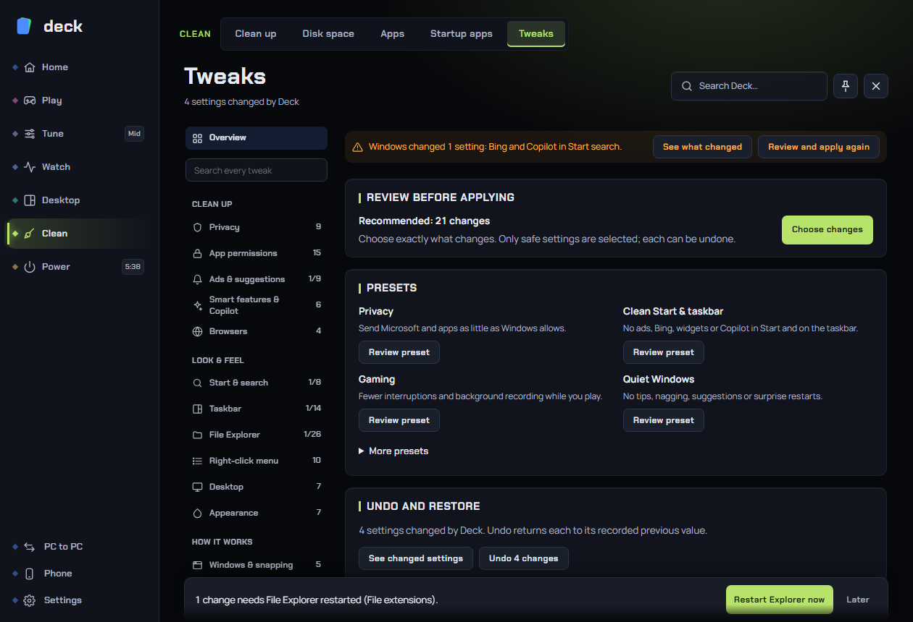

# Tweaks

The **Tweaks** page is a tidy, searchable control panel for Windows settings: privacy, ads and suggestions, Start, the taskbar, File Explorer, the right-click menu, gaming, performance, updates and more. Every tweak shows what Windows is set to **right now**, says in plain words what it does and what it costs you, and can be **undone to the exact value it had before Deck changed it**.

Find it under **Clean > Tweaks** in the sidebar.

The page has about 190 tweaks in 19 categories. Not all of them show on every PC: a tweak only appears if your Windows version and edition have it (see [Tweaks that are hidden](#tweaks-that-are-hidden)).

> The recipes come from the well-known open-source debloat projects Win11Debloat and WinUtil (both MIT-licensed) plus Deck's own, reviewed one by one. Each tweak's **Details** names its source. There is nothing here that removes Microsoft Edge, turns off Windows Update or Defender, or activates Windows.

---

## How tweaks work

### Reading a row

Each tweak is a row:

| Part | Meaning |
|---|---|
| **Name** and short description | What the setting is. |
| **Risk chip** | Only shown when it is not plain **Safe**: **Changes behaviour** or **Advanced** (see below). |
| **After chip** | **Restarts Explorer**, **Sign out to finish** or **Restart to finish**: what has to happen before the change is fully in effect. |
| **Partly** chip | The setting is only partly effective, or another tool has set only part of it. The chip says what is missing. |
| **Control** | A switch (**On / Off**), a choice (a short row of buttons or a list), a link to another page, or a one-time action button. |
| **Details** | Opens the explanation: **Effect** (what you gain), **Tradeoff** (what you give up), the Windows default for choices, the technical steps, the source, and the date Deck changed it. |

The control always shows the **current Windows value**, not a proposal. Opening the page reads the real state, so a setting you changed in Windows' own Settings is shown correctly too. On a choice that has a value of its own that none of the options match, the list shows **Custom**.

If a setting shows two different "halves" (another tool set only some of it), the control leans to the closer option and a **Partly** chip appears.

### Risk levels

| Level | Chip | Meaning |
|---|---|---|
| **Safe** | none | A look-and-feel or harmless setting. Easy to reverse and low impact. |
| **Behaviour** | **Changes behaviour** | Changes how Windows works in a way you will notice, or gives something up (for example location, Game Bar, automatic Store updates). |
| **Advanced** | **Advanced** | Can reduce protection, stability or update safety if misused (for example Recall removal, Memory integrity, reserved storage). |

Of the roughly 190 tweaks, about 116 are Safe, 48 change behaviour and 22 are Advanced.

For **Advanced** tweaks Deck first offers to make a **restore point** (once per session; Windows itself allows only one a day), then shows a **Review change** window: the setting, "Now" and "After", the effect and the tradeoff, with **Cancel** and **Continue**. Nothing is applied until you press Continue.

### What gets recorded for Undo

Before Deck changes a value it writes down exactly what was there: the value and its type, or "it wasn't set", or the service's start type, or a task's state. **Undo** puts back that value, not a "textbook default", so your PC returns to *its* old state even months later. The first value Deck saw is kept, so applying a tweak twice never overwrites the original. The record is tamper-checked: if it is changed outside Deck, Deck sets it aside and says so rather than use it.

If a tweak's value changed after Deck applied it (you changed it elsewhere), Undo shows a **Review changed settings before Undo** window with **Before**, **Applied** and **Current** values and lets you **Keep current values** or **Restore previous values**.

### After-effects

Some changes only take effect after Explorer restarts, you sign out, or the PC restarts. Deck collects them in one bar at the bottom of the page: "3 changes need File Explorer restarted - **Restart Explorer now** / **Later**", "**Sign out** to finish: ...", "**Restart** to finish: ...". You decide when.

### Rules Deck follows

- **Never while a game is in front.** Deck changes Windows settings only outside games and says "<game> is in front".
- **Needs administrator rights.** Anything that changes the machine-wide registry, a service or a scheduled task needs Deck to run with admin rights. Without them the page shows **Limited without admin** and those rows are marked "Needs Deck's admin rights". Per-user settings (the ones that only touch your own account) work without admin.
- **Right account.** If Deck was started as a *different* administrator account than the one you are signed in as, per-user tweaks are disabled with a note ("Deck runs as another account here, so it can't change your own settings") so it can never change the wrong account.
- **Updates changing things back.** Windows feature updates sometimes put settings back. Deck notices (on every page open) and moves those tweaks to **Changed back**.

### Tweaks that are hidden

A tweak is hidden, not greyed, when it is not for your PC: it needs a newer or older Windows build than yours, Windows Pro (some update controls), a laptop battery, an installed app (Chrome, Brave), or a service/drive type your PC does not have. A note at the bottom of a category says "N more aren't for this PC or this Windows version".

---

## The page layout

### The left list

| Entry | What it opens |
|---|---|
| **Overview** | Recommended changes, presets, saving and sharing, and undo (see below). |
| **Search every tweak** | Searches the name, the description and the group of every tweak in every category. Results are grouped by category. |
| The 19 **categories** in three sections: **Clean up**, **Look & feel**, **How it works** | Each shows how many of its tweaks Deck has changed (for example "3/18"). |
| **Built-in apps** and **Store apps & updates** | Jump to those tabs on the [Apps](apps.md) page. |
| **Changed by Deck** | Every tweak Deck currently has changed, with an **Undo N changes** button. |
| **Changed back** | Only appears when Windows has put something back. Each tweak has **Apply again** and **Forget**. |

Inside a category the filter row has **All**, **Turned off**, **Changed** and **Safe only**, plus **Refresh**. Tweaks are grouped under small headings where a category is large.

### Changed back

After a Windows update, an alert at the top of Overview says "After the Windows update, Windows changed N settings: ...". **See what changed** opens the list, and **Review and apply again** opens a checklist. **Forget** stops listing the tweak: the setting stays as it is now, but Deck can no longer undo it.

---

## Overview

| Panel | What it does |
|---|---|
| **Review before applying** | "Recommended: N changes". Opens a checklist of the safe tweaks Deck recommends and your PC does not have yet. Untick any you want to keep, then **Apply**. Only **Safe** tweaks are ever in it. |
| **Presets** | Ready-made sets, each opening the same checklist so you can untick anything: see the list below. A preset says **Already set** when your PC matches it. |
| **Save and share your tweaks** | **Save my tweaks to a file** and **Open a tweaks file** (see [Sharing](#saving-and-sharing-tweaks)). |
| **Undo and restore** | How many settings Deck has changed, **See changed settings**, and **Undo N changes**. |

### Presets

| Preset | What it is for |
|---|---|
| **Privacy** | Sends Microsoft and apps as little as Windows allows (diagnostics, activity history, feedback, cloud search, Recall, update sharing...). |
| **Clean Start & taskbar** | No ads, Bing, widgets or Copilot in Start and on the taskbar; shows file extensions; adds End task to the taskbar menu. |
| **Gaming** | Fewer interruptions and background recording: Game DVR off, mouse acceleration off, Sticky Keys off, no automatic update restarts. |
| **Quiet Windows** | No tips, nagging, suggestions or surprise restarts. |
| **Debloat** | Everything the debloat tools switch off that you will not miss: ads, suggestions, smart-feature promotions and installs you did not ask for. |
| **File Explorer power user** | Explorer shows what is really there (extensions, hidden files, full path), opens to This PC and uses the classic right-click menu. |

---

## Saving and sharing tweaks

Use this to set up a second PC the same way, or to restore your choices after a reinstall.

1. **Save my tweaks to a file** (needs at least one tweak Deck has changed) writes `deck-tweaks.json`. It lists only the **ids of your tweaks and of the option you chose** (with the readable name beside each, for people reading the file) and the Windows build. No registry values, no commands, nothing else.
2. On the other PC, **Open a tweaks file**. Deck reads the file and shows a checklist. **Opening a file never applies anything on its own.** Every line is checked against the recipes in your copy of Deck and sorted into: ready, **already set**, or **skipped** (a tweak your Deck does not know, an option it does not have, or a tweak that is not for this PC).
3. Untick anything you do not want and press **Apply**. Each change goes through the same engine as a click on the page: it keeps its own exact before-value and has its own Undo.

A tweaks file is limited to 600 lines and 256 KB. A file from a different version of Deck is refused with a message to export it again.

---

## The categories

Counts are the number of tweaks in each category; some may be hidden on your PC.

### Clean up

**Privacy (9)** - what Windows sends to Microsoft and keeps about you.

| Tweak | What it does |
|---|---|
| Activity history | Stops Windows keeping a list of the apps and files you open. Clipboard history is unaffected. |
| Diagnostic data and ads ID | Turns off tailored tips, the advertising ID, typing learning and optional diagnostic data (the required minimum stays). |
| Location for Windows and apps | **Changes behaviour.** No app or part of Windows can find where you are; weather and maps need a typed city. |
| Find My Device | **Changes behaviour.** Stops saving the PC's location. If the PC is lost you cannot see it on a map. |
| Cloud results in search | Start search looks only on this PC, not OneDrive or Outlook. |
| Search history on this PC | Start forgets what you searched for. |
| Firmware start-up programs | **Advanced, restart.** Stops the motherboard from installing its maker's software into Windows. Maker anti-theft tools installed this way stop installing themselves. |
| Error reports to Microsoft | **Changes behaviour.** Crash reports stay on the PC. |
| Customer Experience Program | Stops the usage-sharing improvement programme. |

**App permissions (15)** - one switch per Windows privacy permission, all **Changes behaviour**: Camera, Microphone, Contacts, Call history, Messages, Email, Tasks, Calendar, Radios, Documents, Pictures, Videos, All files, Notifications and Account info. Turning a permission off blocks it for the apps that follow Windows' privacy permissions (Store apps and apps that ask Windows). Some desktop apps bypass them. Turning off **Camera** or **Microphone** here will break calls and games that rely on them until you turn them on again.

**Ads & suggestions (9)** - Feedback requests, Tips and suggested content, Lock screen tips and facts, Microsoft 365 ads in Settings, Windows-installed suggested apps (Candy Crush and the like), Companion apps for new devices (**Changes behaviour**: Windows no longer downloads a mouse's or monitor's app), Settings Home page, Online tips in Settings, Device makers' installers (**Changes behaviour**: plugging in a Razer device no longer starts its installer). Nearly all are "nothing you'd notice" to switch off.

**Smart features & Copilot (6)** - Legacy Windows Copilot (the old pane and taskbar button), **Recall** (see the warning below), Click to Do, the Smart features service starting by itself (**Changes behaviour**, saves memory, restart), and the smart features in Paint and Notepad. Many need Windows 11 22H2 or later and show only there.

> **Recall is Advanced and permanent.** Turning Recall off deletes the snapshots it has already saved and removes Recall components. Undo restores the policies only: it cannot bring back deleted snapshots or reinstall the removed pieces. Restart to finish.

**Browsers (5)** - Ads and news in Edge, the smart features in Edge and in Chrome (Chrome's needs Chrome installed), Brave extras (needs Brave installed; Rewards, Wallet, VPN and more), and Edge extras and data sharing. The Edge and Chrome tweaks work through browser **policies**, so the browser then shows "Your browser is managed by your organisation". That line comes from the tweak and goes away with **Undo**.

### Look & feel

**Start & search (8)** - Bing and Copilot in Start search, Recommended in Start, Recently added apps, Phone Link in Start, how **All apps** lists (Hidden, By category, Grid, List; Windows 11 25H2 onward), the previous Start layout (on builds that still have it), **Unpin everything from Start** (a one-time action; Undo puts your pins back), and Recent files in Start. Most need Explorer restarted.

**Taskbar (16)** - what's on it (icon alignment, search style, Task view button, Widgets, Chat and Meet now, battery percentage on laptops, **Notifications and calendar** (**Advanced**: hides the notification centre and the clock's calendar), seconds in the clock, Show desktop corner, badges) and how buttons behave (**End task on right-click**, click goes to last active window, combine buttons on the main and other displays, which displays show apps, flashing apps). Many need Windows 11.

**File Explorer (28)** - what it shows: File extensions (shows `.exe`, `.png` so a "photo.jpg.exe" cannot hide what it is; recommended), Hidden files and folders, Protected system files (**Advanced**: showing Windows' own protected files makes it easy to delete something Windows needs), Drive letters, Compact view, Full path in the title bar, Recent files and folders, Check boxes to select files, Thumbnails, Office.com files in Home, Compressed files in colour. Side pane and This PC: Home, Gallery, OneDrive, USB drives listed twice, your folders under This PC, 3D Objects and Music (older Windows), All folders and Side pane follows open folder. How it works: File Explorer opens to, Folder type guessing (**Changes behaviour**; makes big folders like Downloads open faster), Long paths (**Changes behaviour**, some developer tools need it), Folders in their own process, Reopen folders at sign-in, Copy window with details, " - Shortcut" on new shortcuts, Store in "Open with". Most apply after Explorer restarts.

**Right-click menu (13)** - **Classic right-click menu** (**Changes behaviour**; the full Windows 10 menu at once, without "Show more options"), and switches for individual entries: "Include in library", "Give access to", "Share", "Open in Terminal", "Cast to Device", "Restore previous versions", "Scan with Microsoft Defender", "Troubleshoot compatibility", "Ask Copilot", "Edit in Notepad", "Edit with Photos", "Add to Favorites".

**Desktop (7)** - Desktop icons (This PC, your user folder, Network, Control Panel, Recycle Bin), Full-quality wallpaper (no JPG recompression) and Windows version on the desktop.

**Appearance (7)** - Dark mode (a link to Deck's [Display](display.md) page), Transparency effects, Allow Spotlight, Scrollbars always visible, Accent colour on title bars, Blur on the sign-in screen and Menu delay.

### How it works

**Windows & snapping (5)** - Window snapping (**Changes behaviour**), Snap suggestions, Snap layouts, Browser tabs in Alt+Tab (None / 3 / 5 / 20), Shake to minimise.

**Keyboard & mouse (7)** - Sticky Keys shortcut (five Shift presses; turn it off for games; recommended), Num Lock on at start, **Mouse acceleration** ("Enhance pointer precision"; **Changes behaviour**; off gives the same hand movement the same distance, better for aiming), Toggle Keys shortcut, Filter Keys shortcut (recommended off for gamers), Key repeat delay, Scroll windows under the pointer.

**Gaming (8)** - Game Mode (a link to Deck's CPU profiles, so two places do not fight over it), **Game recording (Xbox Game DVR)** (turn off to stop background recording; recommended for games), Game Bar (**Changes behaviour**: Win+G and the Xbox button stop opening *Windows'* Game Bar; this is separate from Deck's own [game bar](game-bar.md)), **Fullscreen optimisations** (**Advanced**; off restores old exclusive fullscreen; Alt-Tab gets slower and overlays may stop showing), Optimisations for windowed games and Variable refresh for windowed games (**Changes behaviour**, three-way: Windows' choice / On / Off), **Hardware GPU scheduling** (**Changes behaviour**, restart; can lower lag and is needed for frame generation) and **Multiplane overlay** (**Advanced**, restart; turn off only if you have flicker or black screens on NVIDIA).

**Performance (9)** - Animations, Visual effects (opens Windows' own Performance Options), Network throttling for media (**Advanced**: lifts the cap on other traffic while video or audio plays), **SysMain (Superfetch)** (**Advanced**; shown only when a hard drive is present), **Windows Search indexing** (**Advanced**: less disk work, but slow search), Store apps in the background, Delay apps at sign-in (**Changes behaviour**), Power throttling (**Advanced**, restart; more speed in the background, more power use), Automatic maintenance (**Advanced**).

**Network (3)** - Prefer IPv4 over IPv6 (**Changes behaviour**, restart; fixes broken IPv6 networks), **Teredo** (**Advanced**, restart; can lower game ping slightly but Xbox party chat and some Game Pass multiplayer need it) and **DNS server** (**Changes behaviour**; Automatic, Cloudflare, Google, Quad9 or AdGuard, which also blocks ads; set it back to Automatic if a site stops loading).

**Updates & Store (14)** - control how Windows Update behaves without disabling it:

| Tweak | Notes |
|---|---|
| Get updates as soon as released | Off (recommended): features reach you after they are tested on everyone. |
| Restart by itself after updates | Avoids automatic restarts while you are signed in, but only works if scheduled installation is configured. |
| Share updates with other PCs | Stops your PC uploading updates to others. |
| Drivers from Windows Update | **Changes behaviour.** Off stops Windows replacing the driver you chose (such as your GPU driver). You then update drivers yourself. |
| Store apps update by themselves | **Changes behaviour.** Off means Store apps only update when you say so. Relevant to [Apps](apps.md). |
| Longest update pause | **Advanced.** Lets Settings pause updates for 1 or 10 years instead of 5 weeks. A long pause misses security fixes. |
| Automatic updates | **Advanced.** Install by itself, download and ask, ask before downloading, or off. Off means you must install security fixes yourself. |
| Stay on a Windows version | **Advanced** (Windows 11 24H2 and later). Keeps monthly fixes but holds back the next big version. |
| Wait before monthly updates / big Windows versions | Defer by days or months. Needs Windows Pro. |
| Tell me when a restart is needed | Recommended on. |
| Updates for other Microsoft apps, Updates on metered connections, Malicious Software Removal Tool | As named. |

**System (14)** - Hibernation (**Changes behaviour**; off frees the large `hiberfil.sys` and also turns off Fast start-up), Fast start-up (off makes Shut down a true shutdown), Detailed blue screens, Detailed start-up messages, Storage Sense (**Changes behaviour**), **Reserved storage** (**Advanced**; gives back 7 to 10 GB but big Windows updates may fail on a full drive), Automatic device encryption (**Changes behaviour**; never decrypts a drive), Network while asleep (laptops), Hardware clock in UTC (**Advanced**, restart; only for dual-booting Linux), Lock screen, Windows Sandbox and Windows Subsystem for Linux (turn on optional Windows features; Sandbox needs Windows Pro), Auto-restart after a blue screen, Drag tray.

**Advanced (3)** - all **Advanced**: **Memory integrity** (restart; turning it off lets some old drivers and tools run but leaves the PC less protected against kernel malware), Warnings for unsigned RDP files, and Modern Standby (restart; classic sleep on PCs that support it).

---

## Requirements

| Tweak type | Needs |
|---|---|
| Per-user settings (look and feel, Explorer, taskbar, permissions) | Nothing special; works without admin. |
| Machine-wide settings, services, scheduled tasks, optional Windows features | Deck running with administrator rights. |
| Windows 11 features | A Windows 11 build that has them. |
| Windows Pro features (deferring updates, Sandbox) | Windows Pro. |

---

## Recommended setup

1. Start with the **Recommended** panel on Overview and untick anything you want to keep.
2. Then use the **Presets** that match you: **Privacy**, **Quiet Windows**, **Clean Start & taskbar**; **Gaming** if you play.
3. Leave **Advanced** tweaks alone unless you know why you need them and have read their Details.
4. Make the **restore point** when asked.
5. Save your tweaks to a file so you can reapply them after a reinstall.

**Gamers:** Game recording off, Mouse acceleration off, Sticky/Filter Keys shortcuts off, and (if you have the problem) Multiplane overlay off. Leave Hardware GPU scheduling, Fullscreen optimisations and Memory integrity at defaults unless a game needs otherwise.
**Laptops:** leave Network while asleep and Modern Standby alone unless you know you need them; they affect battery life and wake behaviour.
**Managed work PCs:** group policy may override tweaks; if a tweak keeps going back, it is probably being reset by your organisation.

---

## Troubleshooting

**A tweak is greyed out or says "Needs Deck's admin rights".** Deck is not running as administrator. Use **Settings > About > Set up**, or reinstall with the Deck installer.

**It says a game is in front.** Leave the game and try again. Deck never changes Windows settings under a game.

**A tweak went back after a Windows update.** It moved to **Changed back**. Press **Apply again**.

**Undo says the setting changed after Deck applied it.** Something else changed it. Review the values shown and choose to keep the current or restore the old one.

**A tweak is missing.** It does not apply to your Windows version or edition. The note under the category says how many are hidden.

**Edge or Chrome says it is managed by an organisation.** That comes from the browser tweaks; use Undo on them to remove the message.

**A site won't load after I changed DNS.** Set **DNS server** back to **Automatic**.

---

## FAQ

**Does Deck edit the registry directly?** Yes, with its own reviewed recipes, never with free-form scripts downloaded at run time. Each change records its previous value first.

**Can I break Windows?** Safe and most Behaviour tweaks are easy to reverse. Advanced ones can reduce protection or stability, so they ask for a restore point and a review. Undo restores settings, not deleted data (Recall snapshots, for example, cannot return).

**Does anything here affect anti-cheat?** Tweaks only change Windows settings; Deck does not inject into games or read their memory. A few settings (such as Memory integrity or Fullscreen optimisations) change how Windows treats games and drivers, so check a game's own requirements before changing those.

**Do Tweaks turn off Windows Update or Defender?** There is no switch for Defender or for Windows Update itself. The update tweaks only change timing and how much Windows asks you first; even the strictest choice, "Off: only when you check", leaves checking for updates by hand available. Keep installing security updates.

**What does it send out?** Nothing. All tweak data stays on your PC; a saved tweaks file contains only tweak names and options.

**What happens if Deck crashes mid-change?** The before-value is saved before each step runs, so Undo still works afterwards.
